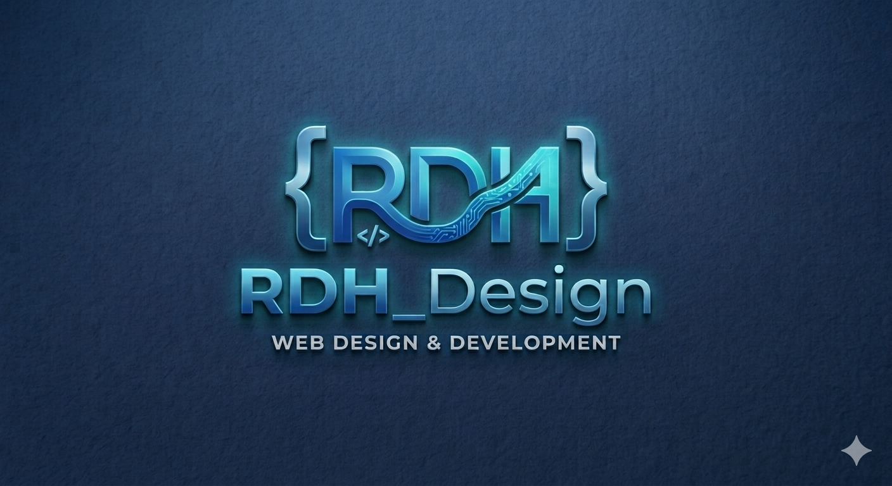

### [Continue](https://continue.dev) session transcript
 Exported: 10/12/2026, 1:29:47 PM

#### _User_

> I need to create a couple of demos for accomodations that I show potential clients can you guide me

#### _Assistant_

> # Creating Demo Accommodations for Potential Clients
> 
> I'd be happy to help! To give you the best guidance, I need a bit more context. Let me ask a few key questions — but I'll also give you a general framework you can start with right away.
> 
> ## First, a few questions to tailor this:
> 
> 1. **What's the product/service?** (e.g., hotel rooms, rental units, accessibility features, travel packages, office space, senior living?)
> 2. **What kind of "accommodations"?** (physical spaces, accessibility/disability accommodations, short-term rentals, corporate housing?)
> 3. **Who are your potential clients?** (property managers, travelers, HR departments, event planners?)
> 4. **What format do you want the demo in?** (live walkthrough, slide deck, interactive website, video, PDF brochure?)
> 5. **Where will you show it?** (in person, over video call, on your website, email attachment?)
> 
> ---
> 
> ## General Framework for Client Demos
> 
> While you gather those answers, here's a structure that works for most accommodation demos:
> 
> ### 1. Lead with the Problem
> Open with the pain point your clients have — not your product.
> 
> ### 2. Show, Don't Tell
> Pick **1–2 realistic scenarios** and walk through them end-to-end. People remember stories, not feature lists.
> 
> ### 3. Keep It Short
> Aim for 5–10 minutes per demo. Attention spans are short.
> 
> ### 4. Make It Tangible
> Use real photos, mock bookings, real floor plans, or a live environment — not just slides.
> 
> ### 5. End with a Clear Next Step
> "What would you like to see next?" or "Shall I set you up with a trial?"
> 
> ---
> 
> ## Two Suggested Demo Types
> 
> | Demo Type | Best For | Effort |
> |-----------|----------|--------|
> | **Scenario Walkthrough** | Showing the client experience | Low |
> | **Interactive/Live Demo** | Letting clients explore themselves | Medium–High |
> 
> ---
> 
> If you tell me the specifics from my questions above, I can:
> 
> - Draft a **script** for each demo
> - Build a **slide outline**
> - Write **HTML/code** for an interactive demo (if digital)
> - Create a **checklist** of props, screens, or setup you'll need
> 
> What are you showcasing exactly?

#### _User_

> The Magalies Accommodation
> 4.6(10)
> ·Guest house
> Overview
> Prices
> Reviews
> 
> Directions
> 
> Save
> 
> Nearby
> 
> Share
> Check availability
> Compare prices
> Free cancellation only
> 
> Check in / Check out
> Mon, Oct 19
> Tue, Oct 20
> 2
> 
> All options
> Booking.com
> R 651
> 
> See rooms 
> Agoda
> R 700
> 
> See rooms 
> More prices from R 699
> 
> 10 Magaliesberg Ave, Carters Glen, Kimberley, 8301
> 
> 
> 078 046 8717
> 
> 
> 
> 6PWF+RM Kimberley
> 
> 
> 
> Your Maps history
> Add a label
> Suggest an edit
> Add missing information
> 
> Add website
> Location summary
> Neighborhood: Carters Glen
> 2.7
> Good for visitors
> 
> Based on sightseeing, recreation, and getting around

#### _Assistant_

> # Demo Plan: The Magalies Accommodation (Guest House, Kimberley)
> 
> Thanks — that helps a lot. Here's what I can piece together about your property and a practical plan for a couple of client demos.
> 
> ## What You Have (Summary)
> 
> | Detail | Info |
> |--------|------|
> | **Name** | The Magalies Accommodation |
> | **Type** | Guest house |
> | **Rating** | 4.6 ★ (10 reviews) |
> | **Location** | 10 Magaliesberg Ave, Carters Glen, Kimberley, 8301 |
> | **Phone** | 078 046 8717 |
> | **Neighborhood score** | 2.7 (good for visitors) |
> | **Price range** | ~R651 (Booking.com) – R700 (Agoda) |
> | **Listed on** | Booking.com, Agoda, Google Maps |
> 
> ---
> 
> ## Before I Write the Demos — 3 Quick Clarifiers
> 
> 1. **Who is the "potential client"?** Are you:
>    - **(A)** Pitching to **guests/travelers** to get direct bookings? *(most likely)*
>    - **(B)** Pitching to **corporate/group clients** (business travelers, contractors, tour groups, medical staff visiting Kimberley)?
>    - **(C)** Pitching to a **partner** (travel agent, OTA, tourism board)?
> 
> 2. **What format do you want?**
>    - WhatsApp/email **flyer or brochure**
>    - **Slide deck** for a meeting
>    - **Website / landing page**
>    - **Short video** walkthrough
> 
> 3. **Do you have photos and room details?** (Room types, rates, amenities, breakfast, parking, etc.)
> 
> ---
> 
> ## Two Recommended Demos
> 
> These work regardless of whether your client is a traveler or a corporate booker.
> 
> ### Demo 1 — "A Night at The Magalies" (Guest Experience Demo)
> A short, story-driven walkthrough that follows a guest from *enquiry → check-in → stay → review*. Best shown on a phone or as a slide flow.
> 
> **Flow:**
> 1. Guest searches "accommodation Kimberley"
> 2. Sees The Magalies — 4.6★, Carters Glen location
> 3. Books (highlights direct rate vs. OTA)
> 4. Arrives — room, amenities, parking, location map
> 5. Checks out → leaves a great review
> 
> ### Demo 2 — "Corporate & Group Stays" (B2B Demo)
> Aimed at businesses, contractors, tour operators, and medical/hospital visitors who need reliable repeat accommodation in Kimberley.
> 
> **Highlights:**
> - Consistent rates, direct invoicing
> - Location near Kimberley CBD / hospitals / N12
> - Group & long-stay options
> - Direct WhatsApp booking (078 046 8717)
> 
> ---
> 
> ## Simple Rate Positioning (Direct vs. OTA)
> 
> A key selling point in *any* demo:
> 
> | Channel | Rate | Who It's Good For |
> |---------|------|-------------------|
> | Booking.com | R651 | Discovery / first-time guests |
> | Agoda | R700 | International guests |
> | **Direct (you)** | **Best rate** | Repeat & corporate clients |
> 
> *Add a "Book Direct & Save" line — it's your strongest pitch.*
> 
> ---
> 
> ## What I Can Build For You Next
> 
> Once you answer the 3 questions above, I can produce any of these:
> 
> - ✍️ **WhatsApp/email pitch message** (copy-paste ready)
> - 📄 **One-page brochure** (text + layout)
> - 🖥️ **Interactive HTML landing page** with booking info, map, and direct-book CTA
> - 🎞️ **Demo script** for showing clients on a call
> - 📊 **Slide deck outline** (for corporate clients)
> 
> ---
> 
> **Quickest next step:** Tell me the answers to the 3 questions, and I'll draft **Demo 1 and Demo 2 in full** — starting with the one you need most.
> 
> Who are you pitching to most often — travelers or businesses?

#### _User_

> can you just give me one demo for now

#### _Assistant_

> # Demo: "A Night at The Magalies" — Guest Experience Walkthrough
> 
> A short, story-driven demo you can show potential clients (guests) on your phone, in a WhatsApp message, or as a slide flow.
> 
> ---
> 
> ## Slide 1 — Title
> 
> > **The Magalies Accommodation**
> > *Your home in Kimberley*
> >
> > ⭐ 4.6 (10 reviews) · Guest House · Carters Glen
> 
> ---
> 
> ## Slide 2 — The Problem
> 
> > *"Finding clean, affordable, well-located accommodation in Kimberley shouldn't be a gamble."*
> 
> Many guests waste time comparing rates across Booking.com and Agoda — and never know if they're getting the best deal.
> 
> ---
> 
> ## Slide 3 — Who We Are
> 
> > **The Magalies Accommodation**
> > 10 Magaliesberg Ave, Carters Glen, Kimberley, 8301
> >
> > - ⭐ Rated **4.6** by guests
> > - 📍 **Carters Glen** — good for visitors
> > - 💰 From **R651** per night
> > - 📞 Direct booking: **078 046 8717**
> 
> ---
> 
> ## Slide 4 — The Guest Journey
> 
> 1. **Search** — "accommodation Kimberley"
> 2. **Find us** — 4.6★, prime Carters Glen location
> 3. **Book** — direct with us for the best rate
> 4. **Arrive & relax** — comfortable rooms, easy access
> 5. **Review** — leave happy, come back again
> 
> ---
> 
> ## Slide 5 — Booking Options
> 
> | Channel | Rate | Notes |
> |---------|------|-------|
> | Booking.com | R651 | Easy discovery |
> | Agoda | R700 | International guests |
> | **Direct (WhatsApp)** | **Best rate** | 📞 078 046 8717 |
> 
> > **💡 Book Direct & Save** — message us on WhatsApp for our best available rate.
> 
> ---
> 
> ## Slide 6 — Location Perks
> 
> > 📍 **10 Magaliesberg Ave, Carters Glen, Kimberley**
> >
> > - Good base for sightseeing & getting around
> > - Easy to find (Google Plus Code: **6PWF+RM Kimberley**)
> > - Close to Kimberley CBD
> 
> ---
> 
> ## Slide 7 — Stay With Us
> 
> > **The Magalies Accommodation**
> > ⭐ 4.6 · From R651/night
> > 📞 **078 046 8717**
> > 📍 10 Magaliesberg Ave, Carters Glen, Kimberley, 8301
> >
> > *Book direct — best rate guaranteed.*
> 
> ---
> 
> ## How to Present This Demo
> 
> - **On a call:** Walk through slides 1 → 7 in under 5 minutes.
> - **On WhatsApp:** Send as a short story — use the title, one highlight, the booking table, and the CTA.
> - **In person:** Print as a one-pager or show on your phone.
> 
> **Closing line to use every time:**
> > *"Shall I send you our best direct rate for your dates?"*
> 
> ---
> 
> Want me to turn this into a **WhatsApp-ready message**, an **HTML landing page**, or a **printable brochure**? Just say which one.

#### _User_

> let me put it to you like this. I am not looking for a demo for any specific accomodation WI am looking for a generic but stand out demo that I can display to all 

#### _Assistant_

> # Generic "Standout" Demo — Accommodation Showcase
> 
> Got it. You want **one flexible demo template** you can drop any property into and show to clients. Here's a generic but impressive version.
> 
> ---
> 
> ## The Concept: "Find Your Stay" — Interactive Demo
> 
> A clean, animated landing page that shows off any accommodation property with a **story-driven flow**. No specific property baked in — just placeholder slots you fill per client.
> 
> ---
> 
> ## What Makes It Stand Out
> 
> | Feature | Why It Impresses |
> |---------|------------------|
> | **Hero with real feel** | Big imagery + instant star rating builds trust in 3 seconds |
> | **Rate comparison table** | Shows you understand the OTA/direct-booking game |
> | **"Book Direct & Save" CTA** | Every owner's favorite selling point |
> | **Animated reveal** | Sleek, modern — sets you apart from generic flyers |
> | **Fully responsive** | Works on phone (where most clients look) |
> 
> ---
> 
> ## The Demo (Single HTML File)
> 
> Copy this into a file called `demo.html` and open it in any browser. Replace the `[bracketed]` parts with the client's details.
> 
> ```html demo.html
> <!DOCTYPE html>
> <html lang="en">
> <head>
> <meta charset="UTF-8">
> <meta name="viewport" content="width=device-width, initial-scale=1.0">
> <title>The Stay — Your Home Away From Home</title>
> <style>
>   * { margin:0; padding:0; box-sizing:border-box; font-family:'Segoe UI',sans-serif; }
>   body { background:#0f1115; color:#fff; overflow-x:hidden; }
> 
>   /* HERO */
>   .hero {
>     min-height:100vh;
>     display:flex; flex-direction:column;
>     align-items:center; justify-content:center;
>     text-align:center; padding:40px 20px;
>     background:linear-gradient(135deg,#1a1f2e 0%,#2d1b3d 100%);
>     position:relative;
>   }
>   .hero::after {
>     content:''; position:absolute; inset:0;
>     background:radial-gradient(circle at 30% 40%,rgba(255,140,0,.15),transparent 60%);
>     pointer-events:none;
>   }
>   .badge {
>     display:inline-block; padding:8px 18px; border-radius:999px;
>     background:rgba(255,140,0,.15); color:#ff8c00;
>     font-size:.85rem; letter-spacing:1px; margin-bottom:24px;
>     border:1px solid rgba(255,140,0,.3);
>   }
>   .hero h1 { font-size:clamp(2rem,6vw,4rem); font-weight:800; line-height:1.1; margin-bottom:16px; }
>   .hero h1 span { color:#ff8c00; }
>   .hero p { font-size:clamp(1rem,2.5vw,1.25rem); color:#b8bdc9; max-width:600px; margin-bottom:32px; }
>   .stars { color:#ffc107; font-size:1.3rem; margin-bottom:8px; }
>   .cta {
>     display:inline-block; padding:16px 40px; border-radius:999px;
>     background:#ff8c00; color:#fff; text-decoration:none;
>     font-weight:700; font-size:1.05rem;
>     transition:transform .2s, box-shadow .2s;
>   }
>   .cta:hover { transform:translateY(-3px); box-shadow:0 12px 30px rgba(255,140,0,.4); }
> 
>   /* SECTION */
>   section { padding:80px 20px; max-width:1000px; margin:0 auto; }
>   .reveal { opacity:0; transform:translateY(30px); transition:all .8s ease; }
>   .reveal.show { opacity:1; transform:translateY(0); }
> 
>   h2 { font-size:clamp(1.5rem,4vw,2.25rem); margin-bottom:16px; }
>   .sub { color:#b8bdc9; margin-bottom:40px; }
> 
>   /* FEATURES */
>   .features { display:grid; grid-template-columns:repeat(auto-fit,minmax(220px,1fr)); gap:24px; }
>   .card {
>     background:#1a1f2e; border:1px solid #262c3d; border-radius:16px;
>     padding:28px; transition:transform .2s, border-color .2s;
>   }
>   .card:hover { transform:translateY(-5px); border-color:#ff8c00; }
>   .card .icon { font-size:2rem; margin-bottom:12px; }
>   .card h3 { margin-bottom:8px; color:#ff8c00; }
>   .card p { color:#b8bdc9; font-size:.95rem; }
> 
>   /* RATE TABLE */
>   table { width:100%; border-collapse:collapse; margin-top:20px; border-radius:12px; overflow:hidden; }
>   th,td { padding:16px; text-align:left; border-bottom:1px solid #262c3d; }
>   th { background:#1a1f2e; color:#ff8c00; font-size:.85rem; letter-spacing:1px; text-transform:uppercase; }
>   tr.best td { background:rgba(255,140,0,.1); font-weight:700; }
> 
>   /* JOURNEY */
>   .steps { display:flex; flex-direction:column; gap:20px; }
>   .step { display:flex; gap:20px; align-items:flex-start; }
>   .num {
>     flex-shrink:0; width:44px; height:44px; border-radius:50%;
>     background:#ff8c00; color:#fff; display:flex;
>     align-items:center; justify-content:center; font-weight:800;
>   }
>   .step h4 { margin-bottom:4px; }
>   .step p { color:#b8bdc9; font-size:.95rem; }
> 
>   /* FOOTER CTA */
>   .footer-cta {
>     text-align:center; padding:80px 20px;
>     background:linear-gradient(135deg,#2d1b3d,#1a1f2e);
>   }
>   .footer-cta h2 { margin-bottom:12px; }
>   .footer-cta p { color:#b8bdc9; margin-bottom:28px; }
>   .footer-cta .cta { margin-top:8px; }
>   small { display:block; color:#6b7280; margin-top:24px; font-size:.8rem; }
> </style>
> </head>
> <body>
> 
> <!-- HERO -->
> <div class="hero">
>   <span class="badge">⭐ RATED [4.6] BY GUESTS</span>
>   <h1>Your Home<br>in <span>[Kimberley]</span></h1>
>   <div class="stars">★★★★★</div>
>   <p>Comfortable, well-located accommodation — book direct and get the best rate. No middlemen, no hidden fees.</p>
>   <a href="#book" class="cta">📞 Book Direct & Save</a>
> </div>
> 
> <!-- FEATURES -->
> <section class="reveal">
>   <h2>Why Guests Choose Us</h2>
>   <p class="sub">Everything you need for a comfortable stay.</p>
>   <div class="features">
>     <div class="card"><div class="icon">📍</div><h3>Prime Location</h3><p>Close to everything — easy to find, easy to get around.</p></div>
>     <div class="card"><div class="icon">💰</div><h3>Best Rates</h3><p>Book direct and skip the OTA commission and markups.</p></div>
>     <div class="card"><div class="icon">⭐</div><h3>Loved by Guests</h3><p>Consistently rated high for cleanliness and comfort.</p></div>
>     <div class="card"><div class="icon">🛏️</div><h3>Comfortable Rooms</h3><p>Relaxing spaces designed for a good night's rest.</p></div>
>   </div>
> </section>
> 
> <!-- RATE COMPARISON -->
> <section class="reveal">
>   <h2>Book Direct & Save</h2>
>   <p class="sub">Same stay, better price when you book with us directly.</p>
>   <table>
>     <tr><th>Channel</th><th>Rate / Night</th><th>Note</th></tr>
>     <tr><td>Booking.com</td><td>R[651]</td><td>Standard OTA rate</td></tr>
>     <tr><td>Agoda</td><td>R[700]</td><td>International booking</td></tr>
>     <tr class="best"><td>✔ Direct (WhatsApp)</td><td>Best Rate</td><td>Message us — save more</td></tr>
>   </table>
> </section>
> 
> <!-- JOURNEY -->
> <section class="reveal">
>   <h2>How It Works</h2>
>   <p class="sub">From search to checkout in five easy steps.</p>
>   <div class="steps">
>     <div class="step"><div class="num">1</div><div><h4>Search</h4><p>Find accommodation in [your area].</p></div></div>
>     <div class="step"><div class="num">2</div><div><h4>Discover</h4><p>High rating, prime location, great value.</p></div></div>
>     <div class="step"><div class="num">3</div><div><h4>Book</h4><p>Message us direct for our best available rate.</p></div></div>
>     <div class="step"><div class="num">4</div><div><h4>Arrive & Relax</h4><p>Comfortable rooms, easy check-in.</p></div></div>
>     <div class="step"><div class="num">5</div><div><h4>Review</h4><p>Leave happy — and come back again.</p></div></div>
>   </div>
> </section>
> 
> <!-- FOOTER CTA -->
> <div class="footer-cta" id="book">
>   <h2>Ready to Book?</h2>
>   <p>[Property Name] · [Address]</p>
>   <a href="https://wa.me/[PHONE]" class="cta">💬 Chat on WhatsApp</a>
>   <small>Replace [bracketed] items with your client's details.</small>
> </div>
> 
> <script>
>   // Scroll reveal animation
>   const obs = new IntersectionObserver(els => {
>     els.forEach(e => { if (e.isIntersecting) e.target.classList.add('show'); });
>   }, { threshold: 0.15 });
>   document.querySelectorAll('.reveal').forEach(el => obs.observe(el));
> </script>
> </body>
> </html>
> ```
> 
> ---
> 
> ## How to Reuse It for Any Client
> 
> Just find and replace these placeholders:
> 
> | Placeholder | Replace With |
> |-------------|--------------|
> | `[4.6]` | Client's star rating |
> | `[Kimberley]` | Client's city/area |
> | `[651]` / `[700]` | Real OTA rates |
> | `[Property Name]` | Client's business name |
> | `[Address]` | Client's address |
> | `[PHONE]` | WhatsApp number (e.g. `27780468717`) |
> 
> ---
> 
> ## Why This One Works as a "Generic Standout"
> 
> - **Dark, premium look** — stands out vs. plain white flyers
> - **Animated scroll reveal** — feels modern and "done by a pro"
> - **Rate table** — instantly communicates the direct-book value
> - **Mobile-first** — looks great on the phone clients actually use
> - **One file, zero dependencies** — works offline, no hosting needed to preview
> 
> ---
> 
> Want me to also make a **matching print/PDF version** or a **shorter WhatsApp-friendly single image**? Just say the word — or if you want these edits applied to a file directly, you can switch to Agent Mode using the Mode Selector dropdown.

#### _User_

> now help me create another a second demo that does not look like that one

#### _Assistant_

> # Second Demo: "The Light Version" — Completely Different Look
> 
> Where the first demo is **dark, animated, and modern**, this one is **bright, editorial, and brochure-style** — like a premium printed travel guide. Completely opposite vibe so you have two distinct tools in your kit.
> 
> ---
> 
> ## The Contrast at a Glance
> 
> | | Demo 1 | Demo 2 (this one) |
> |---|--------|----------|
> | **Vibe** | Dark, tech, premium | Light, warm, editorial |
> | **Colors** | Black/gold/orange | Cream, green, terracotta |
> | **Layout** | Scrolling sections + animation | Card grid / magazine style |
> | **Feel** | App-like | Print brochure / magazine |
> | **Best for** | Younger/corporate clients | Families, traditional owners |
> 
> ---
> 
> ## The Demo (Single HTML File)
> 
> Save as `demo2.html` and open in any browser. Replace `[bracketed]` items per client.
> 
> ```html demo2.html
> <!DOCTYPE html>
> <html lang="en">
> <head>
> <meta charset="UTF-8">
> <meta name="viewport" content="width=device-width, initial-scale=1.0">
> <title>The Guesthouse — A Warm Welcome Awaits</title>
> <style>
>   * { margin:0; padding:0; box-sizing:border-box; }
>   body {
>     font-family:'Georgia','Times New Roman',serif;
>     background:#f7f3ec; color:#2e2a24; line-height:1.6;
>   }
> 
>   /* TOP BAR */
>   .topbar {
>     display:flex; justify-content:space-between; align-items:center;
>     padding:18px 40px; border-bottom:1px solid #e0d8c8;
>     font-family:'Segoe UI',sans-serif; font-size:.85rem;
>     letter-spacing:1px; text-transform:uppercase;
>   }
>   .topbar .brand { font-weight:700; color:#3a5a40; font-size:1rem; }
>   .topbar .phone { color:#8a7e6b; }
> 
>   /* HEADER */
>   header {
>     padding:90px 40px 70px; text-align:center;
>     background:#f7f3ec; position:relative;
>   }
>   header .kicker {
>     font-family:'Segoe UI',sans-serif; font-size:.8rem;
>     letter-spacing:3px; text-transform:uppercase;
>     color:#a35f4a; margin-bottom:18px;
>   }
>   header h1 {
>     font-size:clamp(2.2rem,6vw,4rem); font-weight:400;
>     line-height:1.1; max-width:720px; margin:0 auto 20px;
>   }
>   header h1 em { font-style:italic; color:#3a5a40; }
>   .divider {
>     width:60px; height:2px; background:#c9a86a; margin:26px auto;
>   }
>   header p { max-width:520px; margin:0 auto; color:#6b6357; font-size:1.05rem; }
> 
>   /* PHOTO STRIP (CSS gradient placeholder) */
>   .strip {
>     display:grid; grid-template-columns:2fr 1fr 1fr;
>     gap:6px; height:280px; padding:0 40px;
>   }
>   .strip div { border-radius:4px; }
>   .strip .a { background:linear-gradient(135deg,#d6c9a8,#b8a677); }
>   .strip .b { background:linear-gradient(135deg,#a8bfa0,#7a9a72); }
>   .strip .c { background:linear-gradient(135deg,#c9a86a,#a35f4a); }
> 
>   /* SECTION */
>   section { padding:80px 40px; max-width:1080px; margin:0 auto; }
>   .label {
>     font-family:'Segoe UI',sans-serif; font-size:.78rem;
>     letter-spacing:3px; text-transform:uppercase;
>     color:#a35f4a; margin-bottom:14px;
>   }
>   h2 { font-size:clamp(1.6rem,4vw,2.4rem); font-weight:400; margin-bottom:20px; }
>   h2 em { font-style:italic; color:#3a5a40; }
> 
>   /* TWO COLUMN TEXT */
>   .two-col { display:grid; grid-template-columns:1fr 1fr; gap:50px; }
>   .two-col p { color:#6b6357; margin-bottom:16px; }
>   @media(max-width:720px){ .two-col{grid-template-columns:1fr; gap:20px;} }
> 
>   /* ROOM CARDS */
>   .rooms { display:grid; grid-template-columns:repeat(auto-fit,minmax(260px,1fr)); gap:26px; }
>   .room {
>     background:#fff; border:1px solid #ece4d6; border-radius:6px;
>     overflow:hidden;
>   }
>   .room .img { height:170px; background:#d6c9a8; }
>   .room:nth-child(2) .img { background:#a8bfa0; }
>   .room:nth-child(3) .img { background:#c9a86a; }
>   .room .body { padding:24px; }
>   .room h3 { font-weight:400; font-size:1.3rem; margin-bottom:8px; }
>   .room p { color:#6b6357; font-size:.95rem; margin-bottom:16px; }
>   .room .rate {
>     font-family:'Segoe UI',sans-serif; font-weight:700;
>     color:#3a5a40; font-size:1.05rem;
>   }
> 
>   /* QUOTE */
>   .quote {
>     background:#3a5a40; color:#f7f3ec; text-align:center;
>     padding:70px 40px;
>   }
>   .quote blockquote {
>     font-style:italic; font-size:clamp(1.2rem,3vw,1.7rem);
>     max-width:700px; margin:0 auto 16px; line-height:1.5;
>   }
>   .quote cite {
>     font-family:'Segoe UI',sans-serif; font-size:.85rem;
>     letter-spacing:2px; text-transform:uppercase; color:#c9a86a;
>     font-style:normal;
>   }
> 
>   /* RATES */
>   .rates-list { max-width:600px; margin:0 auto; }
>   .rate-row {
>     display:flex; justify-content:space-between; align-items:center;
>     padding:18px 0; border-bottom:1px solid #e0d8c8;
>     font-family:'Segoe UI',sans-serif;
>   }
>   .rate-row .chan { color:#6b6357; }
>   .rate-row .price { font-weight:700; color:#2e2a24; }
>   .rate-row.highlight .chan { color:#3a5a40; font-weight:700; }
>   .rate-row.highlight .price { color:#3a5a40; }
>   .note {
>     text-align:center; margin-top:24px; color:#8a7e6b;
>     font-family:'Segoe UI',sans-serif; font-size:.9rem;
>   }
> 
>   /* FOOTER */
>   footer {
>     background:#2e2a24; color:#f7f3ec; text-align:center;
>     padding:70px 40px;
>   }
>   footer h2 { color:#f7f3ec; }
>   footer h2 em { color:#c9a86a; }
>   footer p { color:#b8ada0; margin:14px 0 28px; font-family:'Segoe UI',sans-serif; }
>   .btn {
>     display:inline-block; padding:15px 42px;
>     background:#c9a86a; color:#2e2a24; text-decoration:none;
>     font-family:'Segoe UI',sans-serif; font-weight:700;
>     letter-spacing:1px; text-transform:uppercase; font-size:.85rem;
>     border-radius:2px; transition:background .2s;
>   }
>   .btn:hover { background:#d9bc82; }
>   footer small { display:block; margin-top:30px; color:#6b6357; font-size:.75rem; }
> </style>
> </head>
> <body>
> 
> <!-- TOP BAR -->
> <div class="topbar">
>   <span class="brand">[Property Name]</span>
>   <span class="phone">☎ [078 000 0000]</span>
> </div>
> 
> <!-- HEADER -->
> <header>
>   <div class="kicker">Guesthouse · [Kimberley]</div>
>   <h1>A warm welcome, <em>a restful stay.</em></h1>
>   <div class="divider"></div>
>   <p>Thoughtfully kept rooms, a peaceful setting, and genuine hospitality — the way travelling used to feel.</p>
> </header>
> 
> <!-- PHOTO STRIP -->
> <div class="strip">
>   <div class="a"></div>
>   <div class="b"></div>
>   <div class="c"></div>
> </div>
> 
> <!-- INTRO -->
> <section>
>   <div class="label">About Us</div>
>   <div class="two-col">
>     <div>
>       <h2>A place to <em>slow down.</em></h2>
>     </div>
>     <div>
>       <p>[Property Name] offers comfortable, well-appointed accommodation in the heart of [area]. Whether you're passing through or settling in for a while, you'll find everything you need for an easy, pleasant stay.</p>
>       <p>We keep things simple: clean rooms, fair rates, and a friendly welcome every time.</p>
>     </div>
>   </div>
> </section>
> 
> <!-- ROOMS -->
> <section style="padding-top:0;">
>   <div class="label">Rooms & Rates</div>
>   <h2>Choose your <em>comfort.</em></h2>
>   <div class="rooms" style="margin-top:36px;">
>     <div class="room">
>       <div class="img"></div>
>       <div class="body">
>         <h3>Standard Room</h3>
>         <p>Comfortable double bed, en-suite bathroom, and all the essentials.</p>
>         <div class="rate">From R[651] / night</div>
>       </div>
>     </div>
>     <div class="room">
>       <div class="img"></div>
>       <div class="body">
>         <h3>Family Room</h3>
>         <p>Extra space for the family, with room to relax after a long day.</p>
>         <div class="rate">From R[850] / night</div>
>       </div>
>     </div>
>     <div class="room">
>       <div class="img"></div>
>       <div class="body">
>         <h3>Long Stay</h3>
>         <p>Weekly and monthly rates for contractors, medical staff and travellers.</p>
>         <div class="rate">Ask for rates</div>
>       </div>
>     </div>
>   </div>
> </section>
> 
> <!-- QUOTE -->
> <div class="quote">
>   <blockquote>"Exactly what we needed — clean, quiet and close to everything."</blockquote>
>   <cite>— A past guest</cite>
> </div>
> 
> <!-- RATES -->
> <section>
>   <div class="label">Book Direct</div>
>   <h2>Always the <em>best rate.</em></h2>
>   <div class="rates-list" style="margin-top:36px;">
>     <div class="rate-row">
>       <span class="chan">Booking.com</span>
>       <span class="price">R[651]</span>
>     </div>
>     <div class="rate-row">
>       <span class="chan">Agoda</span>
>       <span class="price">R[700]</span>
>     </div>
>     <div class="rate-row highlight">
>       <span class="chan">✔ Book direct with us</span>
>       <span class="price">Best rate</span>
>     </div>
>   </div>
>   <p class="note">Message or call us directly for our best available price.</p>
> </section>
> 
> <!-- FOOTER -->
> <footer>
>   <h2>We'd love to <em>host you.</em></h2>
>   <p>[Property Name] · [Full Address]</p>
>   <a href="https://wa.me/[PHONE]" class="btn">Book on WhatsApp</a>
>   <small>Replace [bracketed] items with your client's details.</small>
> </footer>
> 
> </body>
> </html>
> ```
> 
> ---
> 
> ## Placeholders to Swap
> 
> Same as before — find & replace:
> 
> | Placeholder | Replace With |
> |-------------|--------------|
> | `[Property Name]` | Business name |
> | `[Kimberley]` | City/area |
> | `[area]` | Suburb/CBD name |
> | `[651]` / `[700]` / `[850]` | Real rates |
> | `[Full Address]` | Full address |
> | `[078 000 0000]` / `[PHONE]` | Phone / WhatsApp number |
> 
> ---
> 
> ## Why This Is a Good Second Demo
> 
> - **Completely different aesthetic** — no one will think it's the same template
> - **Editorial / magazine feel** — appeals to a more traditional or family audience
> - **Roman numerals, serif fonts, cream tones** — signals quality and warmth
> - **No animation** — prints beautifully as a PDF brochure too
> - **Green + terracotta palette** — clean, calm, hospitality-appropriate
> 
> ---
> 
> ## Your Demo Toolkit Now
> 
> | Demo | Style | Audience |
> |------|-------|----------|
> | **Demo 1** | Dark, modern, animated | Tech-savvy, corporate, younger |
> | **Demo 2** | Light, editorial, warm | Families, traditional owners, print |
> 
> You can show both and ask: *"Which style suits your property best?"* — which also gives clients a sense of choice and control.
> 
> ---
> 
> Want a **third variation** (e.g. a bold photo-heavy one-page flyer, or a minimalist black-and-white version)? Or should I convert Demo 2 into an **email/WhatsApp text version** to pair with it? If you'd like any of these edits written straight into files, just switch to Agent Mode using the Mode Selector dropdown.

#### _User_

> and now a third one that is completely different to the others that also stands out 

#### _Assistant_

> # Third Demo: "The Bold Poster" — High-Impact, One-Screen Design
> 
> Where Demo 1 is **dark & app-like** and Demo 2 is **light & editorial**, Demo 3 is **loud, graphic, and poster-style** — big type, strong color blocks, asymmetric layout. It's built to grab attention instantly, like a billboard or a bold brand campaign.
> 
> ---
> 
> ## The Contrast at a Glance
> 
> | | Demo 1 | Demo 2 | **Demo 3 (this one)** |
> |---|--------|--------|----------|
> | **Vibe** | Dark, tech | Warm, editorial | **Bold, graphic, poster** |
> | **Colors** | Black/gold | Cream/green | **Electric blue + yellow + black** |
> | **Layout** | Scrolling sections | Magazine grid | **Asymmetric blocks, huge type** |
> | **Feel** | App-like | Print brochure | **Billboard / brand campaign** |
> | **Best for** | Corporate, younger | Families, traditional | **Modern brands, social media, young owners** |
> 
> ---
> 
> ## The Demo (Single HTML File)
> 
> Save as `demo3.html` and open in any browser. Replace `[bracketed]` items per client.
> 
> ```html demo3.html
> <!DOCTYPE html>
> <html lang="en">
> <head>
> <meta charset="UTF-8">
> <meta name="viewport" content="width=device-width, initial-scale=1.0">
> <title>STAY [AREA] — The Bold Way to Book</title>
> <style>
>   @import url('https://fonts.googleapis.com/css2?family=Archivo+Black&family=Inter:wght@400;600;800&display=swap');
>   * { margin:0; padding:0; box-sizing:border-box; }
>   body {
>     font-family:'Inter',sans-serif; background:#f2f2f0;
>     color:#0a0a0a; overflow-x:hidden;
>   }
>   .black { font-family:'Archivo Black',sans-serif; }
> 
>   /* ---- HERO POSTER ---- */
>   .poster {
>     background:#0a0a0a; color:#fff; min-height:100vh;
>     display:grid; grid-template-rows:auto 1fr auto;
>     padding:28px 36px; position:relative; overflow:hidden;
>   }
>   .poster::before {
>     content:''; position:absolute; top:-120px; right:-120px;
>     width:420px; height:420px; border-radius:50%;
>     background:#0047ff; opacity:.85; z-index:0;
>   }
>   .poster::after {
>     content:''; position:absolute; bottom:-100px; left:-80px;
>     width:300px; height:300px; background:#ffe000; z-index:0;
>   }
>   .poster > * { position:relative; z-index:1; }
> 
>   .navbar {
>     display:flex; justify-content:space-between; align-items:center;
>     font-size:.8rem; letter-spacing:2px; text-transform:uppercase;
>     font-weight:600;
>   }
>   .navbar .logo {
>     background:#ffe000; color:#0a0a0a; padding:6px 14px; font-weight:800;
>   }
>   .navbar .contact { color:#fff; }
> 
>   .hero-body {
>     display:flex; flex-direction:column; justify-content:center;
>     padding:40px 0; max-width:1200px;
>   }
>   .hero-tag {
>     display:inline-block; background:#0047ff; color:#fff;
>     padding:8px 16px; font-weight:800; font-size:.85rem;
>     letter-spacing:2px; text-transform:uppercase; margin-bottom:28px;
>     width:fit-content;
>   }
>   .hero-title {
>     font-size:clamp(3rem,11vw,9rem); line-height:.9;
>     letter-spacing:-2px; text-transform:uppercase;
>   }
>   .hero-title .blue { color:#0047ff; }
>   .hero-title .yellow { color:#ffe000; }
>   .hero-sub {
>     margin-top:30px; font-size:clamp(1rem,2.5vw,1.4rem);
>     max-width:520px; color:#c9c9c9; font-weight:400;
>   }
> 
>   .hero-strip {
>     display:flex; gap:10px; flex-wrap:wrap;
>     border-top:2px solid #fff; padding-top:24px;
>   }
>   .chip {
>     border:2px solid #fff; padding:10px 20px;
>     font-size:.85rem; font-weight:600; letter-spacing:1px;
>     text-transform:uppercase; border-radius:999px;
>   }
>   .chip.y { background:#ffe000; color:#0a0a0a; border-color:#ffe000; }
>   .chip.b { background:#0047ff; color:#fff; border-color:#0047ff; }
> 
>   /* ---- TICKER MARQUEE ---- */
>   .ticker {
>     background:#ffe000; color:#0a0a0a;
>     padding:20px 0; overflow:hidden; white-space:nowrap;
>     border-top:4px solid #0a0a0a; border-bottom:4px solid #0a0a0a;
>   }
>   .ticker-inner {
>     display:inline-block; animation:scroll 22s linear infinite;
>     font-family:'Archivo Black',sans-serif; font-size:1.6rem;
>     text-transform:uppercase; letter-spacing:2px;
>   }
>   .ticker span { margin:0 30px; }
>   @keyframes scroll { from{transform:translateX(0);} to{transform:translateX(-50%);} }
> 
>   /* ---- STATS BLOCK ---- */
>   .stats {
>     display:grid; grid-template-columns:repeat(3,1fr);
>     background:#0a0a0a; color:#fff;
>   }
>   .stat {
>     padding:60px 30px; text-align:center;
>     border-right:2px solid #1c1c1c;
>   }
>   .stat:last-child { border-right:none; }
>   .stat .big {
>     font-family:'Archivo Black',sans-serif;
>     font-size:clamp(2.5rem,6vw,4.5rem); line-height:1;
>   }
>   .stat .big.b { color:#0047ff; }
>   .stat .big.y { color:#ffe000; }
>   .stat .lbl {
>     margin-top:12px; font-size:.8rem; letter-spacing:2px;
>     text-transform:uppercase; color:#9a9a9a;
>   }
>   @media(max-width:700px){ .stats{grid-template-columns:1fr;} .stat{border-right:none;border-bottom:2px solid #1c1c1c;} }
> 
>   /* ---- BOLD FEATURE BLOCKS ---- */
>   .blocks { max-width:1200px; margin:0 auto; padding:0; }
>   .block {
>     display:grid; grid-template-columns:1fr 1fr;
>     min-height:380px;
>   }
>   .block.flip { direction:rtl; }
>   .block.flip > * { direction:ltr; }
>   .block .txt {
>     padding:60px 50px; display:flex; flex-direction:column; justify-content:center;
>   }
>   .block .txt .num {
>     font-family:'Archivo Black',sans-serif; font-size:1.2rem;
>     color:#0047ff; margin-bottom:16px; letter-spacing:2px;
>   }
>   .block .txt h3 {
>     font-family:'Archivo Black',sans-serif;
>     font-size:clamp(1.6rem,4vw,2.6rem); line-height:1.05;
>     text-transform:uppercase; margin-bottom:18px;
>   }
>   .block .txt p { color:#444; font-size:1.05rem; }
>   .block .visual { background:#0047ff; position:relative; }
>   .block:nth-child(2) .visual { background:#ffe000; }
>   .block:nth-child(3) .visual { background:#0a0a0a; }
>   .block .visual::after {
>     content:attr(data-emoji); position:absolute;
>     top:50%; left:50%; transform:translate(-50%,-50%);
>     font-size:clamp(3rem,8vw,6rem);
>   }
>   @media(max-width:700px){
>     .block,.block.flip{grid-template-columns:1fr; direction:ltr;min-height:auto;}
>     .block .visual{min-height:200px;}
>   }
> 
>   /* ---- CTA BANNER ---- */
>   .cta-banner {
>     background:#0047ff; color:#fff; text-align:center;
>     padding:90px 30px;
>   }
>   .cta-banner h2 {
>     font-family:'Archivo Black',sans-serif;
>     font-size:clamp(2rem,7vw,5rem); line-height:.95;
>     text-transform:uppercase; margin-bottom:30px;
>   }
>   .cta-banner h2 .y { color:#ffe000; }
>   .btn-big {
>     display:inline-block; background:#ffe000; color:#0a0a0a;
>     padding:22px 56px; font-family:'Archivo Black',sans-serif;
>     font-size:1.1rem; text-transform:uppercase; letter-spacing:1px;
>     text-decoration:none; border:4px solid #0a0a0a;
>     transition:transform .15s;
>   }
>   .btn-big:hover { transform:translate(4px,4px); }
> 
>   /* ---- FOOTER ---- */
>   footer {
>     background:#0a0a0a; color:#9a9a9a; text-align:center;
>     padding:50px 30px; font-size:.85rem;
>   }
>   footer .brand {
>     font-family:'Archivo Black',sans-serif; color:#fff;
>     font-size:1.4rem; margin-bottom:14px;
>   }
>   footer small { display:block; margin-top:24px; color:#555; font-size:.72rem; }
> </style>
> </head>
> <body>
> 
> <!-- HERO POSTER -->
> <div class="poster">
>   <div class="navbar">
>     <span class="logo">[YOUR BRAND]</span>
>     <span class="contact">☎ [078 000 0000]</span>
>   </div>
> 
>   <div class="hero-body">
>     <span class="hero-tag">★★★★★ Guest Rated · [Kimberley]</span>
>     <h1 class="hero-title black">
>       Stay.<br>
>       <span class="blue">Sleep.</span><br>
>       <span class="yellow">Repeat.</span>
>     </h1>
>     <p class="hero-sub">
>       [Property Name] — bold comfort, unbeatable rates, and a location that puts you at the centre of it all.
>     </p>
>   </div>
> 
>   <div class="hero-strip">
>     <span class="chip y">Best Rate Direct</span>
>     <span class="chip b">Free Info</span>
>     <span class="chip">Prime Location</span>
>     <span class="chip">Comfort Rooms</span>
>   </div>
> </div>
> 
> <!-- TICKER -->
> <div class="ticker">
>   <div class="ticker-inner">
>     <span>★ BOOK DIRECT & SAVE ★</span>
>     <span>★ BEST RATES GUARANTEED ★</span>
>     <span>★ BOOK DIRECT & SAVE ★</span>
>     <span>★ BEST RATES GUARANTEED ★</span>
>   </div>
> </div>
> 
> <!-- STATS -->
> <div class="stats">
>   <div class="stat"><div class="big b">[4.6]</div><div class="lbl">Guest Rating</div></div>
>   <div class="stat"><div class="big y">R[651]</div><div class="lbl">From / Night</div></div>
>   <div class="stat"><div class="big">[10+]</div><div class="lbl">Happy Guests</div></div>
> </div>
> 
> <!-- FEATURE BLOCKS -->
> <div class="blocks">
>   <div class="block">
>     <div class="txt">
>       <span class="num">01 — LOCATION</span>
>       <h3>Right Where You Need To Be</h3>
>       <p>Close to [landmarks, CBD, main roads]. Easy to find, easy to get around — the perfect base for your stay.</p>
>     </div>
>     <div class="visual" data-emoji="📍"></div>
>   </div>
> 
>   <div class="block flip">
>     <div class="txt">
>       <span class="num">02 — VALUE</span>
>       <h3>Bold Rates. No Nonsense.</h3>
>       <p>Book direct and skip the markups. Same stay, better price — every single time.</p>
>     </div>
>     <div class="visual" data-emoji="💰"></div>
>   </div>
> 
>   <div class="block">
>     <div class="txt">
>       <span class="num">03 — COMFORT</span>
>       <h3>Made For Real Rest</h3>
>       <p>Clean rooms, comfy beds, and a welcome that feels like home. Everything you need, nothing you don't.</p>
>     </div>
>     <div class="visual" data-emoji="🛏️"></div>
>   </div>
> </div>
> 
> <!-- CTA BANNER -->
> <div class="cta-banner">
>   <h2>Don't just<br><span class="y">book a room.</span><br>Book the best one.</h2>
>   <a href="https://wa.me/[PHONE]" class="btn-big">Book on WhatsApp →</a>
> </div>
> 
> <!-- FOOTER -->
> <footer>
>   <div class="brand">[Property Name]</div>
>   <div>[Full Address] · [City] · [Postal Code]</div>
>   <small>Replace [bracketed] items with your client's details.</small>
> </footer>
> 
> </body>
> </html>
> ```
> 
> ---
> 
> ## Placeholders to Swap
> 
> | Placeholder | Replace With |
> |-------------|--------------|
> | `[YOUR BRAND]` | Short logo text (e.g. "THE MAGALIES") |
> | `[Property Name]` | Full business name |
> | `[Kimberley]` | City/area |
> | `[4.6]`, `[651]`, `[10+]` | Real stats |
> | `[landmarks, CBD, main roads]` | Nearby points of interest |
> | `[Full Address]`, `[City]`, `[Postal Code]` | Address |
> | `[078 000 0000]` / `[PHONE]` | Phone / WhatsApp |
> 
> ---
> 
> ## Full Demo Toolkit — You Now Have Three Distinct Styles
> 
> | Demo | Style | Colors | Best For |
> |------|-------|--------|----------|
> | **Demo 1** | Dark, modern, animated | Black + gold | Corporate, tech, younger |
> | **Demo 2** | Light, editorial, warm | Cream + green | Families, traditional, print |
> | **Demo 3** | Bold, graphic, poster | Blue + yellow + black | Modern brands, social media, young owners |
> 
> **That's the perfect presentation set.** Show all three and say:
> 
> > *"I've prepared three directions — which one feels closest to your brand?"*
> 
> This gives clients **choice without overwhelming them**, and shows you're a designer who thinks in *styles*, not just templates.
> 
> ---
> 
> ## Why Demo 3 Stands Out
> 
> - **Huge type (STAY. SLEEP. REPEAT.)** — impossible to ignore
> - **Scrolling ticker** — adds motion and energy
> - **Asymmetric color blocks** — feels like a real brand campaign
> - **Bold "brutalist" design** — trendy in 2024/25 design circles
> - **Screenshots beautifully** for Instagram / social media
> 
> ---
> 
> Want me to round it off with:
> - A **matching WhatsApp/email pitch** to send all three demos to clients?
> - A **third-style printable PDF flyer**?
> - Or a **comparison one-pager** showing all three side by side so clients can pick?
> 
> Just say which. And if you'd like any of these written directly into files, switch to Agent Mode using the Mode Selector dropdown.

#### _User_

> now create an index page that will have a discription of each page and why they will best fit the client

#### _Assistant_

> # Index Page — Portfolio Showcase for Your 3 Demos
> 
> A landing page that presents all three demos side by side, explains each one, and helps clients self-select. This becomes your **"front door"** when pitching.
> 
> ---
> 
> ## The Index Page (Single HTML File)
> 
> Save as `index.html` in the **same folder** as `demo.html`, `demo2.html`, and `demo3.html`. It links to all three.
> 
> ```html index.html
> <!DOCTYPE html>
> <html lang="en">
> <head>
> <meta charset="UTF-8">
> <meta name="viewport" content="width=device-width, initial-scale=1.0">
> <title>Accommodation Demo Showcase — Choose Your Style</title>
> <style>
>   @import url('https://fonts.googleapis.com/css2?family=Archivo+Black&family=Inter:wght@400;600;800&display=swap');
>   * { margin:0; padding:0; box-sizing:border-box; }
>   body {
>     font-family:'Inter',sans-serif; background:#f4f4f2;
>     color:#111; line-height:1.6;
>   }
> 
>   /* ---- HEADER ---- */
>   header {
>     background:#111; color:#fff; padding:80px 30px 70px;
>     text-align:center; position:relative; overflow:hidden;
>   }
>   header::before {
>     content:''; position:absolute; top:-100px; right:-100px;
>     width:360px; height:360px; border-radius:50%;
>     background:#0047ff; opacity:.35;
>   }
>   header::after {
>     content:''; position:absolute; bottom:-80px; left:-60px;
>     width:260px; height:260px; background:#ffe000; opacity:.25;
>   }
>   header > * { position:relative; z-index:1; }
>   header .tag {
>     font-size:.78rem; letter-spacing:3px; text-transform:uppercase;
>     color:#ffe000; margin-bottom:18px; font-weight:600;
>   }
>   header h1 {
>     font-family:'Archivo Black',sans-serif;
>     font-size:clamp(2rem,6vw,4rem); line-height:1;
>     text-transform:uppercase; margin-bottom:20px;
>   }
>   header h1 .b { color:#0047ff; }
>   header p { max-width:600px; margin:0 auto; color:#c9c9c9; font-size:1.1rem; }
> 
>   /* ---- INTRO STRIP ---- */
>   .intro {
>     background:#ffe000; border-bottom:4px solid #111;
>     padding:26px 30px; text-align:center;
>     font-weight:700; font-size:1.05rem; color:#111;
>   }
>   .intro span { color:#0047ff; }
> 
>   /* ---- GRID ---- */
>   .grid {
>     max-width:1200px; margin:0 auto; padding:70px 30px;
>     display:grid; grid-template-columns:repeat(auto-fit,minmax(320px,1fr));
>     gap:34px;
>   }
> 
>   /* ---- CARD ---- */
>   .card {
>     background:#fff; border:3px solid #111;
>     display:flex; flex-direction:column;
>     transition:transform .2s, box-shadow .2s;
>   }
>   .card:hover {
>     transform:translateY(-6px);
>     box-shadow:12px 12px 0 #111;
>   }
> 
>   /* preview thumbnail */
>   .thumb {
>     height:220px; border-bottom:3px solid #111;
>     display:flex; align-items:center; justify-content:center;
>     position:relative; overflow:hidden;
>   }
>   .thumb .label-tl {
>     position:absolute; top:14px; left:14px;
>     background:#111; color:#fff; padding:6px 14px;
>     font-family:'Archivo Black',sans-serif; font-size:.78rem;
>     letter-spacing:1px; text-transform:uppercase;
>   }
>   .thumb .mini {
>     font-family:'Archivo Black',sans-serif;
>     text-transform:uppercase; text-align:center; line-height:.95;
>   }
> 
>   /* thumb 1 — dark/gold */
>   .thumb.t1 { background:#0f1115; }
>   .thumb.t1 .mini { color:#fff; font-size:2.2rem; }
>   .thumb.t1 .mini em { color:#ff8c00; font-style:normal; display:block; }
> 
>   /* thumb 2 — cream/editorial */
>   .thumb.t2 { background:#f7f3ec; border-bottom:3px solid #111; }
>   .thumb.t2 .mini {
>     font-family:'Georgia',serif; font-weight:400; font-style:italic;
>     color:#3a5a40; font-size:2rem;
>   }
>   .thumb.t2 .mini em { color:#a35f4a; font-style:normal; display:block; font-size:.9rem; letter-spacing:3px; text-transform:uppercase; margin-top:10px;}
> 
>   /* thumb 3 — bold poster */
>   .thumb.t3 { background:#0a0a0a; }
>   .thumb.t3 .mini { color:#fff; font-size:2rem; }
>   .thumb.t3 .mini .blue { color:#0047ff; }
>   .thumb.t3 .mini .yellow { color:#ffe000; }
>   .thumb.t3::after {
>     content:''; position:absolute; top:-40px; right:-40px;
>     width:140px; height:140px; border-radius:50%;
>     background:#0047ff; opacity:.6;
>   }
> 
>   /* card body */
>   .body { padding:30px; flex:1; display:flex; flex-direction:column; }
>   .body h2 {
>     font-family:'Archivo Black',sans-serif;
>     font-size:1.5rem; margin-bottom:6px; text-transform:uppercase;
>   }
>   .body .style {
>     font-size:.75rem; letter-spacing:2px; text-transform:uppercase;
>     color:#999; margin-bottom:18px; font-weight:600;
>   }
>   .body p { color:#444; margin-bottom:20px; }
>   .body .best {
>     background:#f4f4f2; border-left:4px solid #0047ff;
>     padding:14px 18px; margin-bottom:24px; font-size:.92rem;
>   }
>   .body .best strong { display:block; text-transform:uppercase; letter-spacing:1px; font-size:.72rem; color:#0047ff; margin-bottom:6px; }
> 
>   /* feature tags */
>   .tags { display:flex; flex-wrap:wrap; gap:8px; margin-bottom:26px; }
>   .tag {
>     font-size:.72rem; font-weight:600; letter-spacing:1px;
>     text-transform:uppercase; padding:6px 12px;
>     border:2px solid #111; border-radius:999px;
>   }
> 
>   /* button */
>   .view {
>     margin-top:auto;
>     display:block; text-align:center; text-decoration:none;
>     background:#111; color:#fff; padding:16px;
>     font-weight:800; letter-spacing:1px; text-transform:uppercase;
>     border:3px solid #111; transition:background .2s, color .2s;
>   }
>   .view:hover { background:#0047ff; border-color:#0047ff; }
> 
>   /* ---- COMPARISON TABLE ---- */
>   .compare { max-width:1100px; margin:0 auto; padding:20px 30px 80px; }
>   .compare h2 {
>     font-family:'Archivo Black',sans-serif; text-transform:uppercase;
>     font-size:clamp(1.4rem,4vw,2.2rem); margin-bottom:30px; text-align:center;
>   }
>   table { width:100%; border-collapse:collapse; border:3px solid #111; background:#fff; }
>   th,td { padding:16px 18px; text-align:left; border-bottom:2px solid #eee; font-size:.95rem; }
>   th {
>     background:#111; color:#fff; text-transform:uppercase;
>     font-size:.75rem; letter-spacing:1px;
>   }
>   th.hl { background:#0047ff; }
>   td:first-child { font-weight:700; }
>   tr:nth-child(even) td { background:#fafafa; }
> 
>   /* ---- HELP BANNER ---- */
>   .help {
>     background:#0047ff; color:#fff; text-align:center; padding:70px 30px;
>   }
>   .help h2 {
>     font-family:'Archivo Black',sans-serif;
>     font-size:clamp(1.6rem,5vw,3rem); text-transform:uppercase;
>     margin-bottom:16px; line-height:1.05;
>   }
>   .help h2 .y { color:#ffe000; }
>   .help p { max-width:560px; margin:0 auto 30px; color:#dbe3ff; }
>   .help a {
>     display:inline-block; background:#ffe000; color:#111;
>     padding:18px 46px; font-family:'Archivo Black',sans-serif;
>     text-transform:uppercase; letter-spacing:1px; text-decoration:none;
>     border:4px solid #111;
>   }
>   .help a:hover { transform:translate(3px,3px); }
> 
>   /* ---- FOOTER ---- */
>   footer {
>     background:#111; color:#888; text-align:center;
>     padding:50px 30px; font-size:.85rem;
>   }
>   footer strong { color:#fff; display:block; margin-bottom:8px; font-size:1rem; }
> </style>
> </head>
> <body>
> 
> <!-- HEADER -->
> <header>
>   <div class="tag">Accommodation Demo Showcase</div>
>   <h1>Pick Your <span class="b">Style.</span></h1>
>   <p>Three professionally designed demo concepts for accommodation properties. Each has a distinct feel — choose the one that best reflects your brand.</p>
> </header>
> 
> <!-- INTRO -->
> <div class="intro">
>   👇 Explore all three below — each links to a <span>live, interactive demo</span>.
> </div>
> 
> <!-- CARD GRID -->
> <div class="grid">
> 
>   <!-- DEMO 1 -->
>   <div class="card">
>     <div class="thumb t1">
>       <span class="label-tl">Demo 01</span>
>       <div class="mini">Your Home<em>in [City]</em></div>
>     </div>
>     <div class="body">
>       <h2>Modern Dark</h2>
>       <div class="style">Premium · Animated · App-Like</div>
>       <p>A sleek, dark-themed design with smooth scroll animations and a premium feel. Built for a tech-savvy, professional audience.</p>
>       <div class="best">
>         <strong>Best for:</strong>
>         Corporate clients, business travellers, boutique brands, younger owners.
>       </div>
>       <div class="tags">
>         <span class="tag">Animated</span>
>         <span class="tag">Dark Mode</span>
>         <span class="tag">Premium</span>
>       </div>
>       <a href="demo.html" class="view">View Demo 01 →</a>
>     </div>
>   </div>
> 
>   <!-- DEMO 2 -->
>   <div class="card">
>     <div class="thumb t2">
>       <span class="label-tl">Demo 02</span>
>       <div class="mini">A warm welcome<em>Editorial</em></div>
>     </div>
>     <div class="body">
>       <h2>Warm Editorial</h2>
>       <div class="style">Classic · Magazine · Print-Ready</div>
>       <p>A soft, light design inspired by travel magazines. Serif fonts, calm colours, and a warm tone that feels like hospitality should.</p>
>       <div class="best">
>         <strong>Best for:</strong>
>         Family guesthouses, traditional owners, B&amp;Bs, and print brochures.
>       </div>
>       <div class="tags">
>         <span class="tag">Print-Ready</span>
>         <span class="tag">Warm</span>
>         <span class="tag">Classic</span>
>       </div>
>       <a href="demo2.html" class="view">View Demo 02 →</a>
>     </div>
>   </div>
> 
>   <!-- DEMO 3 -->
>   <div class="card">
>     <div class="thumb t3">
>       <span class="label-tl">Demo 03</span>
>       <div class="mini"><span class="blue">Stay.</span><br>Sleep.<br><span class="yellow">Repeat.</span></div>
>     </div>
>     <div class="body">
>       <h2>Bold Poster</h2>
>       <div class="style">Loud · Graphic · Social-Ready</div>
>       <p>A high-impact, poster-style design with big type and bold colour blocks. Impossible to scroll past — built to grab attention.</p>
>       <div class="best">
>         <strong>Best for:</strong>
>         Modern brands, social media, young owners, and high-visibility campaigns.
>       </div>
>       <div class="tags">
>         <span class="tag">Bold</span>
>         <span class="tag">Social</span>
>         <span class="tag">Graphic</span>
>       </div>
>       <a href="demo3.html" class="view">View Demo 03 →</a>
>     </div>
>   </div>
> 
> </div>
> 
> <!-- COMPARISON TABLE -->
> <div class="compare">
>   <h2>Side-by-Side Comparison</h2>
>   <table>
>     <tr>
>       <th>Feature</th>
>       <th class="hl">Demo 01 · Modern Dark</th>
>       <th class="hl">Demo 02 · Warm Editorial</th>
>       <th class="hl">Demo 03 · Bold Poster</th>
>     </tr>
>     <tr><td>Vibe</td><td>Premium, tech</td><td>Calm, classic</td><td>Loud, energetic</td></tr>
>     <tr><td>Colours</td><td>Black &amp; gold</td><td>Cream &amp; green</td><td>Blue, yellow, black</td></tr>
>     <tr><td>Animation</td><td>Yes</td><td>No</td><td>Yes (ticker)</td></tr>
>     <tr><td>Print-Friendly</td><td>No</td><td>Yes</td><td>No</td></tr>
>     <tr><td>Social-Ready</td><td>Good</td><td>Fair</td><td>Excellent</td></tr>
>     <tr><td>Best Audience</td><td>Corporate</td><td>Families</td><td>Modern youth</td></tr>
>   </table>
> </div>
> 
> <!-- HELP BANNER -->
> <div class="help">
>   <h2>Not sure which <span class="y">one fits?</span></h2>
>   <p>Tell me about your property and your ideal guest — I'll recommend the perfect style and tailor it to your brand.</p>
>   <a href="#contact">Let's Talk →</a>
> </div>
> 
> <!-- FOOTER -->
> <footer>
>   <strong>Accommodation Demo Showcase</strong>
>   Three distinct design directions for guesthouses, B&amp;Bs, and short-stay properties.
> </footer>
> 
> </body>
> </html>
> ```
> 
> ---
> 
> ## Folder Structure
> 
> Make sure all four files sit **in the same folder** so the links work:
> 
> ```
> 📁 your-project/
> ├── index.html      ← this showcase page
> ├── demo.html       ← Demo 1 (Modern Dark)
> ├── demo2.html      ← Demo 2 (Warm Editorial)
> └── demo3.html      ← Demo 3 (Bold Poster)
> ```
> 
> > ⚠️ **Important:** Your existing demos are named `demo.html`, `demo2.html`, and `demo3.html` above — but earlier I called the first one `demo.html`. Just make sure the `href` links match your actual filenames.
> 
> ---
> 
> ## What the Index Page Does
> 
> | Section | Purpose |
> |---------|---------|
> | **Hero header** | Sets the tone, says "pick your style" |
> | **Intro strip** | Tells clients they can explore all three |
> | **Three cards** | Thumbnail preview + description + "best for" + tags |
> | **Comparison table** | Side-by-side so clients can decide at a glance |
> | **Help banner** | Invites the client to ask for a recommendation |
> 
> ---
> 
> ## Why This Works as a Sales Tool
> 
> - **Gives choice without overwhelm** — three clear options, not a menu of fifty
> - **Self-selection** — clients tell *you* what they like, saving back-and-forth
> - **Shows expertise** — the comparison table proves you understand design, not just templates
> - **Ends with a CTA** — always move toward the conversation
> 
> ---
> 
> ## How to Present It
> 
> Open `index.html` on your phone or laptop and say:
> 
> > *"I've built three design directions for accommodation properties. Have a quick look — which one feels most like your brand?"*
> 
> Then open their chosen demo full-screen and walk through it.
> 
> ---
> 
> Want me to:
> - **Match the demo filenames** exactly to what you already saved?
> - Add **screenshot images** instead of the CSS thumbnails (more realistic)?
> - Build a **WhatsApp version** of this index as a single text message with links?
> 
> Just say the word — and if you'd like these edits written directly into files, switch to Agent Mode using the Mode Selector dropdown.

#### _User_

> I dont like how demo 3 came out it is way too busy

#### _Assistant_

> # Demo 3 — Redesign: "Bold but Calm"
> 
> Fair feedback — the original Demo 3 had too much going on (ticker, stats, three color blocks, huge type everywhere). Here's a **cleaner, more refined** version that keeps the bold personality but strips away the noise.
> 
> ---
> 
> ## What Changed
> 
> | Removed | Kept / Improved |
> |---------|-----------------|
> | ❌ Scrolling ticker marquee | ✅ One strong hero statement |
> | ❌ Three loud color blocks | ✅ One accent color, used sparingly |
> | ❌ Stats row with 3 big numbers | ✅ Simple, quiet stat line |
> | ❌ Emoji-filled feature blocks | ✅ Clean text + subtle visual |
> | ❌ Multiple competing colors | ✅ Black + white + **one** accent |
> 
> **Result:** Bold and confident, but with breathing room. Less "billboard," more "premium brand."
> 
> ---
> 
> ## The Redesigned Demo 3
> 
> Save as `demo3.html` (replaces the old one).
> 
> ```html demo3.html
> <!DOCTYPE html>
> <html lang="en">
> <head>
> <meta charset="UTF-8">
> <meta name="viewport" content="width=device-width, initial-scale=1.0">
> <title>STAY [AREA] — Bold. Simple. Yours.</title>
> <style>
>   @import url('https://fonts.googleapis.com/css2?family=Archivo+Black&family=Inter:wght@400;500;700&display=swap');
>   * { margin:0; padding:0; box-sizing:border-box; }
>   body {
>     font-family:'Inter',sans-serif; background:#fff;
>     color:#0a0a0a; line-height:1.6;
>   }
>   .black { font-family:'Archivo Black',sans-serif; }
> 
>   /* ---- HERO ---- */
>   .hero {
>     min-height:100vh; display:flex; flex-direction:column;
>     justify-content:space-between; padding:32px 40px 60px;
>     background:#0a0a0a; color:#fff; position:relative;
>   }
>   .hero::before {
>     content:''; position:absolute; top:0; right:0;
>     width:38%; height:100%; background:#0047ff;
>     clip-path:polygon(30% 0, 100% 0, 100% 100%, 0 100%);
>     opacity:.9;
>   }
>   .hero > * { position:relative; z-index:1; }
> 
>   .nav {
>     display:flex; justify-content:space-between; align-items:center;
>     font-size:.8rem; letter-spacing:2px; text-transform:uppercase;
>     font-weight:600;
>   }
>   .nav .logo { font-family:'Archivo Black',sans-serif; font-size:1rem; }
>   .nav .phone { color:#c9c9c9; }
> 
>   .hero-content { max-width:760px; }
>   .hero-content .tag {
>     display:inline-block; font-size:.78rem; letter-spacing:3px;
>     text-transform:uppercase; color:#ffe000; margin-bottom:26px;
>     font-weight:600;
>   }
>   .hero-content h1 {
>     font-family:'Archivo Black',sans-serif;
>     font-size:clamp(2.6rem,8vw,6rem); line-height:.95;
>     text-transform:uppercase; letter-spacing:-1px;
>   }
>   .hero-content h1 .accent { color:#ffe000; }
>   .hero-content p {
>     margin-top:28px; font-size:clamp(1rem,2vw,1.2rem);
>     color:#c9c9c9; max-width:480px;
>   }
> 
>   .hero-foot {
>     display:flex; justify-content:space-between; align-items:flex-end;
>     flex-wrap:wrap; gap:20px;
>   }
>   .hero-foot .meta {
>     font-size:.85rem; color:#9a9a9a; letter-spacing:1px;
>   }
>   .hero-foot .meta strong { color:#fff; display:block; font-size:1rem; margin-bottom:4px; }
> 
>   /* ---- INTRO ---- */
>   .intro {
>     max-width:900px; margin:0 auto; padding:110px 40px 90px;
>     text-align:center;
>   }
>   .intro .kicker {
>     font-size:.78rem; letter-spacing:3px; text-transform:uppercase;
>     color:#0047ff; font-weight:700; margin-bottom:20px;
>   }
>   .intro h2 {
>     font-family:'Archivo Black',sans-serif;
>     font-size:clamp(1.8rem,5vw,3rem); line-height:1.05;
>     text-transform:uppercase; margin-bottom:24px;
>   }
>   .intro p { color:#555; font-size:1.1rem; max-width:620px; margin:0 auto; }
> 
>   /* ---- FEATURES (clean, minimal) ---- */
>   .features {
>     max-width:1100px; margin:0 auto; padding:0 40px 110px;
>     display:grid; grid-template-columns:repeat(auto-fit,minmax(260px,1fr));
>     gap:50px;
>   }
>   .feature .num {
>     font-family:'Archivo Black',sans-serif; font-size:.9rem;
>     color:#0047ff; letter-spacing:2px; margin-bottom:16px;
>   }
>   .feature h3 {
>     font-family:'Archivo Black',sans-serif;
>     font-size:1.3rem; text-transform:uppercase;
>     margin-bottom:12px; line-height:1.15;
>   }
>   .feature p { color:#555; font-size:.98rem; }
> 
>   /* ---- QUOTE ---- */
>   .quote {
>     background:#0a0a0a; color:#fff; padding:100px 40px;
>     text-align:center;
>   }
>   .quote blockquote {
>     font-family:'Archivo Black',sans-serif;
>     font-size:clamp(1.4rem,4vw,2.4rem); line-height:1.2;
>     text-transform:uppercase; max-width:820px; margin:0 auto 24px;
>   }
>   .quote blockquote .accent { color:#ffe000; }
>   .quote cite {
>     font-style:normal; font-size:.8rem; letter-spacing:3px;
>     text-transform:uppercase; color:#9a9a9a;
>   }
> 
>   /* ---- RATES ---- */
>   .rates {
>     max-width:640px; margin:0 auto; padding:110px 40px;
>   }
>   .rates .kicker {
>     font-size:.78rem; letter-spacing:3px; text-transform:uppercase;
>     color:#0047ff; font-weight:700; margin-bottom:16px; text-align:center;
>   }
>   .rates h2 {
>     font-family:'Archivo Black',sans-serif;
>     font-size:clamp(1.6rem,4vw,2.4rem); text-transform:uppercase;
>     text-align:center; margin-bottom:44px; line-height:1.05;
>   }
>   .rate-row {
>     display:flex; justify-content:space-between; align-items:center;
>     padding:22px 0; border-bottom:1px solid #e5e5e5;
>   }
>   .rate-row .chan { color:#555; font-size:1rem; }
>   .rate-row .price { font-family:'Archivo Black',sans-serif; font-size:1.1rem; }
>   .rate-row.best { border-bottom:3px solid #0a0a0a; }
>   .rate-row.best .chan { color:#0a0a0a; font-weight:700; }
>   .rate-row.best .price { color:#0047ff; }
>   .rates .note {
>     text-align:center; margin-top:28px; color:#888; font-size:.9rem;
>   }
> 
>   /* ---- CTA ---- */
>   .cta {
>     background:#0047ff; color:#fff; text-align:center;
>     padding:110px 40px;
>   }
>   .cta h2 {
>     font-family:'Archivo Black',sans-serif;
>     font-size:clamp(1.8rem,5vw,3.4rem); line-height:1.05;
>     text-transform:uppercase; margin-bottom:36px;
>   }
>   .cta h2 .accent { color:#ffe000; }
>   .cta a {
>     display:inline-block; background:#fff; color:#0a0a0a;
>     padding:20px 52px; font-family:'Archivo Black',sans-serif;
>     font-size:1rem; text-transform:uppercase; letter-spacing:1px;
>     text-decoration:none; transition:transform .15s;
>   }
>   .cta a:hover { transform:translateY(-3px); }
> 
>   /* ---- FOOTER ---- */
>   footer {
>     background:#0a0a0a; color:#888; text-align:center;
>     padding:50px 40px; font-size:.85rem;
>   }
>   footer .brand {
>     font-family:'Archivo Black',sans-serif; color:#fff;
>     font-size:1.2rem; margin-bottom:12px; text-transform:uppercase;
>   }
>   footer small { display:block; margin-top:22px; color:#555; font-size:.72rem; }
> 
>   @media(max-width:700px){
>     .hero::before { display:none; }
>     .hero { padding:28px 24px 50px; }
>     .intro, .features, .rates { padding-left:24px; padding-right:24px; }
>   }
> </style>
> </head>
> <body>
> 
> <!-- HERO -->
> <div class="hero">
>   <div class="nav">
>     <span class="logo">[YOUR BRAND]</span>
>     <span class="phone">☎ [078 000 0000]</span>
>   </div>
> 
>   <div class="hero-content">
>     <span class="tag">★★★★★ Guest Rated · [Kimberley]</span>
>     <h1>Stay.<br>Sleep.<br><span class="accent">Repeat.</span></h1>
>     <p>[Property Name] — bold comfort, honest rates, and a location that puts you right where you need to be.</p>
>   </div>
> 
>   <div class="hero-foot">
>     <div class="meta">
>       <strong>[Property Name]</strong>
>       [Full Address]
>     </div>
>     <div class="meta">
>       <strong>From R[651] / night</strong>
>       Book direct for the best rate
>     </div>
>   </div>
> </div>
> 
> <!-- INTRO -->
> <div class="intro">
>   <div class="kicker">About Us</div>
>   <h2>Simple. Comfortable. Yours.</h2>
>   <p>No fuss, no hidden fees — just a clean, comfortable stay with everything you need and nothing you don't.</p>
> </div>
> 
> <!-- FEATURES -->
> <div class="features">
>   <div class="feature">
>     <div class="num">01</div>
>     <h3>Prime Location</h3>
>     <p>Close to [landmarks, CBD, main roads] — easy to find and easy to get around.</p>
>   </div>
>   <div class="feature">
>     <div class="num">02</div>
>     <h3>Honest Rates</h3>
>     <p>Book direct and skip the markups. Same stay, better price, every time.</p>
>   </div>
>   <div class="feature">
>     <div class="num">03</div>
>     <h3>Real Comfort</h3>
>     <p>Clean rooms, comfy beds, and a welcome that feels like home.</p>
>   </div>
> </div>
> 
> <!-- QUOTE -->
> <div class="quote">
>   <blockquote>"Exactly what we needed — <span class="accent">clean, quiet,</span> and close to everything."</blockquote>
>   <cite>— A past guest</cite>
> </div>
> 
> <!-- RATES -->
> <div class="rates">
>   <div class="kicker">Book Direct</div>
>   <h2>Always the best rate.</h2>
>   <div class="rate-row">
>     <span class="chan">Booking.com</span>
>     <span class="price">R[651]</span>
>   </div>
>   <div class="rate-row">
>     <span class="chan">Agoda</span>
>     <span class="price">R[700]</span>
>   </div>
>   <div class="rate-row best">
>     <span class="chan">✔ Book direct with us</span>
>     <span class="price">Best rate</span>
>   </div>
>   <p class="note">Message or call us directly for our best available price.</p>
> </div>
> 
> <!-- CTA -->
> <div class="cta">
>   <h2>Ready when <span class="accent">you are.</span></h2>
>   <a href="https://wa.me/[PHONE]">Book on WhatsApp →</a>
> </div>
> 
> <!-- FOOTER -->
> <footer>
>   <div class="brand">[Property Name]</div>
>   <div>[Full Address] · [City] · [Postal Code]</div>
>   <small>Replace [bracketed] items with your client's details.</small>
> </footer>
> 
> </body>
> </html>
> ```
> 
> ---
> 
> ## What Makes This Version Better
> 
> | Before (busy) | After (calm) |
> |---------------|--------------|
> | Ticker scrolling non-stop | Removed — hero speaks for itself |
> | 3 loud color blocks | One accent color (blue), used with purpose |
> | Emoji everywhere | Clean text, no clutter |
> | Stats row competing for attention | Quiet meta line in the hero |
> | Everything shouting | One clear message per section |
> 
> **The boldness now comes from:**
> - Big, confident typography (Archivo Black)
> - Strong black/white contrast
> - **One** accent color (blue) + a touch of yellow
> - Generous white space
> 
> ---
> 
> ## Placeholders to Swap
> 
> | Placeholder | Replace With |
> |-------------|--------------|
> | `[YOUR BRAND]` | Short logo text |
> | `[Property Name]` | Full business name |
> | `[Kimberley]` | City/area |
> | `[651]` / `[700]` | Real rates |
> | `[landmarks, CBD, main roads]` | Nearby points of interest |
> | `[Full Address]`, `[City]`, `[Postal Code]` | Address |
> | `[078 000 0000]` / `[PHONE]` | Phone / WhatsApp |
> 
> ---
> 
> ## Your Updated Toolkit
> 
> | Demo | Style | Feel |
> |------|-------|------|
> | **Demo 1** | Dark, modern, animated | Premium, tech |
> | **Demo 2** | Light, editorial, warm | Classic, print |
> | **Demo 3** | Bold but calm | Confident, modern |
> 
> Now all three feel **distinct but equally polished** — no more "too busy."
> 
> ---
> 
> Want me to also **update the index page** to reflect the new Demo 3 description (since it's no longer "loud/graphic")? Just say the word — or switch to Agent Mode using the Mode Selector dropdown if you'd like these edits written straight into your files.

#### _User_

> the index page must look proffesional and clean

#### _Assistant_

> # Index Page — Professional & Clean Redesign
> 
> Stripped back to a refined, agency-style showcase. No loud colors, no heavy borders, no gimmicks — just clean typography, generous spacing, and clear structure.
> 
> ---
> 
> ## The Redesigned Index Page
> 
> Save as `index.html` (replaces the old one).
> 
> ```html index.html
> <!DOCTYPE html>
> <html lang="en">
> <head>
> <meta charset="UTF-8">
> <meta name="viewport" content="width=device-width, initial-scale=1.0">
> <title>Accommodation Design Showcase</title>
> <style>
>   @import url('https://fonts.googleapis.com/css2?family=Inter:wght@300;400;500;600;700&display=swap');
>   * { margin:0; padding:0; box-sizing:border-box; }
>   body {
>     font-family:'Inter',sans-serif; background:#fafafa;
>     color:#1a1a1a; line-height:1.65; -webkit-font-smoothing:antialiased;
>   }
> 
>   /* ---- HEADER ---- */
>   header {
>     background:#fff; border-bottom:1px solid #ececec;
>     padding:100px 40px 90px; text-align:center;
>   }
>   header .eyebrow {
>     font-size:.75rem; letter-spacing:4px; text-transform:uppercase;
>     color:#888; font-weight:500; margin-bottom:24px;
>   }
>   header h1 {
>     font-size:clamp(2rem,5vw,3.2rem); font-weight:600;
>     letter-spacing:-1px; line-height:1.15; margin-bottom:22px;
>     color:#111;
>   }
>   header p {
>     max-width:560px; margin:0 auto; color:#666;
>     font-size:1.05rem; font-weight:300;
>   }
> 
>   /* ---- INTRO LINE ---- */
>   .intro {
>     max-width:1100px; margin:0 auto; padding:70px 40px 0;
>     text-align:center;
>   }
>   .intro p {
>     font-size:.95rem; color:#888; letter-spacing:.3px;
>   }
> 
>   /* ---- GRID ---- */
>   .grid {
>     max-width:1100px; margin:0 auto; padding:50px 40px 100px;
>     display:grid; grid-template-columns:repeat(auto-fit,minmax(300px,1fr));
>     gap:32px;
>   }
> 
>   /* ---- CARD ---- */
>   .card {
>     background:#fff; border:1px solid #ececec;
>     border-radius:4px; overflow:hidden;
>     display:flex; flex-direction:column;
>     transition:box-shadow .3s ease, transform .3s ease;
>   }
>   .card:hover {
>     box-shadow:0 12px 40px rgba(0,0,0,.08);
>     transform:translateY(-4px);
>   }
> 
>   /* preview thumbnail */
>   .thumb {
>     height:200px; display:flex; align-items:center;
>     justify-content:center; position:relative;
>     border-bottom:1px solid #ececec;
>   }
>   .thumb .num {
>     position:absolute; top:16px; left:16px;
>     font-size:.7rem; letter-spacing:2px; text-transform:uppercase;
>     font-weight:600; color:#999;
>   }
>   .thumb .mini {
>     text-align:center; line-height:1;
>   }
> 
>   /* thumb 1 — dark */
>   .thumb.t1 { background:#0f1115; }
>   .thumb.t1 .mini {
>     font-size:1.6rem; font-weight:700; color:#fff;
>     letter-spacing:-.5px;
>   }
>   .thumb.t1 .mini em { color:#ff8c00; font-style:normal; display:block; font-size:.85rem; letter-spacing:2px; text-transform:uppercase; margin-top:8px; font-weight:500;}
> 
>   /* thumb 2 — editorial */
>   .thumb.t2 { background:#f7f3ec; }
>   .thumb.t2 .mini {
>     font-family:'Georgia',serif; font-style:italic;
>     font-size:1.5rem; color:#3a5a40;
>   }
>   .thumb.t2 .mini em { color:#a35f4a; font-style:normal; display:block; font-size:.7rem; letter-spacing:3px; text-transform:uppercase; margin-top:10px; font-family:'Inter',sans-serif;}
> 
>   /* thumb 3 — bold calm */
>   .thumb.t3 { background:#0a0a0a; }
>   .thumb.t3 .mini {
>     font-size:1.5rem; font-weight:800; color:#fff;
>     letter-spacing:-.5px; text-transform:uppercase; line-height:1.05;
>   }
>   .thumb.t3 .mini .accent { color:#ffe000; }
> 
>   /* card body */
>   .body { padding:32px 30px 30px; flex:1; display:flex; flex-direction:column; }
>   .body h2 {
>     font-size:1.25rem; font-weight:600; letter-spacing:-.3px;
>     margin-bottom:6px; color:#111;
>   }
>   .body .style {
>     font-size:.72rem; letter-spacing:2px; text-transform:uppercase;
>     color:#999; font-weight:500; margin-bottom:20px;
>   }
>   .body p {
>     color:#666; font-size:.95rem; font-weight:300;
>     margin-bottom:22px;
>   }
>   .body .best {
>     border-left:2px solid #111; padding:2px 0 2px 16px;
>     margin-bottom:26px;
>   }
>   .body .best strong {
>     display:block; font-size:.7rem; letter-spacing:2px;
>     text-transform:uppercase; color:#111; font-weight:600;
>     margin-bottom:6px;
>   }
>   .body .best span { font-size:.9rem; color:#666; font-weight:300; }
> 
>   /* tags */
>   .tags { display:flex; flex-wrap:wrap; gap:8px; margin-bottom:28px; }
>   .tag {
>     font-size:.7rem; letter-spacing:1px; text-transform:uppercase;
>     color:#888; font-weight:500; padding:5px 12px;
>     border:1px solid #e5e5e5; border-radius:999px;
>   }
> 
>   /* button */
>   .view {
>     margin-top:auto; display:block; text-align:center;
>     text-decoration:none; background:#111; color:#fff;
>     padding:15px; font-size:.8rem; font-weight:600;
>     letter-spacing:1.5px; text-transform:uppercase;
>     border-radius:3px; transition:background .25s ease;
>   }
>   .view:hover { background:#333; }
> 
>   /* ---- COMPARISON ---- */
>   .compare {
>     max-width:1000px; margin:0 auto; padding:0 40px 110px;
>   }
>   .compare .head {
>     text-align:center; margin-bottom:44px;
>   }
>   .compare .head .eyebrow {
>     font-size:.72rem; letter-spacing:3px; text-transform:uppercase;
>     color:#999; font-weight:500; margin-bottom:14px;
>   }
>   .compare .head h2 {
>     font-size:clamp(1.4rem,3.5vw,2rem); font-weight:600;
>     letter-spacing:-.5px; color:#111;
>   }
>   table {
>     width:100%; border-collapse:collapse;
>     background:#fff; border:1px solid #ececec; border-radius:4px;
>     overflow:hidden;
>   }
>   th,td {
>     padding:18px 22px; text-align:left;
>     border-bottom:1px solid #f0f0f0; font-size:.92rem;
>   }
>   th {
>     background:#fafafa; font-size:.72rem; letter-spacing:1.5px;
>     text-transform:uppercase; color:#888; font-weight:600;
>   }
>   td:first-child { font-weight:500; color:#111; }
>   td { color:#666; font-weight:300; }
>   tr:last-child td { border-bottom:none; }
> 
>   /* ---- CTA ---- */
>   .cta {
>     background:#111; color:#fff; text-align:center;
>     padding:90px 40px;
>   }
>   .cta h2 {
>     font-size:clamp(1.5rem,4vw,2.4rem); font-weight:600;
>     letter-spacing:-.5px; margin-bottom:18px; line-height:1.2;
>   }
>   .cta p {
>     max-width:520px; margin:0 auto 34px; color:#aaa;
>     font-weight:300; font-size:1rem;
>   }
>   .cta a {
>     display:inline-block; background:#fff; color:#111;
>     padding:16px 44px; font-size:.8rem; font-weight:600;
>     letter-spacing:1.5px; text-transform:uppercase;
>     text-decoration:none; border-radius:3px;
>     transition:opacity .25s ease;
>   }
>   .cta a:hover { opacity:.85; }
> 
>   /* ---- FOOTER ---- */
>   footer {
>     background:#fafafa; border-top:1px solid #ececec;
>     text-align:center; padding:44px 40px;
>     font-size:.82rem; color:#999; font-weight:300;
>   }
>   footer strong {
>     display:block; color:#111; font-weight:600;
>     margin-bottom:8px; font-size:.9rem;
>   }
> 
>   @media(max-width:640px){
>     header { padding:70px 24px 60px; }
>     .grid, .compare, .intro { padding-left:24px; padding-right:24px; }
>     th,td { padding:14px 16px; font-size:.85rem; }
>   }
> </style>
> </head>
> <body>
> 
> <!-- HEADER -->
> <header>
>   <div class="eyebrow">Accommodation Design Showcase</div>
>   <h1>Three design directions.<br>One perfect fit.</h1>
>   <p>Professionally crafted website concepts for accommodation properties — each with a distinct character, built to suit different brands and audiences.</p>
> </header>
> 
> <!-- INTRO -->
> <div class="intro">
>   <p>Explore each concept below. Every demo is live and interactive.</p>
> </div>
> 
> <!-- GRID -->
> <div class="grid">
> 
>   <!-- DEMO 1 -->
>   <div class="card">
>     <div class="thumb t1">
>       <span class="num">01</span>
>       <div class="mini">Your Home<em>in [City]</em></div>
>     </div>
>     <div class="body">
>       <h2>Modern Dark</h2>
>       <div class="style">Premium · Animated · App-Like</div>
>       <p>A sleek, dark-themed design with smooth scroll animations and a refined, premium feel.</p>
>       <div class="best">
>         <strong>Best for</strong>
>         <span>Corporate clients, business travellers, and boutique brands.</span>
>       </div>
>       <div class="tags">
>         <span class="tag">Animated</span>
>         <span class="tag">Dark Mode</span>
>         <span class="tag">Premium</span>
>       </div>
>       <a href="demo.html" class="view">View Demo</a>
>     </div>
>   </div>
> 
>   <!-- DEMO 2 -->
>   <div class="card">
>     <div class="thumb t2">
>       <span class="num">02</span>
>       <div class="mini">A warm welcome<em>Editorial</em></div>
>     </div>
>     <div class="body">
>       <h2>Warm Editorial</h2>
>       <div class="style">Classic · Magazine · Print-Ready</div>
>       <p>A soft, light design inspired by travel magazines — calm colours and a warm, welcoming tone.</p>
>       <div class="best">
>         <strong>Best for</strong>
>         <span>Family guesthouses, traditional owners, and B&amp;Bs.</span>
>       </div>
>       <div class="tags">
>         <span class="tag">Print-Ready</span>
>         <span class="tag">Warm</span>
>         <span class="tag">Classic</span>
>       </div>
>       <a href="demo2.html" class="view">View Demo</a>
>     </div>
>   </div>
> 
>   <!-- DEMO 3 -->
>   <div class="card">
>     <div class="thumb t3">
>       <span class="num">03</span>
>       <div class="mini">Stay.<br>Sleep.<br><span class="accent">Repeat.</span></div>
>     </div>
>     <div class="body">
>       <h2>Bold &amp; Calm</h2>
>       <div class="style">Confident · Modern · Minimal</div>
>       <p>A bold, confident design with strong typography and generous space — modern without the noise.</p>
>       <div class="best">
>         <strong>Best for</strong>
>         <span>Modern brands, young owners, and social-media-first properties.</span>
>       </div>
>       <div class="tags">
>         <span class="tag">Bold</span>
>         <span class="tag">Minimal</span>
>         <span class="tag">Modern</span>
>       </div>
>       <a href="demo3.html" class="view">View Demo</a>
>     </div>
>   </div>
> 
> </div>
> 
> <!-- COMPARISON -->
> <div class="compare">
>   <div class="head">
>     <div class="eyebrow">At a Glance</div>
>     <h2>Side-by-side comparison</h2>
>   </div>
>   <table>
>     <tr>
>       <th>Feature</th>
>       <th>Modern Dark</th>
>       <th>Warm Editorial</th>
>       <th>Bold &amp; Calm</th>
>     </tr>
>     <tr><td>Vibe</td><td>Premium, tech</td><td>Calm, classic</td><td>Confident, modern</td></tr>
>     <tr><td>Colours</td><td>Black &amp; gold</td><td>Cream &amp; green</td><td>Black, white &amp; blue</td></tr>
>     <tr><td>Animation</td><td>Yes</td><td>No</td><td>Minimal</td></tr>
>     <tr><td>Print-Friendly</td><td>No</td><td>Yes</td><td>No</td></tr>
>     <tr><td>Best Audience</td><td>Corporate</td><td>Families</td><td>Modern brands</td></tr>
>   </table>
> </div>
> 
> <!-- CTA -->
> <div class="cta">
>   <h2>Not sure which one fits?</h2>
>   <p>Tell me about your property and your ideal guest — I'll recommend the right direction and tailor it to your brand.</p>
>   <a href="#contact">Get in Touch</a>
> </div>
> 
> <!-- FOOTER -->
> <footer>
>   <strong>Accommodation Design Showcase</strong>
>   Three distinct design directions for guesthouses, B&amp;Bs, and short-stay properties.
> </footer>
> 
> </body>
> </html>
> ```
> 
> ---
> 
> ## What Makes This Professional & Clean
> 
> | Element | Approach |
> |---------|----------|
> | **Colour** | Neutral palette — white, soft grey, near-black. No loud accents. |
> | **Typography** | Single font (Inter), clear hierarchy, generous line-height |
> | **Spacing** | Lots of breathing room — nothing feels cramped |
> | **Borders** | Thin, subtle (1px light grey) — not heavy black frames |
> | **Shadows** | Soft, only on hover — adds polish without clutter |
> | **Buttons** | Simple, understated, uppercase micro-labels |
> | **Thumbnails** | Minimal previews — hint at the style, don't shout |
> 
> **The result:** It reads like a real design agency portfolio, not a template.
> 
> ---
> 
> ## Folder Structure
> 
> ```
> 📁 your-project/
> ├── index.html      ← this showcase page
> ├── demo.html       ← Demo 1 (Modern Dark)
> ├── demo2.html      ← Demo 2 (Warm Editorial)
> └── demo3.html      ← Demo 3 (Bold & Calm)
> ```
> 
> > Make sure the `href` links match your actual filenames.
> 
> ---
> 
> ## Why This Works as a Sales Tool
> 
> - **Feels premium** — clients trust polished presentation
> - **Clear hierarchy** — they instantly understand the three options
> - **Self-selection** — the "Best for" line guides them without pressure
> - **Comparison table** — answers questions before they're asked
> - **Soft CTA** — invites conversation without being pushy
> 
> ---
> 
> Want me to:
> - Add **real screenshot images** instead of the CSS thumbnails?
> - Build a **matching PDF version** for emailing?
> - Create a **WhatsApp-friendly text summary** to send alongside the link?
> 
> Just say the word — or switch to Agent Mode using the Mode Selector dropdown if you'd like these edits written straight into your files.

#### _User_

> when I look at demo 3 it just looks old fashioned and out of style 

#### _Assistant_

> # Demo 3 — Modern Redesign
> 
> You're right — the heavy black/blue/yellow with big blocky type reads as dated. Let's rebuild it with a **current, contemporary** aesthetic: soft neutrals, refined type, subtle depth, and a modern editorial feel.
> 
> ---
> 
> ## What's Outdated vs. What's Modern
> 
> | Old (dated) | New (modern) |
> |-------------|--------------|
> | Harsh black + electric blue + yellow | Soft off-white, warm grey, muted sage |
> | Heavy blocky "Archivo Black" type | Clean modern sans (Inter) with light weights |
> | Hard color blocks & clip-paths | Soft gradients, rounded corners, subtle shadows |
> | All-caps shouting | Sentence case, elegant spacing |
> | Flat, rigid layout | Airy, editorial, breathing room |
> 
> ---
> 
> ## The Modern Demo 3
> 
> Save as `demo3.html` (replaces the old one).
> 
> ```html demo3.html
> <!DOCTYPE html>
> <html lang="en">
> <head>
> <meta charset="UTF-8">
> <meta name="viewport" content="width=device-width, initial-scale=1.0">
> <title>[Property Name] — A Modern Stay</title>
> <style>
>   @import url('https://fonts.googleapis.com/css2?family=Inter:wght@300;400;500;600&family=Fraunces:opsz,wght@9..144,300;9..144,400;9..144,500&display=swap');
>   * { margin:0; padding:0; box-sizing:border-box; }
>   body {
>     font-family:'Inter',sans-serif; background:#fbfaf8;
>     color:#1c1c1a; line-height:1.7; -webkit-font-smoothing:antialiased;
>   }
>   .serif { font-family:'Fraunces',serif; }
> 
>   /* ---- HERO ---- */
>   .hero {
>     min-height:100vh; display:flex; flex-direction:column;
>     justify-content:space-between; padding:36px 48px 56px;
>     background:linear-gradient(160deg,#f4f1ec 0%,#e8e4dc 100%);
>     position:relative; overflow:hidden;
>   }
>   .hero::before {
>     content:''; position:absolute; top:-200px; right:-150px;
>     width:600px; height:600px; border-radius:50%;
>     background:radial-gradient(circle,rgba(122,140,120,.18),transparent 70%);
>   }
>   .hero::after {
>     content:''; position:absolute; bottom:-180px; left:-120px;
>     width:480px; height:480px; border-radius:50%;
>     background:radial-gradient(circle,rgba(180,150,120,.15),transparent 70%);
>   }
>   .hero > * { position:relative; z-index:1; }
> 
>   .nav {
>     display:flex; justify-content:space-between; align-items:center;
>     font-size:.82rem; letter-spacing:.5px; color:#6b6b66;
>   }
>   .nav .logo {
>     font-family:'Fraunces',serif; font-size:1.15rem;
>     font-weight:500; color:#1c1c1a; letter-spacing:-.3px;
>   }
>   .nav .phone { font-weight:400; }
> 
>   .hero-content { max-width:820px; }
>   .hero-content .tag {
>     display:inline-flex; align-items:center; gap:8px;
>     font-size:.78rem; letter-spacing:1.5px; text-transform:uppercase;
>     color:#7a8c78; font-weight:500; margin-bottom:32px;
>   }
>   .hero-content .tag::before {
>     content:''; width:24px; height:1px; background:#7a8c78;
>   }
>   .hero-content h1 {
>     font-family:'Fraunces',serif; font-weight:300;
>     font-size:clamp(2.6rem,7vw,5.2rem); line-height:1.05;
>     letter-spacing:-1.5px; color:#1c1c1a;
>   }
>   .hero-content h1 em {
>     font-style:italic; font-weight:400; color:#7a8c78;
>   }
>   .hero-content p {
>     margin-top:32px; font-size:clamp(1rem,1.8vw,1.15rem);
>     color:#5a5a55; max-width:520px; font-weight:300;
>   }
> 
>   .hero-foot {
>     display:flex; justify-content:space-between; align-items:flex-end;
>     flex-wrap:wrap; gap:24px; padding-top:40px;
>     border-top:1px solid rgba(0,0,0,.08);
>   }
>   .hero-foot .meta { font-size:.85rem; color:#8a8a85; font-weight:300; }
>   .hero-foot .meta strong {
>     display:block; color:#1c1c1a; font-weight:500;
>     font-size:.95rem; margin-bottom:4px;
>   }
> 
>   /* ---- INTRO ---- */
>   .intro {
>     max-width:760px; margin:0 auto; padding:130px 48px 100px;
>     text-align:center;
>   }
>   .intro .kicker {
>     font-size:.75rem; letter-spacing:2.5px; text-transform:uppercase;
>     color:#7a8c78; font-weight:500; margin-bottom:24px;
>   }
>   .intro h2 {
>     font-family:'Fraunces',serif; font-weight:300;
>     font-size:clamp(1.8rem,4.5vw,2.8rem); line-height:1.2;
>     letter-spacing:-.8px; margin-bottom:28px; color:#1c1c1a;
>   }
>   .intro h2 em { font-style:italic; color:#7a8c78; }
>   .intro p { color:#5a5a55; font-size:1.08rem; font-weight:300; }
> 
>   /* ---- FEATURES ---- */
>   .features {
>     max-width:1080px; margin:0 auto; padding:0 48px 130px;
>     display:grid; grid-template-columns:repeat(auto-fit,minmax(260px,1fr));
>     gap:56px;
>   }
>   .feature .num {
>     font-family:'Fraunces',serif; font-size:1.1rem;
>     color:#7a8c78; font-weight:400; margin-bottom:20px;
>     letter-spacing:1px;
>   }
>   .feature h3 {
>     font-family:'Fraunces',serif; font-weight:400;
>     font-size:1.35rem; letter-spacing:-.3px;
>     margin-bottom:14px; color:#1c1c1a;
>   }
>   .feature p { color:#5a5a55; font-size:.98rem; font-weight:300; }
> 
>   /* ---- QUOTE ---- */
>   .quote {
>     background:#1c1c1a; color:#f4f1ec; padding:120px 48px;
>     text-align:center;
>   }
>   .quote blockquote {
>     font-family:'Fraunces',serif; font-weight:300;
>     font-size:clamp(1.5rem,4vw,2.6rem); line-height:1.3;
>     letter-spacing:-.5px; max-width:820px; margin:0 auto 28px;
>   }
>   .quote blockquote em { font-style:italic; color:#a8b8a4; }
>   .quote cite {
>     font-style:normal; font-size:.78rem; letter-spacing:2.5px;
>     text-transform:uppercase; color:#8a8a85; font-weight:400;
>   }
> 
>   /* ---- RATES ---- */
>   .rates { max-width:600px; margin:0 auto; padding:130px 48px; }
>   .rates .kicker {
>     font-size:.75rem; letter-spacing:2.5px; text-transform:uppercase;
>     color:#7a8c78; font-weight:500; margin-bottom:20px; text-align:center;
>   }
>   .rates h2 {
>     font-family:'Fraunces',serif; font-weight:300;
>     font-size:clamp(1.6rem,4vw,2.4rem); letter-spacing:-.8px;
>     text-align:center; margin-bottom:52px; color:#1c1c1a;
>   }
>   .rates h2 em { font-style:italic; color:#7a8c78; }
>   .rate-row {
>     display:flex; justify-content:space-between; align-items:center;
>     padding:24px 0; border-bottom:1px solid #e8e4dc;
>   }
>   .rate-row .chan { color:#5a5a55; font-size:1rem; font-weight:300; }
>   .rate-row .price {
>     font-family:'Fraunces',serif; font-size:1.15rem;
>     font-weight:400; color:#1c1c1a;
>   }
>   .rate-row.best { border-bottom:1px solid #7a8c78; }
>   .rate-row.best .chan { color:#1c1c1a; font-weight:500; }
>   .rate-row.best .price { color:#7a8c78; }
>   .rates .note {
>     text-align:center; margin-top:32px; color:#8a8a85;
>     font-size:.9rem; font-weight:300;
>   }
> 
>   /* ---- CTA ---- */
>   .cta {
>     background:linear-gradient(160deg,#e8e4dc 0%,#f4f1ec 100%);
>     text-align:center; padding:130px 48px;
>   }
>   .cta h2 {
>     font-family:'Fraunces',serif; font-weight:300;
>     font-size:clamp(1.8rem,4.5vw,3rem); line-height:1.15;
>     letter-spacing:-1px; margin-bottom:40px; color:#1c1c1a;
>   }
>   .cta h2 em { font-style:italic; color:#7a8c78; }
>   .cta a {
>     display:inline-block; background:#1c1c1a; color:#f4f1ec;
>     padding:20px 52px; font-size:.82rem; font-weight:500;
>     letter-spacing:1.5px; text-transform:uppercase;
>     text-decoration:none; border-radius:999px;
>     transition:transform .25s ease, box-shadow .25s ease;
>   }
>   .cta a:hover {
>     transform:translateY(-3px);
>     box-shadow:0 16px 40px rgba(28,28,26,.2);
>   }
> 
>   /* ---- FOOTER ---- */
>   footer {
>     background:#1c1c1a; color:#8a8a85; text-align:center;
>     padding:56px 48px; font-size:.85rem; font-weight:300;
>   }
>   footer .brand {
>     font-family:'Fraunces',serif; color:#f4f1ec;
>     font-size:1.2rem; font-weight:400; margin-bottom:14px;
>     letter-spacing:-.3px;
>   }
>   footer small { display:block; margin-top:24px; color:#5a5a55; font-size:.72rem; }
> 
>   @media(max-width:700px){
>     .hero { padding:28px 24px 44px; }
>     .intro, .features, .rates, .cta { padding-left:24px; padding-right:24px; }
>     .intro { padding-top:90px; padding-bottom:70px; }
>     .features { padding-bottom:90px; gap:40px; }
>     .rates { padding-top:90px; padding-bottom:90px; }
>     .cta { padding-top:90px; padding-bottom:90px; }
>   }
> </style>
> </head>
> <body>
> 
> <!-- HERO -->
> <div class="hero">
>   <div class="nav">
>     <span class="logo">[Property Name]</span>
>     <span class="phone">☎ [078 000 0000]</span>
>   </div>
> 
>   <div class="hero-content">
>     <span class="tag">★★★★★ Guest Rated · [Kimberley]</span>
>     <h1>A quiet place to <em>rest, reset,</em> and feel at home.</h1>
>     <p>Thoughtfully kept rooms, honest rates, and a location that puts you right where you need to be.</p>
>   </div>
> 
>   <div class="hero-foot">
>     <div class="meta">
>       <strong>[Property Name]</strong>
>       [Full Address]
>     </div>
>     <div class="meta">
>       <strong>From R[651] / night</strong>
>       Book direct for the best rate
>     </div>
>   </div>
> </div>
> 
> <!-- INTRO -->
> <div class="intro">
>   <div class="kicker">About Us</div>
>   <h2>Simple comfort, <em>done well.</em></h2>
>   <p>No fuss, no hidden fees — just a clean, comfortable stay with everything you need and nothing you don't.</p>
> </div>
> 
> <!-- FEATURES -->
> <div class="features">
>   <div class="feature">
>     <div class="num">01</div>
>     <h3>Prime Location</h3>
>     <p>Close to [landmarks, CBD, main roads] — easy to find and easy to get around.</p>
>   </div>
>   <div class="feature">
>     <div class="num">02</div>
>     <h3>Honest Rates</h3>
>     <p>Book direct and skip the markups. Same stay, better price, every time.</p>
>   </div>
>   <div class="feature">
>     <div class="num">03</div>
>     <h3>Real Comfort</h3>
>     <p>Clean rooms, comfy beds, and a welcome that feels like home.</p>
>   </div>
> </div>
> 
> <!-- QUOTE -->
> <div class="quote">
>   <blockquote>"Exactly what we needed — <em>clean, quiet,</em> and close to everything."</blockquote>
>   <cite>— A past guest</cite>
> </div>
> 
> <!-- RATES -->
> <div class="rates">
>   <div class="kicker">Book Direct</div>
>   <h2>Always the <em>best rate.</em></h2>
>   <div class="rate-row">
>     <span class="chan">Booking.com</span>
>     <span class="price">R[651]</span>
>   </div>
>   <div class="rate-row">
>     <span class="chan">Agoda</span>
>     <span class="price">R[700]</span>
>   </div>
>   <div class="rate-row best">
>     <span class="chan">Book direct with us</span>
>     <span class="price">Best rate</span>
>   </div>
>   <p class="note">Message or call us directly for our best available price.</p>
> </div>
> 
> <!-- CTA -->
> <div class="cta">
>   <h2>Ready when <em>you are.</em></h2>
>   <a href="https://wa.me/[PHONE]">Book on WhatsApp</a>
> </div>
> 
> <!-- FOOTER -->
> <footer>
>   <div class="brand">[Property Name]</div>
>   <div>[Full Address] · [City] · [Postal Code]</div>
>   <small>Replace [bracketed] items with your client's details.</small>
> </footer>
> 
> </body>
> </html>
> ```
> 
> ---
> 
> ## What Makes This Modern
> 
> | Element | Modern Approach |
> |---------|-----------------|
> | **Palette** | Warm off-white, soft sage green, muted taupe — calm and current |
> | **Typography** | Elegant serif (Fraunces) for headings + clean sans (Inter) for body |
> | **Type treatment** | Sentence case, italic accents, light weights — not shouting |
> | **Shapes** | Soft gradients, rounded pill buttons, subtle radial glows |
> | **Layout** | Airy, editorial, generous white space |
> | **Motion** | Gentle hover lifts and soft shadows — no gimmicks |
> 
> **The vibe:** Contemporary boutique hotel / modern wellness brand. Feels 2025, not 2015.
> 
> ---
> 
> ## Placeholders to Swap
> 
> | Placeholder | Replace With |
> |-------------|--------------|
> | `[Property Name]` | Full business name |
> | `[Kimberley]` | City/area |
> | `[651]` / `[700]` | Real rates |
> | `[landmarks, CBD, main roads]` | Nearby points of interest |
> | `[Full Address]`, `[City]`, `[Postal Code]` | Address |
> | `[078 000 0000]` / `[PHONE]` | Phone / WhatsApp |
> 
> ---
> 
> ## Your Updated Toolkit
> 
> | Demo | Style | Feel |
> |------|-------|------|
> | **Demo 1** | Dark, modern, animated | Premium, tech |
> | **Demo 2** | Light, editorial, warm | Classic, print |
> | **Demo 3** | Soft, modern, boutique | Contemporary, calm |
> 
> Now Demo 3 feels **fresh and current** — no more dated blocky look.
> 
> ---
> 
> Want me to also **update the index page** to reflect the new Demo 3 description (it's now "Soft Modern" rather than "Bold & Calm")? Just say the word — or switch to Agent Mode using the Mode Selector dropdown if you'd like these edits written straight into your files.

#### _User_

> now just update the index page to match that style

#### _Assistant_

> # Index Page — Updated to Match the Modern Style
> 
> Rebuilt to match Demo 3's contemporary aesthetic: warm off-white, soft sage accents, elegant serif headings, and airy spacing. Now the showcase page and Demo 3 feel like they belong to the same design language.
> 
> ---
> 
> ## The Updated Index Page
> 
> Save as `index.html` (replaces the old one).
> 
> ```html index.html
> <!DOCTYPE html>
> <html lang="en">
> <head>
> <meta charset="UTF-8">
> <meta name="viewport" content="width=device-width, initial-scale=1.0">
> <title>Accommodation Design Showcase</title>
> <style>
>   @import url('https://fonts.googleapis.com/css2?family=Inter:wght@300;400;500;600&family=Fraunces:opsz,wght@9..144,300;9..144,400;9..144,500&display=swap');
>   * { margin:0; padding:0; box-sizing:border-box; }
>   body {
>     font-family:'Inter',sans-serif; background:#fbfaf8;
>     color:#1c1c1a; line-height:1.7; -webkit-font-smoothing:antialiased;
>   }
>   .serif { font-family:'Fraunces',serif; }
> 
>   /* ---- HEADER ---- */
>   header {
>     padding:130px 48px 100px; text-align:center;
>     background:linear-gradient(160deg,#f4f1ec 0%,#e8e4dc 100%);
>     position:relative; overflow:hidden;
>   }
>   header::before {
>     content:''; position:absolute; top:-200px; right:-150px;
>     width:600px; height:600px; border-radius:50%;
>     background:radial-gradient(circle,rgba(122,140,120,.18),transparent 70%);
>   }
>   header::after {
>     content:''; position:absolute; bottom:-180px; left:-120px;
>     width:480px; height:480px; border-radius:50%;
>     background:radial-gradient(circle,rgba(180,150,120,.15),transparent 70%);
>   }
>   header > * { position:relative; z-index:1; }
> 
>   header .eyebrow {
>     display:inline-flex; align-items:center; gap:10px;
>     font-size:.75rem; letter-spacing:2.5px; text-transform:uppercase;
>     color:#7a8c78; font-weight:500; margin-bottom:32px;
>   }
>   header .eyebrow::before,
>   header .eyebrow::after {
>     content:''; width:24px; height:1px; background:#7a8c78;
>   }
>   header h1 {
>     font-family:'Fraunces',serif; font-weight:300;
>     font-size:clamp(2.2rem,5.5vw,3.8rem); line-height:1.1;
>     letter-spacing:-1.5px; margin-bottom:28px; color:#1c1c1a;
>   }
>   header h1 em { font-style:italic; color:#7a8c78; }
>   header p {
>     max-width:560px; margin:0 auto; color:#5a5a55;
>     font-size:1.08rem; font-weight:300;
>   }
> 
>   /* ---- INTRO LINE ---- */
>   .intro {
>     max-width:1080px; margin:0 auto; padding:80px 48px 0;
>     text-align:center;
>   }
>   .intro p {
>     font-size:.95rem; color:#8a8a85; font-weight:300;
>     letter-spacing:.3px;
>   }
> 
>   /* ---- GRID ---- */
>   .grid {
>     max-width:1080px; margin:0 auto; padding:56px 48px 130px;
>     display:grid; grid-template-columns:repeat(auto-fit,minmax(300px,1fr));
>     gap:36px;
>   }
> 
>   /* ---- CARD ---- */
>   .card {
>     background:#fff; border:1px solid #ece8e0;
>     border-radius:12px; overflow:hidden;
>     display:flex; flex-direction:column;
>     transition:box-shadow .35s ease, transform .35s ease;
>   }
>   .card:hover {
>     box-shadow:0 20px 50px rgba(28,28,26,.08);
>     transform:translateY(-6px);
>   }
> 
>   /* preview thumbnail */
>   .thumb {
>     height:210px; display:flex; align-items:center;
>     justify-content:center; position:relative;
>     border-bottom:1px solid #ece8e0;
>   }
>   .thumb .num {
>     position:absolute; top:18px; left:20px;
>     font-family:'Fraunces',serif; font-size:.85rem;
>     color:#8a8a85; font-weight:400; letter-spacing:1px;
>   }
>   .thumb .mini { text-align:center; line-height:1; }
> 
>   /* thumb 1 — dark */
>   .thumb.t1 { background:#0f1115; }
>   .thumb.t1 .mini {
>     font-family:'Fraunces',serif; font-weight:300;
>     font-size:1.7rem; color:#fff; letter-spacing:-.5px;
>   }
>   .thumb.t1 .mini em {
>     color:#ff8c00; font-style:italic; display:block;
>     font-size:.8rem; letter-spacing:2px; text-transform:uppercase;
>     margin-top:10px; font-family:'Inter',sans-serif; font-weight:400;
>   }
> 
>   /* thumb 2 — editorial */
>   .thumb.t2 { background:#f7f3ec; }
>   .thumb.t2 .mini {
>     font-family:'Fraunces',serif; font-style:italic;
>     font-size:1.6rem; color:#3a5a40; font-weight:300;
>   }
>   .thumb.t2 .mini em {
>     color:#a35f4a; font-style:normal; display:block;
>     font-size:.7rem; letter-spacing:3px; text-transform:uppercase;
>     margin-top:12px; font-family:'Inter',sans-serif; font-weight:500;
>   }
> 
>   /* thumb 3 — soft modern */
>   .thumb.t3 {
>     background:linear-gradient(160deg,#f4f1ec 0%,#e8e4dc 100%);
>   }
>   .thumb.t3 .mini {
>     font-family:'Fraunces',serif; font-weight:300;
>     font-size:1.5rem; color:#1c1c1a; letter-spacing:-.5px;
>     line-height:1.15;
>   }
>   .thumb.t3 .mini em { font-style:italic; color:#7a8c78; }
> 
>   /* card body */
>   .body { padding:34px 32px 32px; flex:1; display:flex; flex-direction:column; }
>   .body h2 {
>     font-family:'Fraunces',serif; font-weight:400;
>     font-size:1.4rem; letter-spacing:-.3px;
>     margin-bottom:8px; color:#1c1c1a;
>   }
>   .body .style {
>     font-size:.72rem; letter-spacing:2px; text-transform:uppercase;
>     color:#8a8a85; font-weight:500; margin-bottom:22px;
>   }
>   .body p {
>     color:#5a5a55; font-size:.96rem; font-weight:300;
>     margin-bottom:24px;
>   }
>   .body .best {
>     border-left:2px solid #7a8c78; padding:2px 0 2px 18px;
>     margin-bottom:28px;
>   }
>   .body .best strong {
>     display:block; font-size:.7rem; letter-spacing:2px;
>     text-transform:uppercase; color:#7a8c78; font-weight:600;
>     margin-bottom:6px;
>   }
>   .body .best span { font-size:.9rem; color:#5a5a55; font-weight:300; }
> 
>   /* tags */
>   .tags { display:flex; flex-wrap:wrap; gap:8px; margin-bottom:30px; }
>   .tag {
>     font-size:.7rem; letter-spacing:1px; text-transform:uppercase;
>     color:#7a8c78; font-weight:500; padding:6px 14px;
>     border:1px solid #d8ddd6; border-radius:999px;
>     background:#f4f6f3;
>   }
> 
>   /* button */
>   .view {
>     margin-top:auto; display:block; text-align:center;
>     text-decoration:none; background:#1c1c1a; color:#f4f1ec;
>     padding:16px; font-size:.78rem; font-weight:500;
>     letter-spacing:1.5px; text-transform:uppercase;
>     border-radius:999px;
>     transition:transform .25s ease, box-shadow .25s ease;
>   }
>   .view:hover {
>     transform:translateY(-2px);
>     box-shadow:0 12px 30px rgba(28,28,26,.18);
>   }
> 
>   /* ---- COMPARISON ---- */
>   .compare {
>     max-width:1000px; margin:0 auto; padding:0 48px 130px;
>   }
>   .compare .head { text-align:center; margin-bottom:52px; }
>   .compare .head .eyebrow {
>     display:inline-flex; align-items:center; gap:10px;
>     font-size:.72rem; letter-spacing:2.5px; text-transform:uppercase;
>     color:#7a8c78; font-weight:500; margin-bottom:20px;
>   }
>   .compare .head .eyebrow::before,
>   .compare .head .eyebrow::after {
>     content:''; width:20px; height:1px; background:#7a8c78;
>   }
>   .compare .head h2 {
>     font-family:'Fraunces',serif; font-weight:300;
>     font-size:clamp(1.5rem,3.5vw,2.2rem); letter-spacing:-.8px;
>     color:#1c1c1a;
>   }
>   .compare .head h2 em { font-style:italic; color:#7a8c78; }
> 
>   table {
>     width:100%; border-collapse:collapse;
>     background:#fff; border:1px solid #ece8e0;
>     border-radius:12px; overflow:hidden;
>   }
>   th,td {
>     padding:20px 24px; text-align:left;
>     border-bottom:1px solid #f0ece4; font-size:.92rem;
>   }
>   th {
>     background:#faf8f4; font-size:.72rem; letter-spacing:1.5px;
>     text-transform:uppercase; color:#8a8a85; font-weight:600;
>   }
>   td:first-child { font-weight:500; color:#1c1c1a; }
>   td { color:#5a5a55; font-weight:300; }
>   tr:last-child td { border-bottom:none; }
> 
>   /* ---- CTA ---- */
>   .cta {
>     background:linear-gradient(160deg,#e8e4dc 0%,#f4f1ec 100%);
>     text-align:center; padding:130px 48px;
>   }
>   .cta h2 {
>     font-family:'Fraunces',serif; font-weight:300;
>     font-size:clamp(1.6rem,4vw,2.6rem); letter-spacing:-1px;
>     margin-bottom:22px; line-height:1.2; color:#1c1c1a;
>   }
>   .cta h2 em { font-style:italic; color:#7a8c78; }
>   .cta p {
>     max-width:520px; margin:0 auto 40px; color:#5a5a55;
>     font-weight:300; font-size:1.02rem;
>   }
>   .cta a {
>     display:inline-block; background:#1c1c1a; color:#f4f1ec;
>     padding:20px 52px; font-size:.8rem; font-weight:500;
>     letter-spacing:1.5px; text-transform:uppercase;
>     text-decoration:none; border-radius:999px;
>     transition:transform .25s ease, box-shadow .25s ease;
>   }
>   .cta a:hover {
>     transform:translateY(-3px);
>     box-shadow:0 16px 40px rgba(28,28,26,.2);
>   }
> 
>   /* ---- FOOTER ---- */
>   footer {
>     background:#1c1c1a; color:#8a8a85; text-align:center;
>     padding:56px 48px; font-size:.85rem; font-weight:300;
>   }
>   footer strong {
>     display:block; color:#f4f1ec; font-weight:400;
>     margin-bottom:10px; font-size:1rem;
>     font-family:'Fraunces',serif; letter-spacing:-.3px;
>   }
> 
>   @media(max-width:640px){
>     header { padding:90px 24px 70px; }
>     .grid, .compare, .intro { padding-left:24px; padding-right:24px; }
>     .grid { padding-bottom:90px; }
>     .compare { padding-bottom:90px; }
>     .cta { padding:90px 24px; }
>     th,td { padding:16px 18px; font-size:.85rem; }
>   }
> </style>
> </head>
> <body>
> 
> <!-- HEADER -->
> <header>
>   <div class="eyebrow">Accommodation Design Showcase</div>
>   <h1>Three design directions.<br><em>One perfect fit.</em></h1>
>   <p>Professionally crafted website concepts for accommodation properties — each with a distinct character, built to suit different brands and audiences.</p>
> </header>
> 
> <!-- INTRO -->
> <div class="intro">
>   <p>Explore each concept below. Every demo is live and interactive.</p>
> </div>
> 
> <!-- GRID -->
> <div class="grid">
> 
>   <!-- DEMO 1 -->
>   <div class="card">
>     <div class="thumb t1">
>       <span class="num">01</span>
>       <div class="mini">Your Home<em>in [City]</em></div>
>     </div>
>     <div class="body">
>       <h2>Modern Dark</h2>
>       <div class="style">Premium · Animated · App-Like</div>
>       <p>A sleek, dark-themed design with smooth scroll animations and a refined, premium feel.</p>
>       <div class="best">
>         <strong>Best for</strong>
>         <span>Corporate clients, business travellers, and boutique brands.</span>
>       </div>
>       <div class="tags">
>         <span class="tag">Animated</span>
>         <span class="tag">Dark Mode</span>
>         <span class="tag">Premium</span>
>       </div>
>       <a href="demo.html" class="view">View Demo</a>
>     </div>
>   </div>
> 
>   <!-- DEMO 2 -->
>   <div class="card">
>     <div class="thumb t2">
>       <span class="num">02</span>
>       <div class="mini">A warm welcome<em>Editorial</em></div>
>     </div>
>     <div class="body">
>       <h2>Warm Editorial</h2>
>       <div class="style">Classic · Magazine · Print-Ready</div>
>       <p>A soft, light design inspired by travel magazines — calm colours and a warm, welcoming tone.</p>
>       <div class="best">
>         <strong>Best for</strong>
>         <span>Family guesthouses, traditional owners, and B&amp;Bs.</span>
>       </div>
>       <div class="tags">
>         <span class="tag">Print-Ready</span>
>         <span class="tag">Warm</span>
>         <span class="tag">Classic</span>
>       </div>
>       <a href="demo2.html" class="view">View Demo</a>
>     </div>
>   </div>
> 
>   <!-- DEMO 3 -->
>   <div class="card">
>     <div class="thumb t3">
>       <span class="num">03</span>
>       <div class="mini">A quiet place to <em>rest.</em></div>
>     </div>
>     <div class="body">
>       <h2>Soft Modern</h2>
>       <div class="style">Contemporary · Calm · Boutique</div>
>       <p>A refined, contemporary design with elegant typography and generous space — modern and timeless.</p>
>       <div class="best">
>         <strong>Best for</strong>
>         <span>Boutique properties, modern brands, and design-conscious owners.</span>
>       </div>
>       <div class="tags">
>         <span class="tag">Contemporary</span>
>         <span class="tag">Calm</span>
>         <span class="tag">Boutique</span>
>       </div>
>       <a href="demo3.html" class="view">View Demo</a>
>     </div>
>   </div>
> 
> </div>
> 
> <!-- COMPARISON -->
> <div class="compare">
>   <div class="head">
>     <div class="eyebrow">At a Glance</div>
>     <h2>Side-by-side <em>comparison</em></h2>
>   </div>
>   <table>
>     <tr>
>       <th>Feature</th>
>       <th>Modern Dark</th>
>       <th>Warm Editorial</th>
>       <th>Soft Modern</th>
>     </tr>
>     <tr><td>Vibe</td><td>Premium, tech</td><td>Calm, classic</td><td>Contemporary, boutique</td></tr>
>     <tr><td>Colours</td><td>Black &amp; gold</td><td>Cream &amp; green</td><td>Warm neutrals &amp; sage</td></tr>
>     <tr><td>Animation</td><td>Yes</td><td>No</td><td>Subtle</td></tr>
>     <tr><td>Print-Friendly</td><td>No</td><td>Yes</td><td>Yes</td></tr>
>     <tr><td>Best Audience</td><td>Corporate</td><td>Families</td><td>Modern brands</td></tr>
>   </table>
> </div>
> 
> <!-- CTA -->
> <div class="cta">
>   <h2>Not sure which one <em>fits?</em></h2>
>   <p>Tell me about your property and your ideal guest — I'll recommend the right direction and tailor it to your brand.</p>
>   <a href="#contact">Get in Touch</a>
> </div>
> 
> <!-- FOOTER -->
> <footer>
>   <strong>Accommodation Design Showcase</strong>
>   Three distinct design directions for guesthouses, B&amp;Bs, and short-stay properties.
> </footer>
> 
> </body>
> </html>
> ```
> 
> ---
> 
> ## What Changed
> 
> | Element | Before | Now |
> |---------|--------|-----|
> | **Palette** | White + grey + black | Warm off-white + sage green + taupe |
> | **Headings** | Inter (sans) | Fraunces (elegant serif) |
> | **Accents** | Hard black borders | Soft sage lines & subtle glows |
> | **Cards** | Sharp corners, thin borders | Rounded corners, soft shadows |
> | **Buttons** | Rectangular, blocky | Rounded pill, gentle hover lift |
> | **Background** | Flat white | Soft gradient with radial glows |
> | **Demo 3 label** | "Bold & Calm" | "Soft Modern" |
> 
> **The result:** The index page and Demo 3 now share the same design language — cohesive, current, and professional.
> 
> ---
> 
> ## Folder Structure
> 
> ```
> 📁 your-project/
> ├── index.html      ← this showcase page
> ├── demo.html       ← Demo 1 (Modern Dark)
> ├── demo2.html      ← Demo 2 (Warm Editorial)
> └── demo3.html      ← Demo 3 (Soft Modern)
> ```
> 
> ---
> 
> ## Why This Works
> 
> - **Cohesive** — the showcase matches the newest demo's aesthetic
> - **Professional** — feels like a real design studio portfolio
> - **Current** — warm neutrals + serif/sans pairing is very 2025
> - **Clear** — clients instantly understand the three options
> - **Guided** — "Best for" lines help them self-select
> 
> ---
> 
> Want me to:
> - Add **real screenshot images** in place of the CSS thumbnails?
> - Build a **matching PDF version** for emailing?
> - Create a **WhatsApp-friendly text summary** to send alongside the link?
> 
> Just say the word — or switch to Agent Mode using the Mode Selector dropdown if you'd like these edits written straight into your files.

#### _User_

> can I have so tha twhen a potential client clicks on teh Get in Touch in the cta that there is a prefilled message that they can change 

#### _Assistant_

> # Adding a Prefilled "Get in Touch" Message
> 
> Right now the CTA button links to `#contact`, which goes nowhere. Let's make it open a **WhatsApp chat with a ready-made message** the client can edit before sending.
> 
> ---
> 
> ## The Change
> 
> Replace the CTA button in `index.html`:
> 
> ```html index.html
> <!-- ... existing code ... -->
> 
> <!-- CTA -->
> <div class="cta">
>   <h2>Not sure which one <em>fits?</em></h2>
>   <p>Tell me about your property and your ideal guest — I'll recommend the right direction and tailor it to your brand.</p>
>   <a href="https://wa.me/[YOUR_NUMBER]?text=Hi%2C%20I%27m%20interested%20in%20a%20website%20for%20my%20accommodation%20property.%20I%20like%20the%20%5BDEMO%20NAME%5D%20style%20best.%20My%20property%20is%20located%20in%20%5BAREA%5D%20and%20I%27d%20like%20to%20know%20more." target="_blank" rel="noopener">Get in Touch</a>
> </div>
> 
> <!-- ... rest of code ... -->
> ```
> 
> ---
> 
> ## What You Need to Change
> 
> | Placeholder | Replace With | Example |
> |-------------|--------------|---------|
> | `[YOUR_NUMBER]` | Your WhatsApp number, **no `+` or spaces** | `27780468717` |
> 
> > ⚠️ **Important:** WhatsApp links use the international format **without** the `+` or spaces. So `078 046 8717` becomes `27780468717` (country code `27` for South Africa).
> 
> ---
> 
> ## What the Client Sees
> 
> When they click the button, WhatsApp opens with this message already typed in:
> 
> > *"Hi, I'm interested in a website for my accommodation property. I like the [DEMO NAME] style best. My property is located in [AREA] and I'd like to know more."*
> 
> They can **edit any part** of it before hitting send — including changing `[DEMO NAME]` and `[AREA]` to their details.
> 
> ---
> 
> ## Want It Even Smarter? (Optional)
> 
> You can also pre-fill from each card's "View Demo" button, so when a client clicks a specific demo, the WhatsApp message already names it. For example, on **Demo 3's** card:
> 
> ```html index.html
> <!-- ... existing code ... -->
> 
>   <!-- DEMO 3 -->
>   <div class="card">
>     <!-- ... existing thumbnail and body ... -->
>     <a href="demo3.html" class="view">View Demo</a>
>     <a href="https://wa.me/[YOUR_NUMBER]?text=Hi%2C%20I%27m%20interested%20in%20the%20Soft%20Modern%20design%20for%20my%20accommodation.%20My%20property%20is%20in%20%5BAREA%5D."
>        target="_blank" rel="noopener"
>        style="display:block;text-align:center;margin-top:12px;font-size:.78rem;color:#7a8c78;text-decoration:none;letter-spacing:1px;text-transform:uppercase;">
>       Enquire about this style →
>     </a>
>   </div>
> 
> <!-- ... rest of code ... -->
> ```
> 
> That way, the client can go straight from a demo they like into a chat that already mentions it.
> 
> ---
> 
> ## Quick Note on Encoding
> 
> The `%20` characters in the link are just **URL-encoded spaces** — that's what makes the message display properly. You don't need to touch them; just make sure the text between them reads naturally.
> 
> If you'd prefer, I can give you the **decoded version** and I'll handle the encoding — just tell me the exact wording you want the client to see.
> 
> ---
> 
> Want me to:
> - **Apply the same WhatsApp logic** to all three demo cards (each with its own message)?
> - **Add an email option** as a fallback (`mailto:` link)?
> - **Include a phone call button** next to the WhatsApp one?
> 
> Just say the word — or switch to Agent Mode using the Mode Selector dropdown if you'd like these edits written straight into your files.

#### _User_

> it will be a mail to instead of whatsapp

#### _Assistant_

> # Switching the CTA to Email (mailto:)
> 
> Here's the change to make "Get in Touch" open the client's email app with a **prefilled subject and message** they can edit before sending.
> 
> ---
> 
> ## The Change
> 
> Replace the CTA button in `index.html`:
> 
> ```html index.html
> <!-- ... existing code ... -->
> 
> <!-- CTA -->
> <div class="cta">
>   <h2>Not sure which one <em>fits?</em></h2>
>   <p>Tell me about your property and your ideal guest — I'll recommend the right direction and tailor it to your brand.</p>
>   <a href="mailto:[YOUR_EMAIL]?subject=Website%20Enquiry%20for%20My%20Accommodation&body=Hi%2C%0A%0AI%27m%20interested%20in%20a%20website%20for%20my%20accommodation%20property.%0A%0AI%20like%20the%20%5BDEMO%20NAME%5D%20style%20best.%0AMy%20property%20is%20located%20in%20%5BAREA%5D.%0A%0AI%27d%20like%20to%20know%20more%20about%20getting%20started.%0A%0AThanks!">Get in Touch</a>
> </div>
> 
> <!-- ... rest of code ... -->
> ```
> 
> ---
> 
> ## What You Need to Change
> 
> | Placeholder | Replace With | Example |
> |-------------|--------------|---------|
> | `[YOUR_EMAIL]` | Your email address | `hello@yourstudio.com` |
> 
> ---
> 
> ## What the Client Sees
> 
> When they click the button, their email app opens with:
> 
> **Subject:** `Website Enquiry for My Accommodation`
> 
> **Body:**
> > Hi,
> >
> > I'm interested in a website for my accommodation property.
> >
> > I like the [DEMO NAME] style best.
> > My property is located in [AREA].
> >
> > I'd like to know more about getting started.
> >
> > Thanks!
> 
> They can edit any part before hitting send.
> 
> ---
> 
> ## How the Encoding Works (So You Can Customise It)
> 
> | Symbol | Encoded As |
> |--------|------------|
> | Space | `%20` |
> | Line break | `%0A` |
> | `,` | `%2C` |
> | `'` | `%27` |
> | `!` | `%21` |
> 
> The `?subject=` and `&body=` parts tell the email app where the subject and body go.
> 
> ---
> 
> ## Optional: Per-Demo Enquiry Links
> 
> If you'd like each demo card to also offer an enquiry link that names that specific style, here's an example for **Demo 3**:
> 
> ```html index.html
> <!-- ... existing code ... -->
> 
>   <!-- DEMO 3 -->
>   <div class="card">
>     <!-- ... existing thumbnail and body ... -->
>     <a href="demo3.html" class="view">View Demo</a>
>     <a href="mailto:[YOUR_EMAIL]?subject=Enquiry%3A%20Soft%20Modern%20Design&body=Hi%2C%0A%0AI%27m%20interested%20in%20the%20Soft%20Modern%20design%20for%20my%20accommodation%20property.%0AMy%20property%20is%20located%20in%20%5BAREA%5D.%0A%0AI%27d%20like%20to%20know%20more.%0A%0AThanks!"
>        style="display:block;text-align:center;margin-top:14px;font-size:.78rem;color:#7a8c78;text-decoration:none;letter-spacing:1px;text-transform:uppercase;">
>       Enquire about this style →
>     </a>
>   </div>
> 
> <!-- ... rest of code ... -->
> ```
> 
> Add the same pattern to Demo 1 and Demo 2 (just change "Soft Modern" and the demo name accordingly).
> 
> ---
> 
> ## A Note on Long mailto Links
> 
> Some email clients and browsers have limits on how long `mailto:` links can be, and very long ones can occasionally get cut off. If you'd rather keep it short and reliable, a **simpler version** just prefills the subject:
> 
> ```html index.html
>   <a href="mailto:[YOUR_EMAIL]?subject=Website%20Enquiry%20for%20My%20Accommodation">Get in Touch</a>
> ```
> 
> The client types their own message, but the subject is ready — clean, short, and 100% reliable across all devices.
> 
> ---
> 
> Want me to:
> - Apply the same email logic to **all three demo cards** (each with its own subject)?
> - Add a **phone call link** (`tel:`) beside the email button as a fallback?
> - Write the **fully updated `index.html`** with the email button in place, ready to copy as one file?
> 
> Just say the word — or switch to Agent Mode using the Mode Selector dropdown if you'd like these edits written straight into your files.

#### _User_

> which would you do whatsapp or mail

#### _Assistant_

> # WhatsApp vs. Email — My Recommendation
> 
> Honestly? **Do both.** But if you're forced to pick one for the primary button, here's how they compare for your situation.
> 
> ---
> 
> ## The Honest Comparison
> 
> | Factor | WhatsApp | Email |
> |--------|----------|-------|
> | **Speed of reply** | Instant — most people check within minutes | Slower — hours to a day |
> | **Response rate** | ⭐ Much higher for SA clients | Lower — emails get ignored |
> | **Friction to send** | One tap, no app switching | Opens mail app, sometimes fails on desktop |
> | **Works on phone** | Seamless | Clunky (mail clients vary wildly) |
> | **Works on desktop** | Needs WhatsApp Web setup | Smooth |
> | **Feels professional** | Casual, but normal in SA | More formal, suits corporates |
> | **You can send links/media** | Instantly, naturally | Attachments are clunkier |
> | **Follow-up** | Easy back-and-forth | Threads can get messy |
> | **South African context** | ⭐ The default for business chat | Used but slower |
> 
> ---
> 
> ## My Recommendation: **WhatsApp Primary, Email Secondary**
> 
> Here's my reasoning, specific to you:
> 
> 1. **Your clients are guesthouse/B&B owners** — typically hands-on, mobile-first people. They don't sit at desks checking email.
> 2. **You're in South Africa** — WhatsApp is *the* business communication channel here. It's not casual, it's normal.
> 3. **Speed of conversation matters** — you want to close fast while they're excited about the demo. WhatsApp keeps that momentum.
> 4. **You can send them the live demo link instantly** — right there in the chat, keeping them in the flow.
> 5. **They can reply with questions immediately** — no email lag.
> 
> **But keep email as an option** because:
> - Some corporate/group clients prefer email
> - It gives the impression of a "proper" business
> - It works for desktop users
> - It's a fallback if their WhatsApp isn't set up
> 
> ---
> 
> ## The Ideal Setup
> 
> Put **both** buttons side by side in the CTA:
> 
> ```html index.html
> <!-- ... existing code ... -->
> 
> <div class="cta" style="display:flex;flex-direction:column;align-items:center;gap:16px;">
>   <h2>Not sure which one <em>fits?</em></h2>
>   <p>Tell me about your property and your ideal guest — I'll recommend the right direction and tailor it to your brand.</p>
>   <div style="display:flex;gap:14px;flex-wrap:wrap;justify-content:center;">
>     <a href="https://wa.me/[YOUR_NUMBER]?text=Hi%2C%20I%27m%20interested%20in%20a%20website%20for%20my%20accommodation%20property."
>        target="_blank" rel="noopener"
>        style="display:inline-block;background:#25D366;color:#fff;padding:20px 44px;font-size:.8rem;font-weight:600;letter-spacing:1.5px;text-transform:uppercase;text-decoration:none;border-radius:999px;transition:transform .25s ease,box-shadow .25s ease;">
>       WhatsApp
>     </a>
>     <a href="mailto:[YOUR_EMAIL]?subject=Website%20Enquiry%20for%20My%20Accommodation"
>        style="display:inline-block;background:#1c1c1a;color:#f4f1ec;padding:20px 44px;font-size:.8rem;font-weight:600;letter-spacing:1.5px;text-transform:uppercase;text-decoration:none;border-radius:999px;transition:transform .25s ease,box-shadow .25s ease;">
>       Email
>     </a>
>   </div>
> </div>
> 
> <!-- ... rest of code ... -->
> ```
> 
> The **WhatsApp button uses green** (#25D366) — instantly recognisable, and clients *know* what to expect when they tap it.
> 
> ---
> 
> ## Final Verdict
> 
> | Question | Answer |
> |----------|--------|
> | If forced to pick one? | **WhatsApp** |
> | Best for closing fast? | **WhatsApp** |
> | Best for corporate/B2B? | **Email** |
> | What I'd actually build? | **Both** — WhatsApp primary, email fallback |
> 
> ---
> 
> ## Why This Wins
> 
> - **No client is left out** — mobile-first clients tap WhatsApp, formal ones tap Email
> - **Green button = instant recognition** — no confusion about what happens next
> - **You keep the momentum** — most will pick the faster, easier option
> - **You look professional** — offering both signals you're flexible and business-ready
> 
> ---
> 
> Want me to write out the **fully updated `index.html`** with both buttons styled to match your new modern theme? Just say the word — or switch to Agent Mode using the Mode Selector dropdown if you'd like these edits written straight into your files.

#### _User_

> now how about for each demo

#### _Assistant_

> # Per-Demo Contact Buttons
> 
> Good call — this lets a client who's already decided on a style go straight to a chat/email that **names that style**, so you know exactly what they want before you even reply.
> 
> ---
> 
> ## The Pattern
> 
> Each demo card gets **two small links** below the "View Demo" button:
> 
> - **WhatsApp** — opens a chat with a message naming that demo
> - **Email** — opens an email with a subject naming that demo
> 
> ---
> 
> ## Demo 1 — Modern Dark
> 
> ```html index.html
> <!-- ... existing code ... -->
> 
>   <!-- DEMO 1 -->
>   <div class="card">
>     <!-- ... existing thumbnail and body ... -->
>     <a href="demo.html" class="view">View Demo</a>
>     <div class="contact-links">
>       <a href="https://wa.me/[YOUR_NUMBER]?text=Hi%2C%20I%27m%20interested%20in%20the%20Modern%20Dark%20design%20for%20my%20accommodation%20property.%20My%20property%20is%20in%20%5BAREA%5D."
>          target="_blank" rel="noopener">WhatsApp</a>
>       <a href="mailto:[YOUR_EMAIL]?subject=Enquiry%3A%20Modern%20Dark%20Design&body=Hi%2C%0A%0AI%27m%20interested%20in%20the%20Modern%20Dark%20design%20for%20my%20accommodation%20property.%0AMy%20property%20is%20in%20%5BAREA%5D.%0A%0AI%27d%20like%20to%20know%20more.">Email</a>
>     </div>
>   </div>
> 
> <!-- ... rest of code ... -->
> ```
> 
> ---
> 
> ## Demo 2 — Warm Editorial
> 
> ```html index.html
> <!-- ... existing code ... -->
> 
>   <!-- DEMO 2 -->
>   <div class="card">
>     <!-- ... existing thumbnail and body ... -->
>     <a href="demo2.html" class="view">View Demo</a>
>     <div class="contact-links">
>       <a href="https://wa.me/[YOUR_NUMBER]?text=Hi%2C%20I%27m%20interested%20in%20the%20Warm%20Editorial%20design%20for%20my%20accommodation%20property.%20My%20property%20is%20in%20%5BAREA%5D."
>          target="_blank" rel="noopener">WhatsApp</a>
>       <a href="mailto:[YOUR_EMAIL]?subject=Enquiry%3A%20Warm%20Editorial%20Design&body=Hi%2C%0A%0AI%27m%20interested%20in%20the%20Warm%20Editorial%20design%20for%20my%20accommodation%20property.%0AMy%20property%20is%20in%20%5BAREA%5D.%0A%0AI%27d%20like%20to%20know%20more.">Email</a>
>     </div>
>   </div>
> 
> <!-- ... rest of code ... -->
> ```
> 
> ---
> 
> ## Demo 3 — Soft Modern
> 
> ```html index.html
> <!-- ... existing code ... -->
> 
>   <!-- DEMO 3 -->
>   <div class="card">
>     <!-- ... existing thumbnail and body ... -->
>     <a href="demo3.html" class="view">View Demo</a>
>     <div class="contact-links">
>       <a href="https://wa.me/[YOUR_NUMBER]?text=Hi%2C%20I%27m%20interested%20in%20the%20Soft%20Modern%20design%20for%20my%20accommodation%20property.%20My%20property%20is%20in%20%5BAREA%5D."
>          target="_blank" rel="noopener">WhatsApp</a>
>       <a href="mailto:[YOUR_EMAIL]?subject=Enquiry%3A%20Soft%20Modern%20Design&body=Hi%2C%0A%0AI%27m%20interested%20in%20the%20Soft%20Modern%20design%20for%20my%20accommodation%20property.%0AMy%20property%20is%20in%20%5BAREA%5D.%0A%0AI%27d%20like%20to%20know%20more.">Email</a>
>     </div>
>   </div>
> 
> <!-- ... rest of code ... -->
> ```
> 
> ---
> 
> ## The Styling (Add Once to Your CSS)
> 
> Add this to the `<style>` block in `index.html` — it styles the two links to match your modern theme:
> 
> ```css index.html
> /* ... existing styles ... */
> 
>   /* contact links under each demo */
>   .contact-links {
>     display:flex; gap:10px; margin-top:14px;
>   }
>   .contact-links a {
>     flex:1; text-align:center; text-decoration:none;
>     font-size:.72rem; font-weight:500; letter-spacing:1.2px;
>     text-transform:uppercase; padding:11px 8px;
>     border-radius:999px; border:1px solid #d8ddd6;
>     color:#7a8c78; background:#f4f6f3;
>     transition:background .25s ease, color .25s ease, border-color .25s ease;
>   }
>   .contact-links a:hover {
>     background:#7a8c78; color:#fff; border-color:#7a8c78;
>   }
> 
> /* ... rest of styles ... */
> ```
> 
> ---
> 
> ## What the Client Sees
> 
> Under each demo's "View Demo" button, two small pill links appear:
> 
> > **[ WhatsApp ]  [ Email ]**
> 
> - Tapping **WhatsApp** opens a chat: *"Hi, I'm interested in the Soft Modern design for my accommodation property. My property is in [AREA]."*
> - Tapping **Email** opens an email with subject *"Enquiry: Soft Modern Design"* and a similar body.
> 
> They can edit `[AREA]` and anything else before sending.
> 
> ---
> 
> ## Placeholders to Swap (Same for All Three)
> 
> | Placeholder | Replace With | Example |
> |-------------|--------------|---------|
> | `[YOUR_NUMBER]` | WhatsApp number, no `+` or spaces | `27780468717` |
> | `[YOUR_EMAIL]` | Your email address | `hello@yourstudio.com` |
> 
> ---
> 
> ## Why This Works Well
> 
> - **You know the intent upfront** — the message names the exact style they liked
> - **Less back-and-forth** — no "which one did you mean?"
> - **Two channels, one tap** — mobile clients pick WhatsApp, formal ones pick Email
> - **Consistent with the main CTA** — same two options, just scoped per demo
> - **Looks clean** — small, subtle pills that don't compete with "View Demo"
> 
> ---
> 
> ## Quick Tip
> 
> If you'd rather keep the cards **uncluttered**, you can drop the per-demo links and just keep the single CTA at the bottom — but the per-demo version **converts better** because it captures intent at the moment of interest.
> 
> ---
> 
> Want me to write out the **complete, final `index.html`** with all three cards, both contact links, and the styling already in place — ready to copy as one file? Just say the word — or switch to Agent Mode using the Mode Selector dropdown if you'd like these edits written straight into your files.

#### _User_

> when this is all done can I put this on my portfolio even though it is just for displaying to clients who have guesthouses and the fact tha tyou worte all the code

#### _Assistant_

> # Can You Put This on Your Portfolio?
> 
> **Short answer: Yes — but be smart about how you present it.**
> 
> Let me break this down honestly, because there are two separate questions hiding in there.
> 
> ---
> 
> ## Question 1: Is it OK to show demo work in a portfolio?
> 
> **Yes, absolutely.** This is completely normal and standard practice.
> 
> Designers, developers, and agencies show **concept work** and **demo work** all the time. It's called a *spec piece* or *concept project*. It's not deceptive as long as you're honest about what it is.
> 
> What matters is **how you label it**:
> 
> | ✅ Honest framing | ❌ Misleading framing |
> |-------------------|----------------------|
> | "Concept designs for accommodation properties" | "Client work" (if there's no client) |
> | "Demo templates built for guesthouse pitches" | "Live client websites" |
> | "Self-initiated design concepts" | Implying real businesses hired you |
> 
> As long as you call it what it is — **concept/demo work** — you're on solid ground.
> 
> ---
> 
> ## Question 2: The AI authorship question
> 
> This is the more important one, and I want to be straight with you.
> 
> **The reality in 2025:**
> - Using AI tools (like me) to help write code is **completely normal** now. Most developers do it.
> - What matters is **what you do with it** — do you understand it, can you customise it, can you maintain it, can you explain it?
> - A portfolio piece isn't just "here's code" — it's "here's a problem I solved and here's how I think."
> 
> **The honest position:**
> - You **directed** the design, made decisions, gave feedback, iterated ("too busy," "looks old fashioned," "make it professional") — that's real design work.
> - You **assembled** the pieces into a working showcase.
> - You're **using** it as a real sales tool for real clients.
> 
> That's a legitimate skill set. But you should be able to **talk about it** if someone asks.
> 
> ---
> 
> ## How I'd Recommend You Present It
> 
> ### Option A — "Concept Work" (Safest & Most Honest)
> 
> > **Accommodation Website Concepts**
> > *Self-initiated design concepts exploring three distinct visual directions for guesthouses and B&Bs. Built as a sales tool to help property owners visualise their brand.*
> >
> > **Role:** Concept, art direction, front-end build
> > **Tools:** HTML, CSS, AI-assisted development
> 
> This is 100% honest and still impressive.
> 
> ### Option B — "Design Exploration"
> 
> > **Three Directions, One Property**
> > *A design study exploring how the same accommodation business can be presented in three completely different visual languages — from premium dark to warm editorial to soft modern.*
> 
> This frames it as a **thinking exercise**, which is exactly what good designers do.
> 
> ### Option C — "Live Sales Tool"
> 
> > **Client Pitch Toolkit**
> > *A working showcase used to pitch website design to accommodation owners. Clients browse three live demos and enquire directly via WhatsApp or email.*
> 
> This is honest too — it *is* a real tool you use.
> 
> ---
> 
> ## What to Actually Put on Your Portfolio
> 
> | Include | Why |
> |---------|-----|
> | ✅ The **index page** as the hero image | Shows the full system |
> | ✅ **Screenshots** of all three demos | Shows range and versatility |
> | ✅ A short **case study** (problem → approach → result) | Shows thinking, not just output |
> | ✅ Your **role** clearly stated | Honesty builds trust |
> | ✅ **Live links** to the demos | Lets people click and explore |
> | ⚠️ A note like *"Concept work"* or *"Self-initiated"* | Keeps it honest |
> 
> ---
> 
> ## The Case Study Template (Copy This)
> 
> > **Project:** Accommodation Website Concepts
> >
> > **The Brief:** Property owners in the accommodation sector often struggle to visualise what a website could look like for their business. I needed a way to show them options quickly and let them choose a direction.
> >
> > **The Approach:** I designed three distinct visual directions — Modern Dark, Warm Editorial, and Soft Modern — each targeting a different type of property and audience. Each demo is fully responsive and includes a direct enquiry path via WhatsApp and email.
> >
> > **The Result:** A reusable pitch toolkit that lets clients self-select a style and enquire instantly, cutting back-and-forth and speeding up the sales conversation.
> >
> > **My Role:** Concept, art direction, front-end build, iteration.
> >
> > **Tools:** HTML, CSS, AI-assisted development.
> 
> ---
> 
> ## The One Thing I'd Advise
> 
> **Be ready to answer: "Did you write this yourself?"**
> 
> The best answer isn't to hide it — it's to own it:
> 
> > *"I used AI tools to help with the code, but I directed the design, made all the creative decisions, and iterated until it matched the vision. It's how I work — I focus on the design and the client, and use the best tools available to build it."*
> 
> That's a **modern, honest, and confident** answer. Most people will respect it. Anyone who doesn't is out of touch with how work actually gets done in 2025.
> 
> ---
> 
> ## Bottom Line
> 
> | Question | Answer |
> |----------|--------|
> | Can you put it on your portfolio? | **Yes** |
> | Should you label it as client work? | **No** — call it concept/demo work |
> | Is AI-assisted code a problem? | **No** — as long as you're honest and can talk about it |
> | Will it impress people? | **Yes** — it's polished, functional, and solves a real problem |
> 
> ---
> 
> Want me to:
> - Write a **full portfolio case study** in your voice, ready to paste?
> - Create a **portfolio-ready image set** (mockup descriptions for screenshots)?
> - Draft a **short "About this project" blurb** for the top of the portfolio entry?
> 
> Just say the word — or switch to Agent Mode using the Mode Selector dropdown if you'd like any of this written straight into files.

#### _User_

> so I could add a section on my portfolio site labeld demos for clients to see cause I am going to create more demos for other things like restaurants and things like that

#### _Assistant_

> # Yes — A "Demos" Section Is a Great Idea
> 
> That's actually a **smart move**. Instead of treating each demo as a one-off, you're building a **library of pitch tools** organised by industry. That's a real asset, and it makes your portfolio look like a working studio rather than a collection of random pieces.
> 
> ---
> 
> ## Why This Works Well
> 
> | Benefit | Why It Matters |
> |---------|----------------|
> | **Scalable** | Add restaurants, salons, plumbers, etc. — the structure already exists |
> | **Client-friendly** | Visitors browse by industry and instantly see something relevant to them |
> | **Shows range** | Multiple industries = you look versatile and experienced |
> | **Reusable** | Each demo becomes a template you can adapt per client |
> | **Honest** | "Demos" is a clear, truthful label — no pretending it's client work |
> | **Sales tool** | It *is* your pitch deck, live on your site |
> 
> ---
> 
> ## Suggested Structure
> 
> ```
> 📁 Demos
> ├── 🏨 Accommodation
> │   ├── Modern Dark
> │   ├── Warm Editorial
> │   └── Soft Modern
> ├── 🍽️ Restaurants
> │   ├── (coming soon)
> │   └── ...
> ├── 💇 Salons & Spas
> │   └── ...
> └── 🔧 Trades & Services
>     └── ...
> ```
> 
> Each industry gets its own **landing page** (like the index page you already have), and each landing page links to that industry's demos.
> 
> ---
> 
> ## How to Label It on Your Portfolio
> 
> Keep it simple and honest:
> 
> > **Demos**
> > *A growing library of design concepts for different industries. Browse by category to see what's possible for your business.*
> 
> Or slightly warmer:
> 
> > **See It Before You Build It**
> > *Live design demos for real industries — pick the one closest to your business and explore.*
> 
> ---
> 
> ## The Page Structure I'd Recommend
> 
> ### 1. Demos Hub (top level)
> A clean grid of **industry cards** — Accommodation, Restaurants, Salons, Trades, etc. Each card links to that industry's demo page.
> 
> ### 2. Industry Page (e.g. Accommodation)
> Exactly what you already built — the index page with three style options, comparison table, and contact CTA.
> 
> ### 3. Individual Demo
> The full demo itself (demo.html, demo2.html, demo3.html).
> 
> ---
> 
> ## Folder Structure for the Future
> 
> ```
> 📁 your-portfolio/
> ├── demos.html                    ← the hub (all industries)
> ├── 📁 accommodation/
> │   ├── index.html                ← your current showcase
> │   ├── demo.html
> │   ├── demo2.html
> │   └── demo3.html
> ├── 📁 restaurants/
> │   ├── index.html
> │   ├── demo.html
> │   └── demo2.html
> └── 📁 salons/
>     └── ...
> ```
> 
> This keeps everything tidy and lets you add new industries without touching the old ones.
> 
> ---
> 
> ## A Few Practical Tips
> 
> **1. Keep the naming consistent**
> Every industry page uses the same layout — just swap the content. Clients learn the pattern fast.
> 
> **2. Add a "coming soon" placeholder**
> If you're building restaurants next, show a greyed-out card on the hub. It signals momentum and gives you a reason to follow up with clients.
> 
> **3. Reuse the same three-style formula**
> Modern Dark / Warm Editorial / Soft Modern works for almost any industry. You can rename them per industry (e.g. for restaurants: "Moody Bistro," "Fresh & Bright," "Fine Dining") but keep the underlying structure.
> 
> **4. Link back to your main services**
> Each demo page should have a soft CTA: *"Want this for your business? Get in touch."* — which you already have.
> 
> **5. Track what clients pick**
> Note which style gets chosen most often per industry. Over time, that tells you what to lead with.
> 
> ---
> 
> ## What This Does for Your Brand
> 
> - **Positions you as a specialist** in small-business websites
> - **Makes you easy to hire** — clients see their industry, pick a style, enquire
> - **Scales with you** — every new industry is just a new folder
> - **Looks professional** — a curated library beats a random portfolio grid
> - **Saves you time** — you stop explaining, clients start choosing
> 
> ---
> 
> ## Bottom Line
> 
> Yes — build a **"Demos" section**, organise it **by industry**, and grow it over time. It's honest, useful, and it turns your portfolio into a **sales machine** rather than just a gallery.
> 
> ---
> 
> Want me to:
> - Build the **Demos Hub page** (`demos.html`) — the top-level grid of industries?
> - Create a **reusable industry template** you can copy for restaurants, salons, etc.?
> - Draft the **copy** for the hub page (headings, descriptions, CTAs)?
> 
> Just say the word — or switch to Agent Mode using the Mode Selector dropdown if you'd like any of this written straight into files.

#### _User_

> so one thing I do create web apps as well not just websites

#### _Assistant_

> # Good — That Changes the Structure (For the Better)
> 
> If you build **web apps** as well as **websites**, then "Demos" shouldn't be a single section — it should be **two distinct sections**, because they're different products for different clients.
> 
> ---
> 
> ## Why Separate Them
> 
> | | Websites | Web Apps |
> |---|----------|----------|
> | **What it is** | A presence — brochure, booking, info | A tool — login, data, workflows |
> | **Client type** | Guesthouses, restaurants, salons | Businesses with processes to solve |
> | **What they buy** | "Show me online" | "Help me run my business" |
> | **Price point** | Usually lower | Usually higher |
> | **Demo style** | Visual, style-driven | Functional, feature-driven |
> 
> Mixing them confuses clients. Separating them makes you look **more capable**, not less.
> 
> ---
> 
> ## Suggested Portfolio Structure
> 
> ```
> 📁 Portfolio
> ├── 🖥️ Websites
> │   ├── 🏨 Accommodation
> │   ├── 🍽️ Restaurants
> │   ├── 💇 Salons & Spas
> │   └── 🔧 Trades & Services
> │
> └── ⚙️ Web Apps
>     ├── 📅 Booking Systems
>     ├── 📊 Dashboards
>     ├── 🧾 Invoicing / Quotes
>     └── 📦 Inventory / Stock
> ```
> 
> Two top-level sections. Each expands into industries or app types.
> 
> ---
> 
> ## How to Present Each Section
> 
> ### Websites Section
> > **Websites**
> > *Design concepts for real industries. Browse by category, pick a style, and see what your business could look like online.*
> 
> ### Web Apps Section
> > **Web Apps**
> > *Working tools built to solve real business problems — bookings, dashboards, invoicing, and more. Explore live demos.*
> 
> The tone is different on purpose:
> - **Websites** = visual, aspirational, "imagine your brand"
> - **Web Apps** = functional, practical, "see it working"
> 
> ---
> 
> ## What a Web App Demo Looks Like
> 
> Web app demos are **different** from website demos. Instead of three visual styles, you show **one working tool** with:
> 
> - A **login screen** (or "try demo" button)
> - **Real functionality** — click, add, edit, save
> - **Sample data** so it feels alive
> - A short **"what it does"** panel
> 
> Example app demo ideas:
> | App Type | Demo Idea |
> |----------|-----------|
> | Booking system | Calendar + booking flow for a guesthouse |
> | Dashboard | Sales/occupancy stats for a small business |
> | Invoicing | Create → send → track an invoice |
> | Inventory | Add stock, see levels, get low-stock alerts |
> 
> ---
> 
> ## Updated Folder Structure
> 
> ```
> 📁 your-portfolio/
> ├── index.html                    ← main portfolio home
> ├── websites.html                 ← websites hub
> ├── apps.html                     ← web apps hub
> │
> ├── 📁 websites/
> │   ├── 📁 accommodation/
> │   │   ├── index.html
> │   │   ├── demo.html
> │   │   ├── demo2.html
> │   │   └── demo3.html
> │   ├── 📁 restaurants/
> │   └── 📁 salons/
> │
> └── 📁 apps/
>     ├── 📁 booking-system/
>     │   └── index.html
>     ├── 📁 dashboard/
>     │   └── index.html
>     └── 📁 invoicing/
>         └── index.html
> ```
> 
> Clean, scalable, and easy to grow.
> 
> ---
> 
> ## How This Strengthens Your Position
> 
> - **You look like a full-service builder** — not just "a website guy"
> - **Higher-value clients** — web apps attract businesses with real budgets
> - **Clearer offering** — clients self-select: "I need a website" vs "I need a tool"
> - **Room to grow** — every new app type is just a new folder
> - **Honest** — "Demos" and "Web Apps" are truthful labels
> 
> ---
> 
> ## A Small But Important Tip
> 
> On your **main portfolio home**, show both sections side by side:
> 
> > **Websites** — *Beautiful, fast sites for real businesses.*
> > **Web Apps** — *Custom tools that run your business.*
> 
> Two cards. Two clicks. Client knows exactly where to go.
> 
> ---
> 
> ## Bottom Line
> 
> Yes — build a **Demos** section, but split it into:
> 
> 1. **Websites** (by industry)
> 2. **Web Apps** (by function)
> 
> This makes you look more capable, attracts better clients, and gives you a structure that scales as you build more.
> 
> ---
> 
> Want me to:
> - Build the **main portfolio home** with both sections?
> - Create the **Web Apps hub page** (`apps.html`)?
> - Design a **reusable web app demo template** (e.g. a booking system) you can adapt?
> 
> Just say the word — or switch to Agent Mode using the Mode Selector dropdown if you'd like any of this written straight into files.

#### _User_

> will goes go before or after the section where I display the projects tha tI have already built

#### _Assistant_

> # Where Should "Demos" Go — Before or After Your Real Projects?
> 
> **Short answer: After.** But let me explain why, because the reasoning matters more than the rule.
> 
> ---
> 
> ## The Core Principle
> 
> Your portfolio should follow the **"prove it, then invite it"** order:
> 
> 1. **Prove you can do the work** → real projects
> 2. **Invite them to imagine their own** → demos
> 
> Real projects build **trust**. Demos build **desire**. Trust comes first.
> 
> ---
> 
> ## Why Real Projects Go First
> 
> | Reason | Why It Matters |
> |--------|----------------|
> | **Credibility** | Real work = "this person has actually done this" |
> | **Proof** | Demos are concepts; projects are evidence |
> | **Social proof** | If you have client names/logos, that's gold |
> | **Depth** | Projects show you finish things, not just start them |
> | **Trust before ask** | Visitors need to believe you before they explore |
> 
> A visitor who lands on your site and sees **real work first** is far more likely to take your demos seriously.
> 
> ---
> 
> ## Why Demos Go After
> 
> | Reason | Why It Matters |
> |--------|----------------|
> | **They're an invitation** | "Here's what I could build for *you*" |
> | **They're exploratory** | Visitors browse demos when they're already interested |
> | **They convert** | Demos are where the enquiry happens |
> | **They're a soft close** | After seeing your work, demos feel like a natural next step |
> 
> Demos are the **"what about me?"** moment. That only lands *after* trust is established.
> 
> ---
> 
> ## The Ideal Page Order
> 
> ```
> 1. Hero / Intro
>    └── Who you are, what you do
> 
> 2. Real Projects
>    └── "Here's what I've built for real clients"
> 
> 3. Demos
>    ├── Websites (by industry)
>    └── Web Apps (by function)
>    └── "Here's what I could build for you"
> 
> 4. Services / What I Offer
>    └── How we'd work together
> 
> 5. Contact / CTA
>    └── Let's talk
> ```
> 
> ---
> 
> ## The One Exception
> 
> If you have **very few real projects** (or none yet), then demos can go **first** — because you need *something* to show. In that case:
> 
> ```
> 1. Hero
> 2. Demos (as your main showcase)
> 3. Real Projects (if any)
> 4. Contact
> ```
> 
> But as soon as you have **2–3 solid real projects**, move them above the demos.
> 
> ---
> 
> ## A Smart Middle Ground
> 
> You can also **blend them** by using demos as a *teaser* and projects as *proof*:
> 
> ```
> 1. Hero
> 2. Featured Project (one strong real piece)
> 3. Demos (browse by industry)
> 4. More Projects (the rest of your real work)
> 5. Contact
> ```
> 
> This gives visitors a taste of real work immediately, then lets them explore demos, then shows depth.
> 
> ---
> 
> ## How to Visually Separate Them
> 
> Make it obvious they're different things:
> 
> | Section | Heading | Subtext |
> |---------|---------|---------|
> | **Projects** | "Selected Work" | "Real projects for real clients" |
> | **Demos** | "Explore Demos" | "Concept designs — see what's possible for your business" |
> 
> The wording does the work. No confusion.
> 
> ---
> 
> ## Bottom Line
> 
> | Situation | Order |
> |-----------|-------|
> | You have real projects | **Projects → Demos** |
> | You have few/no projects | **Demos → Projects** |
> | You want a hybrid | **Featured Project → Demos → More Projects** |
> 
> **Default answer: Demos go after your real projects.**
> 
> ---
> 
> Want me to:
> - Sketch out the **full portfolio home page** with this order in place?
> - Write the **section headings and copy** for both Projects and Demos?
> - Build the **HTML** for the combined home page?
> 
> Just say the word — or switch to Agent Mode using the Mode Selector dropdown if you'd like any of this written straight into files.

#### _User_

> <!DOCTYPE html>
> <html lang="en">
> <head>
> <meta charset="UTF-8" />
> <meta name="viewport" content="width=device-width, initial-scale=1.0" />
> <link rel="icon" type="image/x-icon" href="logo.jpg">
> <title>RDH Design — Web Design & Development</title>
> <link rel="preconnect" href="https://fonts.googleapis.com">
> <link rel="preconnect" href="https://fonts.gstatic.com" crossorigin>
> <link href="https://fonts.googleapis.com/css2?family=Inter:wght@400;500;600;700&family=Instrument+Serif:ital@0;1&display=swap" rel="stylesheet">
> <style>
> *,
> *::before,
> *::after {
> box-sizing: border-box;
> margin: 0;
> padding: 0;
> }
> :root {
> /* Light surfaces */
> --bg: #f4f5f7;           /* light grey page background */
> --surface: #eceef1;      /* slightly deeper grey for section breaks */
> --card: #ffffff;         /* white cards float on the grey */
> --border: #e2e4e9;       /* soft grey border */
> /* Dark surfaces (ticker, process, CTA, footer) */
> --dark: #0a0a0f;
> --dark-surface: #12121a;
> --dark-border: #262633;
> /* Text */
> --text: #52525b;         /* body text */
> --text-strong: #18181b;  /* headings */
> --text-muted: #71717a;   /* secondary */
> --text-on-dark: #a1a1aa;
> --white: #fafafa;
> /* Brand — matches blue logo */
> --accent: #2563eb;
> --accent-2: #06b6d4;
> --success: #10b981;
> /* Radius */
> --r-sm: 8px;
> --r-md: 16px;
> --r-lg: 24px;
> }
> html {
> scroll-behavior: smooth;
> }
> body {
> font-family: 'Inter', sans-serif;
> background: var(--bg);
> color: var(--text);
> overflow-x: hidden;
> -webkit-font-smoothing: antialiased;
> -moz-osx-font-smoothing: grayscale;
> }
> h1, h2, h3, .section-title, .av-name, .step-num, .av-stat-num {
> font-family: 'Instrument Serif', serif;
> font-weight: 400;
> letter-spacing: -0.02em;
> color: var(--text-strong);
> }
> /* ── NAV ── */
> nav {
> position: fixed;
> top: 0;
> left: 0;
> right: 0;
> z-index: 100;
> display: flex;
> align-items: center;
> justify-content: space-between;
> padding: 1rem 5%;
> background: transparent;
> border-bottom: 1px solid transparent;
> transition: background 0.3s ease, border-color 0.3s ease, box-shadow 0.3s ease;
> }
> /* Nav links — light by default */
> nav ul a {
> text-decoration: none;
> color: rgba(255, 255, 255, 0.75);
> font-size: 0.88rem;
> font-weight: 500;
> transition: color 0.3s ease;
> }
> nav ul a:hover {
> color: #fff;
> }
> /* Nav — scrolled state (light background, dark text) */
> nav.scrolled {
> background: var(--dark-surface);
> backdrop-filter: blur(14px);
> -webkit-backdrop-filter: blur(14px);
> border-bottom: 1px solid var(--border);
> box-shadow: 0 1px 12px rgba(0, 0, 0, 0.04);
> }
> nav.scrolled ul a {
> color: var(--text-on-dark);
> }
> nav.scrolled ul a:hover {
> color: var(--white);
> }
> .logo {
> display: inline-flex;
> align-items: center;
> height: 44px;
> text-decoration: none;
> }
> .logo img {
> height: 100%;
> width: auto;
> max-height: 36px;
> object-fit: contain;
> border-radius: 6px;
> }
> .nav-toggle {
> display: none;
> align-items: center;
> justify-content: center;
> width: 44px;
> height: 44px;
> border: 1px solid var(--border);
> border-radius: var(--r-sm);
> background: #fff;
> color: var(--text-strong);
> cursor: pointer;
> }
> .nav-toggle-lines,
> .nav-toggle-lines::before,
> .nav-toggle-lines::after {
> display: block;
> width: 18px;
> height: 2px;
> border-radius: 999px;
> background: currentColor;
> transition: transform 0.2s ease, opacity 0.2s ease;
> content: '';
> }
> .nav-toggle-lines {
> position: relative;
> }
> .nav-toggle-lines::before {
> position: absolute;
> top: -6px;
> left: 0;
> }
> .nav-toggle-lines::after {
> position: absolute;
> top: 6px;
> left: 0;
> }
> nav.nav-open .nav-toggle-lines {
> background: transparent;
> }
> nav.nav-open .nav-toggle-lines::before {
> transform: translateY(6px) rotate(45deg);
> }
> nav.nav-open .nav-toggle-lines::after {
> transform: translateY(-6px) rotate(-45deg);
> }
> nav ul {
> list-style: none;
> display: flex;
> gap: 2rem;
> align-items: center;
> }
> nav ul a {
> text-decoration: none;
> color: var(--text);
> font-size: 0.88rem;
> font-weight: 500;
> transition: color 0.2s;
> }
> nav ul a:hover {
> color: var(--text-strong);
> }
> .nav-cta {
> background: linear-gradient(135deg, var(--accent), var(--accent-2)) !important;
> color: #fff !important;
> padding: 0.5rem 1.3rem;
> border-radius: var(--r-sm);
> font-weight: 600 !important;
> transition: opacity 0.2s !important;
> }
> .nav-cta:hover {
> opacity: 0.9;
> }
> /* ── HERO ── */
> .hero {
> min-height: 100vh;
> display: flex;
> align-items: center;
> justify-content: center;
> text-align: center;
> padding: 9rem 5% 5rem;
> position: relative;
> overflow: hidden;
> }
> .hero::before {
> content: '';
> position: absolute;
> top: 10%;
> left: 15%;
> width: 500px;
> height: 500px;
> background: radial-gradient(circle, rgba(37, 99, 235, 0.08) 0%, transparent 70%);
> pointer-events: none;
> }
> .hero::after {
> content: '';
> position: absolute;
> bottom: 5%;
> right: 10%;
> width: 400px;
> height: 400px;
> background: radial-gradient(circle, rgba(6, 182, 212, 0.07) 0%, transparent 70%);
> pointer-events: none;
> }
> .hero-inner {
> max-width: 860px;
> position: relative;
> z-index: 1;
> }
> .hero-pill {
> display: inline-flex;
> align-items: center;
> gap: 0.5rem;
> background: #fff;
> border: 1px solid var(--border);
> color: var(--text);
> font-size: 0.78rem;
> font-weight: 500;
> letter-spacing: 0.08em;
> text-transform: uppercase;
> padding: 0.45rem 1rem;
> border-radius: 50px;
> margin-bottom: 2rem;
> flex-wrap: wrap;
> justify-content: center;
> box-shadow: 0 1px 2px rgba(0, 0, 0, 0.03);
> }
> .hero-pill-dot {
> width: 6px;
> height: 6px;
> border-radius: 50%;
> background: var(--success);
> box-shadow: 0 0 8px var(--success);
> transition: background 0.3s, box-shadow 0.3s;
> }
> .hero-pill-dot.unavailable {
> background: #f04f4f;
> box-shadow: 0 0 8px #f04f4f;
> }
> #adminTrigger {
> opacity: 0;
> font-size: 0.7rem;
> color: var(--text);
> background: none;
> border: none;
> cursor: default;
> padding: 0 0.3rem;
> transition: opacity 0.2s;
> }
> #adminTrigger:hover {
> opacity: 0.25;
> cursor: pointer;
> }
> .hero h1 {
> font-size: clamp(3rem, 7vw, 6rem);
> line-height: 1.02;
> margin-bottom: 1.5rem;
> }
> .hero h1 .grad {
> background: linear-gradient(90deg, var(--accent), var(--accent-2));
> -webkit-background-clip: text;
> -webkit-text-fill-color: transparent;
> background-clip: text;
> font-style: italic;
> }
> .hero-sub {
> font-size: 1.1rem;
> line-height: 1.7;
> color: var(--text);
> max-width: 560px;
> margin: 0 auto 2.5rem;
> }
> .hero-actions {
> display: flex;
> gap: 1rem;
> justify-content: center;
> flex-wrap: wrap;
> margin-bottom: 4rem;
> }
> .btn-primary {
> background: linear-gradient(135deg, var(--accent), var(--accent-2));
> color: #fff;
> padding: 0.9rem 2rem;
> border-radius: var(--r-sm);
> text-decoration: none;
> font-weight: 600;
> font-size: 0.95rem;
> display: inline-block;
> transition: transform 0.15s, box-shadow 0.15s;
> box-shadow: 0 4px 14px rgba(37, 99, 235, 0.25);
> }
> .btn-primary:hover {
> transform: translateY(-2px);
> box-shadow: 0 6px 20px rgba(37, 99, 235, 0.35);
> }
> .btn-outline {
> border: 1px solid var(--border);
> background: #fff;
> color: var(--text-strong);
> padding: 0.9rem 2rem;
> border-radius: var(--r-sm);
> text-decoration: none;
> font-weight: 500;
> font-size: 0.95rem;
> display: inline-block;
> transition: border-color 0.2s, color 0.2s, background 0.2s;
> }
> .btn-outline:hover {
> border-color: var(--accent);
> color: var(--accent);
> background: rgba(37, 99, 235, 0.04);
> }
> .tech-row {
> display: flex;
> justify-content: center;
> gap: 0.6rem;
> flex-wrap: wrap;
> }
> .tech-badge {
> background: #fff;
> border: 1px solid var(--border);
> border-radius: var(--r-sm);
> padding: 0.35rem 0.8rem;
> font-size: 0.78rem;
> font-weight: 500;
> color: var(--text);
> letter-spacing: 0.04em;
> }
> /* ── SCROLL TICKER (dark band) ── */
> .ticker {
> background: var(--dark);
> border-top: 1px solid var(--dark-border);
> border-bottom: 1px solid var(--dark-border);
> padding: 0.9rem 0;
> overflow: hidden;
> white-space: nowrap;
> position: relative;
> -webkit-mask-image: linear-gradient(90deg, transparent, #000 8%, #000 92%, transparent);
> mask-image: linear-gradient(90deg, transparent, #000 8%, #000 92%, transparent);
> }
> .ticker-inner {
> display: inline-block;
> animation: ticker-scroll 40s linear infinite;
> }
> .ticker-item {
> display: inline-flex;
> align-items: center;
> gap: 0.6rem;
> margin-right: 3rem;
> font-size: 0.82rem;
> font-weight: 500;
> color: var(--text-on-dark);
> letter-spacing: 0.06em;
> text-transform: uppercase;
> }
> .ticker-item span {
> color: var(--accent-2);
> }
> @keyframes ticker-scroll {
> 0% { transform: translateX(0); }
> 100% { transform: translateX(-50%); }
> }
> /* ── SECTION COMMON ── */
> section {
> padding: 6rem 5%;
> }
> .section-label {
> font-size: 0.72rem;
> font-weight: 600;
> letter-spacing: 0.22em;
> text-transform: uppercase;
> color: var(--accent);
> margin-bottom: 0.8rem;
> }
> .section-title {
> font-size: clamp(2rem, 4vw, 3rem);
> line-height: 1.1;
> margin-bottom: 1rem;
> }
> .section-subtitle {
> font-size: 1rem;
> line-height: 1.7;
> color: var(--text);
> }
> /* ── SERVICES ── */
> .services {
> background: var(--surface);
> }
> .services-top {
> display: grid;
> grid-template-columns: 1fr 1fr;
> gap: 4rem;
> align-items: end;
> margin-bottom: 3.5rem;
> }
> .services-grid {
> display: grid;
> grid-template-columns: repeat(3, 1fr);
> gap: 1.5rem;
> }
> .service-card {
> background: var(--card);
> border: 1px solid var(--border);
> border-radius: var(--r-md);
> padding: 2.2rem 1.8rem;
> transition: transform 0.2s, box-shadow 0.2s, border-color 0.2s;
> cursor: default;
> box-shadow: 0 1px 3px rgba(0, 0, 0, 0.04);
> }
> .service-card:hover {
> transform: translateY(-4px);
> border-color: rgba(37, 99, 235, 0.3);
> box-shadow: 0 12px 28px rgba(0, 0, 0, 0.08);
> }
> .service-card:hover .svc-icon {
> background: linear-gradient(135deg, var(--accent), var(--accent-2));
> color: #fff;
> }
> .svc-icon {
> width: 48px;
> height: 48px;
> border-radius: var(--r-sm);
> background: rgba(37, 99, 235, 0.08);
> color: var(--accent);
> display: flex;
> align-items: center;
> justify-content: center;
> margin-bottom: 1.3rem;
> transition: background 0.2s, color 0.2s;
> }
> .svc-icon svg {
> width: 22px;
> height: 22px;
> stroke-width: 1.75;
> }
> .service-card h3 {
> font-size: 1.15rem;
> margin-bottom: 0.5rem;
> }
> .service-card p {
> font-size: 0.85rem;
> line-height: 1.6;
> color: var(--text);
> }
> /* ── WORK / PROJECTS ── */
> .work {
> background: var(--bg);
> }
> h3 a {
> color: var(--text-strong);
> text-decoration: none;
> transition: color 0.2s;
> }
> h3 a:hover {
> color: var(--accent);
> }
> .work-header {
> display: flex;
> align-items: flex-end;
> justify-content: space-between;
> margin-bottom: 3rem;
> gap: 2rem;
> flex-wrap: wrap;
> }
> .btn-link {
> color: var(--accent);
> text-decoration: none;
> font-size: 0.85rem;
> font-weight: 600;
> display: inline-flex;
> align-items: center;
> gap: 0.4rem;
> transition: gap 0.2s;
> }
> .btn-link:hover {
> gap: 0.7rem;
> }
> .work-grid {
> display: grid;
> grid-template-columns: repeat(3, 1fr);
> gap: 1.5rem;
> }
> .project-card {
> background: var(--card);
> border: 1px solid var(--border);
> border-radius: var(--r-md);
> overflow: hidden;
> transition: border-color 0.2s, transform 0.2s, box-shadow 0.2s;
> box-shadow: 0 1px 3px rgba(0, 0, 0, 0.04);
> }
> .project-card:hover {
> border-color: rgba(37, 99, 235, 0.4);
> transform: translateY(-4px);
> box-shadow: 0 12px 28px rgba(0, 0, 0, 0.08);
> }
> .project-thumb {
> height: 180px;
> display: flex;
> align-items: center;
> justify-content: center;
> font-size: 3.5rem;
> position: relative;
> overflow: hidden;
> }
> .project-thumb-icon {
> position: relative;
> z-index: 1;
> display: flex;
> align-items: center;
> justify-content: center;
> width: min(80%, 220px);
> max-height: 80%;
> }
> .project-thumb-icon img {
> display: block;
> max-width: 100%;
> max-height: 120px;
> object-fit: contain;
> filter: drop-shadow(0 10px 20px rgba(0, 0, 0, 0.25));
> }
> .project-body {
> padding: 1.5rem;
> }
> .project-tags {
> display: flex;
> gap: 0.4rem;
> flex-wrap: wrap;
> margin-bottom: 0.8rem;
> }
> .project-tag {
> font-size: 0.68rem;
> font-weight: 600;
> letter-spacing: 0.08em;
> text-transform: uppercase;
> padding: 0.2rem 0.55rem;
> border-radius: 4px;
> background: rgba(37, 99, 235, 0.08);
> color: var(--accent);
> }
> .project-tag.green {
> background: rgba(16, 185, 129, 0.1);
> color: #059669;
> }
> .project-body h3 {
> font-size: 1.15rem;
> margin-bottom: 0.4rem;
> }
> .project-body p {
> font-size: 0.83rem;
> line-height: 1.6;
> color: var(--text);
> }
> /* ── ABOUT ── */
> .about {
> background: var(--bg);
> }
> .about-grid {
> display: grid;
> grid-template-columns: 1fr 1.3fr;
> gap: 6rem;
> align-items: center;
> }
> .about-visual {
> position: relative;
> }
> .av-main {
> background: var(--card);
> border: 1px solid var(--border);
> border-radius: var(--r-lg);
> padding: 3rem;
> position: relative;
> overflow: hidden;
> box-shadow: 0 1px 3px rgba(0, 0, 0, 0.04);
> }
> .av-main::before {
> content: '';
> position: absolute;
> top: -60px;
> right: -60px;
> width: 200px;
> height: 200px;
> background: radial-gradient(circle, rgba(37, 99, 235, 0.1), transparent 70%);
> }
> .av-name {
> font-size: 2rem;
> margin-bottom: 0.3rem;
> }
> .av-role {
> font-size: 0.82rem;
> font-weight: 600;
> letter-spacing: 0.12em;
> text-transform: uppercase;
> color: var(--accent);
> margin-bottom: 1.5rem;
> }
> .av-bio {
> font-size: 0.9rem;
> line-height: 1.7;
> color: var(--text);
> }
> .av-skills {
> display: flex;
> flex-wrap: wrap;
> gap: 0.5rem;
> margin-top: 1.5rem;
> }
> .av-skill {
> background: rgba(37, 99, 235, 0.06);
> border: 1px solid rgba(37, 99, 235, 0.18);
> color: var(--text);
> font-size: 0.78rem;
> padding: 0.3rem 0.7rem;
> border-radius: 6px;
> }
> .av-stat-strip {
> display: grid;
> grid-template-columns: repeat(3, 1fr);
> gap: 1rem;
> margin-top: 1.5rem;
> }
> .av-stat {
> background: var(--surface);
> border: 1px solid var(--border);
> border-radius: var(--r-sm);
> padding: 0.9rem;
> text-align: center;
> }
> .av-stat-num {
> font-size: 1.8rem;
> background: linear-gradient(90deg, var(--accent), var(--accent-2));
> -webkit-background-clip: text;
> -webkit-text-fill-color: transparent;
> background-clip: text;
> line-height: 1;
> }
> .av-stat-label {
> font-size: 0.68rem;
> font-weight: 600;
> letter-spacing: 0.08em;
> text-transform: uppercase;
> color: var(--text-muted);
> margin-top: 0.3rem;
> }
> .about-text .section-subtitle {
> margin-bottom: 2rem;
> }
> .about-list {
> list-style: none;
> display: flex;
> flex-direction: column;
> gap: 1rem;
> margin-bottom: 2.5rem;
> }
> .about-list li {
> display: flex;
> align-items: flex-start;
> gap: 0.8rem;
> font-size: 0.9rem;
> line-height: 1.55;
> color: var(--text);
> }
> .about-list li > span {
> flex: 1;
> min-width: 0;
> }
> .about-check {
> width: 20px;
> height: 20px;
> background: rgba(16, 185, 129, 0.12);
> border-radius: 50%;
> display: flex;
> align-items: center;
> justify-content: center;
> flex-shrink: 0;
> /* ↓ this is the key change */
> margin-top: 0.15em;
> font-size: 0.65rem;
> color: #059669;
> font-weight: 700;
> }
> .av-header {
> display: flex;
> align-items: center;
> gap: 1.5rem;
> margin-bottom: 1.5rem;
> }
> .av-photo {
> width: 100px;
> height: 100px;
> border-radius: 50%;
> overflow: hidden;
> flex-shrink: 0;
> border: 2px solid var(--accent);
> box-shadow: 0 0 24px rgba(37, 99, 235, 0.25);
> }
> .av-photo img {
> width: 100%;
> height: 100%;
> object-fit: cover;
> display: block;
> }
> .av-header-text {
> flex: 1;
> }
> .av-header-text .av-name {
> margin-bottom: 0.3rem;
> }
> .av-header-text .av-role {
> margin-bottom: 0;
> }
> /* ── PROCESS (dark band) ── */
> .process {
> background: var(--dark);
> }
> .process .section-title {
> color: var(--white);
> }
> .process .section-label {
> color: var(--accent-2);
> }
> .process-header {
> text-align: center;
> max-width: 560px;
> margin: 0 auto 3.5rem;
> }
> .process-steps {
> display: grid;
> grid-template-columns: repeat(4, 1fr);
> gap: 0;
> position: relative;
> max-width: 1000px;
> margin: 0 auto;
> }
> .process-steps::before {
> content: '';
> position: absolute;
> top: 22px;
> left: calc(12.5% + 1rem);
> right: calc(12.5% + 1rem);
> height: 1px;
> background: linear-gradient(90deg, var(--accent), var(--accent-2));
> opacity: 0.4;
> }
> .step {
> text-align: center;
> padding: 0 1.2rem;
> }
> .step-num {
> width: 44px;
> height: 44px;
> border-radius: 50%;
> background: linear-gradient(135deg, var(--accent), var(--accent-2));
> color: #fff;
> font-size: 1rem;
> display: flex;
> align-items: center;
> justify-content: center;
> margin: 0 auto 1.2rem;
> position: relative;
> z-index: 1;
> }
> .step h3 {
> font-size: 1.15rem;
> margin-bottom: 0.5rem;
> color: var(--white);
> }
> .step p {
> font-size: 0.82rem;
> line-height: 1.55;
> color: var(--text-on-dark);
> }
> /* ── TESTIMONIALS ── */
> .testimonials {
> background: var(--surface);
> }
> .testimonials-header {
> text-align: center;
> max-width: 500px;
> margin: 0 auto 3rem;
> }
> .t-grid {
> display: grid;
> grid-template-columns: repeat(3, 1fr);
> gap: 1.5rem;
> max-width: 1000px;
> margin: 0 auto;
> }
> .t-card {
> background: var(--card);
> border: 1px solid var(--border);
> border-radius: var(--r-md);
> padding: 1.8rem;
> box-shadow: 0 1px 3px rgba(0, 0, 0, 0.04);
> }
> .t-stars {
> color: #f59e0b;
> margin-bottom: 0.8rem;
> font-size: 0.85rem;
> letter-spacing: 0.1em;
> }
> .t-card blockquote {
> font-size: 0.88rem;
> font-style: italic;
> line-height: 1.7;
> color: var(--text);
> margin-bottom: 1.3rem;
> }
> .t-reviewer {
> display: flex;
> align-items: center;
> gap: 0.7rem;
> }
> .t-avatar {
> width: 38px;
> height: 38px;
> border-radius: 50%;
> background: linear-gradient(135deg, var(--accent), var(--accent-2));
> color: #fff;
> font-weight: 700;
> font-size: 0.82rem;
> display: flex;
> align-items: center;
> justify-content: center;
> }
> .t-name {
> font-weight: 600;
> font-size: 0.88rem;
> color: var(--text-strong);
> }
> .t-sub {
> font-size: 0.75rem;
> color: var(--text-muted);
> }
> /* ── CTA (dark band) ── */
> .cta-section {
> background: var(--dark);
> padding: 7rem 5%;
> text-align: center;
> position: relative;
> overflow: hidden;
> }
> .cta-section::before {
> content: '';
> position: absolute;
> top: 50%;
> left: 50%;
> transform: translate(-50%, -50%);
> width: 600px;
> height: 400px;
> background: radial-gradient(ellipse, rgba(37, 99, 235, 0.2) 0%, transparent 70%);
> pointer-events: none;
> }
> .cta-inner {
> position: relative;
> z-index: 1;
> }
> .cta-section .section-title {
> color: var(--white);
> margin-bottom: 1rem;
> }
> .cta-section .section-label {
> color: var(--accent-2);
> }
> .cta-section .section-subtitle {
> max-width: 500px;
> margin: 0 auto 2.5rem;
> color: var(--text-on-dark);
> }
> .contact-chips {
> display: flex;
> justify-content: center;
> gap: 1rem;
> flex-wrap: wrap;
> margin-top: 2.5rem;
> }
> .contact-chip {
> display: flex;
> align-items: center;
> gap: 0.5rem;
> background: var(--dark-surface);
> border: 1px solid var(--dark-border);
> border-radius: var(--r-sm);
> padding: 0.7rem 1.2rem;
> font-size: 0.85rem;
> color: var(--text-on-dark);
> text-decoration: none;
> transition: border-color 0.2s, color 0.2s;
> overflow-wrap: anywhere;
> }
> button.contact-chip {
> font-family: inherit;
> cursor: pointer;
> }
> .contact-chip:hover {
> border-color: var(--accent);
> color: var(--white);
> }
> .contact-chip-icon {
> font-size: 1rem;
> }
> /* ── FOOTER (dark) ── */
> footer {
> background: var(--dark);
> border-top: 1px solid var(--dark-border);
> padding: 1.5rem 5%;
> display: flex;
> align-items: center;
> justify-content: space-between;
> flex-wrap: wrap;
> gap: 1rem;
> }
> footer .logo {
> font-size: 1.1rem;
> height: 40px;
> }
> footer .logo img {
> height: 100%;
> width: auto;
> max-height: 32px;
> object-fit: contain;
> border-radius: 6px;
> }
> .footer-links {
> display: flex;
> gap: 1.5rem;
> }
> .footer-links a {
> text-decoration: none;
> color: var(--text-on-dark);
> font-size: 0.82rem;
> opacity: 0.7;
> transition: opacity 0.2s;
> }
> .footer-links a:hover {
> opacity: 1;
> color: var(--white);
> }
> .footer-copy {
> font-size: 0.78rem;
> color: var(--text-on-dark);
> opacity: 0.7;
> overflow-wrap: anywhere;
> }
> /* ── RESPONSIVE ── */
> @media (max-width: 1024px) {
> .services-grid {
> grid-template-columns: 1fr 1fr;
> }
> .work-grid {
> grid-template-columns: 1fr 1fr;
> }
> }
> @media (max-width: 900px) {
> .services-top {
> grid-template-columns: 1fr;
> }
> .about-grid {
> grid-template-columns: 1fr;
> gap: 3rem;
> }
> .process-steps {
> grid-template-columns: 1fr 1fr;
> }
> .process-steps::before {
> display: none;
> }
> .t-grid {
> grid-template-columns: 1fr;
> max-width: 480px;
> }
> }
> @media (max-width: 640px) {
> section {
> padding: 4.5rem 5%;
> }
> nav {
> padding: 0.9rem 5%;
> align-items: center;
> flex-wrap: wrap;
> }
> .logo {
> height: 36px;
> }
> .logo img {
> max-height: 28px;
> }
> .nav-toggle {
> display: inline-flex;
> }
> nav ul {
> display: none;
> width: 100%;
> flex-direction: column;
> align-items: stretch;
> gap: 0.35rem;
> padding-top: 0.9rem;
> }
> nav.nav-open ul {
> display: flex;
> }
> nav ul li {
> width: 100%;
> }
> nav ul a {
> display: block;
> width: 100%;
> padding: 0.9rem 1rem;
> border: 1px solid var(--border);
> border-radius: var(--r-sm);
> background: #fff;
> }
> .nav-cta {
> text-align: center;
> }
> .hero {
> min-height: auto;
> padding: 7rem 5% 4rem;
> }
> .hero::before {
> width: 260px;
> height: 260px;
> top: 3%;
> left: -12%;
> }
> .hero::after {
> width: 220px;
> height: 220px;
> right: -10%;
> bottom: 2%;
> }
> .hero-pill {
> max-width: 100%;
> text-align: left;
> line-height: 1.4;
> justify-content: flex-start;
> border-radius: 18px;
> }
> .hero h1 {
> font-size: clamp(2.35rem, 11vw, 3.4rem);
> }
> .hero-sub {
> font-size: 1rem;
> }
> .hero-actions {
> flex-direction: column;
> align-items: stretch;
> margin-bottom: 2.75rem;
> }
> .btn-primary,
> .btn-outline {
> width: 100%;
> }
> .tech-row {
> justify-content: flex-start;
> }
> .tech-badge {
> max-width: 100%;
> }
> .section-title {
> font-size: clamp(1.75rem, 9vw, 2.4rem);
> }
> .work-grid {
> grid-template-columns: 1fr;
> }
> .services-grid {
> grid-template-columns: 1fr;
> }
> .process-steps {
> grid-template-columns: 1fr;
> }
> .work-header {
> align-items: flex-start;
> }
> .av-main {
> padding: 2rem 1.4rem;
> }
> .av-stat-strip {
> grid-template-columns: 1fr;
> }
> .step {
> padding: 0;
> }
> .contact-chips {
> gap: 0.75rem;
> }
> .contact-chip {
> width: 100%;
> justify-content: center;
> flex-wrap: wrap;
> text-align: center;
> }
> footer {
> flex-direction: column;
> align-items: flex-start;
> gap: 1.5rem;
> }
> footer .logo {
> height: 36px;
> }
> footer .logo img {
> max-height: 28px;
> }
> .footer-links {
> width: 100%;
> flex-wrap: wrap;
> gap: 1rem;
> }
> }
> </style>
> </head>
> <body>
> <!-- NAV -->
> <nav id="siteNav">
> <a class="logo" href="#"></a>
> <button class="nav-toggle" id="navToggle" type="button" aria-expanded="false" aria-controls="siteMenu"
> aria-label="Open navigation menu">
> <span class="nav-toggle-lines"></span>
> </button>
> <ul id="siteMenu">
> <li><a href="#about">About</a></li>
> <li><a href="#services">Services</a></li>
> <li><a href="#work">Work</a></li>
> <li><a href="#contact" class="nav-cta">Hire Me</a></li>
> </ul>
> </nav>
> <!-- HERO -->
> <section class="hero">
> <div class="hero-inner">
> <div class="hero-pill">
> <span class="hero-pill-dot" id="availDot"></span>
> <span id="availText">Available for new projects</span>
> <button id="adminTrigger" onclick="toggleAvailability()" title=""></button>
> </div>
> <h1>Websites that work<br><span class="grad">as hard as you do</span></h1>
> <p class="hero-sub">I'm Regan Harebottle — a web developer &amp; web app developer, crafting responsive, high-quality
> digital experiences for businesses and individuals.</p>
> <div class="hero-actions">
> <a href="#work" class="btn-primary">View My Work</a>
> <a href="#contact" class="btn-outline">Get in Touch</a>
> </div>
> <div class="tech-row">
> <span class="tech-badge">HTML5</span>
> <span class="tech-badge">CSS3</span>
> <span class="tech-badge">JavaScript</span>
> <span class="tech-badge">PHP</span>
> <span class="tech-badge">SQL</span>
> <span class="tech-badge">Graphic Design</span>
> <span class="tech-badge">Responsive Design</span>
> </div>
> </div>
> </section>
> <!-- TICKER -->
> <div class="ticker">
> <div class="ticker-inner">
> <span class="ticker-item"><span>✦</span> Web App Developer</span>
> <span class="ticker-item"><span>✦</span> Web Design</span>
> <span class="ticker-item"><span>✦</span> Web Development</span>
> <span class="ticker-item"><span>✦</span> Graphic Design</span>
> <span class="ticker-item"><span>✦</span> Responsive Layouts</span>
> <span class="ticker-item"><span>✦</span> Database Integration</span>
> <span class="ticker-item"><span>✦</span> Photography Galleries</span>
> <span class="ticker-item"><span>✦</span> Custom Forms</span>
> <span class="ticker-item"><span>✦</span> Web App Developer</span>
> <span class="ticker-item"><span>✦</span> Web Design</span>
> <span class="ticker-item"><span>✦</span> Web Development</span>
> <span class="ticker-item"><span>✦</span> Graphic Design</span>
> <span class="ticker-item"><span>✦</span> Responsive Layouts</span>
> <span class="ticker-item"><span>✦</span> Database Integration</span>
> <span class="ticker-item"><span>✦</span> Photography Galleries</span>
> <span class="ticker-item"><span>✦</span> Custom Forms</span>
> </div>
> </div>
> <!-- ABOUT -->
> <section class="about" id="about">
> <div class="about-grid">
> <div class="about-visual">
> <div class="av-main">
> <div class="av-header">
> <div class="av-photo">
> 
> </div>
> <div class="av-header-text">
> <div class="av-name">Regan Harebottle</div>
> <div class="av-role">Web Developer &amp; Designer</div>
> </div>
> </div>
> <p class="av-bio">Based in South Africa. I build digital products that look great and work flawlessly — from
> concept through to deployment. I care deeply about the details.</p>
> <div class="av-skills">
> <span class="av-skill">HTML / CSS</span>
> <span class="av-skill">JavaScript</span>
> <span class="av-skill">PHP</span>
> <span class="av-skill">MySQL</span>
> <span class="av-skill">Responsive Design</span>
> <span class="av-skill">Graphic Design</span>
> </div>
> <div class="av-stat-strip">
> <div class="av-stat">
> <div class="av-stat-num">5</div>
> <div class="av-stat-label">Projects</div>
> </div>
> <div class="av-stat">
> <div class="av-stat-num">2025</div>
> <div class="av-stat-label">Founded</div>
> </div>
> <div class="av-stat">
> <div class="av-stat-num">100%</div>
> <div class="av-stat-label">Responsive</div>
> </div>
> </div>
> </div>
> </div>
> <div class="about-text">
> <p class="section-label">About Me</p>
> <h2 class="section-title">Design and code, handled by one person.</h2>
> <p class="section-subtitle">I started RDH Design in 2025 to give small businesses and organisations a digital presence they're proud to share. Every project is designed and built by me — no handoffs, no miscommunication, no templates.</p>
> <ul class="about-list">
> <li>
> <div class="about-check">✓</div>
> <span><strong style="color:var(--text-strong)">Hand-coded, never templated.</strong>Every site is built from scratch for your exact needs — no page builders, no recycled themes. </span>
> </li>
> <li>
> <div class="about-check">✓</div>
> <span><strong style="color:var(--text-strong)">Responsive by default.</strong>Tested on every screen size before launch, so it looks right on phones, tablets, and desktops.</span>
> </li>
> <li>
> <div class="about-check">✓</div>
> <span><strong style="color:var(--text-strong)">Full-stack capability.</strong>Front-end design, PHP back-ends, and SQL databases — one person, the whole stack. </span>
> </li>
> <li>
> <div class="about-check">✓</div>
> <span><strong style="color:var(--text-strong)">Clear communication.</strong>Regular updates, honest timelines, and no jargon. You'll always know where your project stands.</span>
> </li>
> </ul>
> <a href="#contact" class="btn-primary">Start a Project →</a>
> </div>
> </div>
> </section>
> <!-- SERVICES -->
> <section class="services" id="services">
> <div class="services-top">
> <div>
> <p class="section-label">What I Do</p>
> <h2 class="section-title">End-to-End<br>Web Solutions</h2>
> </div>
> <p class="section-subtitle">From a simple landing page to a full data-driven web application — I handle the
> design, the code, and everything in between. No templates, no shortcuts.</p>
> </div>
> <div class="services-grid">
> <div class="service-card">
> <div class="svc-icon">
> <svg viewBox="0 0 24 24" fill="none" stroke="currentColor" stroke-linecap="round" stroke-linejoin="round">
> <path d="M12 19l7-7 3 3-7 7-3-3z"/>
> <path d="M18 13l-1.5-7.5L2 2l3.5 14.5L13 18l5-5z"/>
> <path d="M2 2l7.586 7.586"/>
> <circle cx="11" cy="11" r="2"/>
> </svg>
> </div>
> <h3>Web Design</h3>
> <p>Clean, modern layouts built around your brand and your audience. Designed to convert, not just to look good.</p>
> </div>
> <div class="service-card">
> <div class="svc-icon">
> <svg viewBox="0 0 24 24" fill="none" stroke="currentColor" stroke-linecap="round" stroke-linejoin="round">
> <polyline points="16 18 22 12 16 6"/>
> <polyline points="8 6 2 12 8 18"/>
> </svg>
> </div>
> <h3>Front-End Development</h3>
> <p>Pixel-perfect HTML, CSS, and JavaScript. Fast, accessible, and responsive on every device.</p>
> </div>
> <div class="service-card">
> <div class="svc-icon">
> <svg viewBox="0 0 24 24" fill="none" stroke="currentColor" stroke-linecap="round" stroke-linejoin="round">
> <ellipse cx="12" cy="5" rx="9" ry="3"/>
> <path d="M21 12c0 1.66-4 3-9 3s-9-1.34-9-3"/>
> <path d="M3 5v14c0 1.66 4 3 9 3s9-1.34 9-3V5"/>
> </svg>
> </div>
> <h3>Back-End &amp; Databases</h3>
> <p>PHP APIs, MySQL databases, login systems, and dynamic pages that handle real data.</p>
> </div>
> <div class="service-card">
> <div class="svc-icon">
> <svg viewBox="0 0 24 24" fill="none" stroke="currentColor" stroke-linecap="round" stroke-linejoin="round">
> <path d="M23 19a2 2 0 0 1-2 2H3a2 2 0 0 1-2-2V8a2 2 0 0 1 2-2h4l2-3h6l2 3h4a2 2 0 0 1 2 2z"/>
> <circle cx="12" cy="13" r="4"/>
> </svg>
> </div>
> <h3>Photography &amp; Gallery Sites</h3>
> <p> Image-first sites with lightboxes, filters, and optimised loading for photographers and creatives.</p>
> </div>
> <div class="service-card">
> <div class="svc-icon">
> <svg viewBox="0 0 24 24" fill="none" stroke="currentColor" stroke-linecap="round" stroke-linejoin="round">
> <path d="M12 19l7-7 3 3-7 7-3-3z"/>
> <path d="M18 13l-1.5-7.5L2 2l3.5 14.5L13 18l5-5z"/>
> <path d="M2 2l7.586 7.586"/>
> <circle cx="11" cy="11" r="2"/>
> </svg>
> </div>
> <h3>Brand &amp; Graphic Design</h3>
> <p>Logos, brand assets, and print-ready design that carry your identity across every touchpoint.</p>
> </div>
> <div class="service-card">
> <div class="svc-icon">
> <svg viewBox="0 0 24 24" fill="none" stroke="currentColor" stroke-linecap="round" stroke-linejoin="round">
> <circle cx="12" cy="12" r="10"/>
> <line x1="2" y1="12" x2="22" y2="12"/>
> <path d="M12 2a15.3 15.3 0 0 1 4 10 15.3 15.3 0 0 1-4 10 15.3 15.3 0 0 1-4-10 15.3 15.3 0 0 1 4-10z"/>
> </svg>
> </div>
> <h3>Hosting &amp; Deployment</h3>
> <p> Domain setup, hosting, SSL, and go-live support. Your site launches secure, fast, and ready.</p>
> </div>
> </div>
> </section>
> <!-- WORK -->
> <section class="work" id="work">
> <div class="work-header">
> <div>
> <p class="section-label">Selected Work</p>
> <h2 class="section-title">Projects I've Built</h2>
> </div>
> <a href="https://github.com/DesignRDH" class="btn-link" target="_blank" rel="noopener noreferrer">View GitHub →</a>
> </div>
> <div class="work-grid">
> <div class="project-card">
> <div class="project-thumb" style="background: linear-gradient(145deg, #525252, #03390f);">
> <div class="project-thumb-icon">
> 
> </div>
> </div>
> <div class="project-body">
> <div class="project-tags">
> <span class="project-tag">Garden Bird Survey Project</span>
> <span class="project-tag">Multi Page</span>
> <span class="project-tag">Web App</span>
> <span class="project-tag green">Live</span>
> </div>
> <h3><a href="" target="_blank">Garden Bird Survey Project</a></h3>
> <p>A citizen-science web app for the Gariep Bird Club, letting members register, log garden bird sightings, and browse a shared gallery. Built to support long-term research in the Greater Kimberley area.</p>
> </div>
> </div>
> <div class="project-card">
> <div class="project-thumb" style="background: linear-gradient(145deg, #525252, #4b9b43);">
> <div class="project-thumb-icon">
> 
> </div>
> </div>
> <div class="project-body">
> <div class="project-tags">
> <span class="project-tag">Dentist Studio Website</span>
> <span class="project-tag">Single Page</span>
> <span class="project-tag green">Live</span>
> </div>
> <h3><a href="https://healthysmileskimberley.co.za/" target="_blank">Healthy Smiles Dentist Studio</a></h3>
> <p>A single-page site for a Kimberley dental practice, with three built-in contact paths — WhatsApp, phone, and email — so patients can book however they prefer.</p>
> </div>
> </div>
> <div class="project-card">
> <div class="project-thumb" style="background: linear-gradient(145deg, #525252, #550404);">
> <div class="project-thumb-icon">
> 
> </div>
> </div>
> <div class="project-body">
> <div class="project-tags">
> <span class="project-tag">Academic Coaching Website</span>
> <span class="project-tag">Multi-Page</span>
> <span class="project-tag green">Live</span>
> </div>
> <h3><a href="https://www.thorntree-academic-coaching.co.za/" target="_blank">ThornTree Academic Coaching</a></h3>
> <p>A multi-page site for an academic coaching practice, featuring course listings, a gallery, and a news & updates section.</p>
> </div>
> </div>
> <div class="project-card">
> <div class="project-thumb" style="background: linear-gradient(145deg, #525252, #887516);">
> <div class="project-thumb-icon">
> 
> </div>
> </div>
> <div class="project-body">
> <div class="project-tags">
> <span class="project-tag">Web App</span>
> <span class="project-tag green">Live</span>
> </div>
> <h3><a href="https://heronrymap.africa/" target="_blank">Heronry Map</a></h3>
> <p>An interactive mapping platform for logging and tracking heron colonies across Africa, with user accounts, data submission forms, and a public gallery.</p>
> </div>
> </div>
> <div class="project-card">
> <div class="project-thumb" style="background: linear-gradient(145deg, #525252, #1a3a20);">
> <div class="project-thumb-icon">
> 
> </div>
> </div>
> <div class="project-body">
> <div class="project-tags">
> <span class="project-tag">Club Website</span>
> <span class="project-tag">Multi-Page</span>
> <span class="project-tag green">Live</span>
> </div>
> <h3><a href="https://www.gariepbirdclub.org.za/" target="_blank">Gariep Bird Club</a></h3>
> <p>A full club website covering atlasing information, bird-of-the-month features, event calendars, birdlists, committee pages, and constitution documents.</p>
> </div>
> </div>
> </div>
> </section>
> <!-- PROCESS -->
> <section class="process">
> <div class="process-header">
> <p class="section-label">How It Works</p>
> <h2 class="section-title">Simple Process,<br>Exceptional Results</h2>
> </div>
> <div class="process-steps">
> <div class="step">
> <div class="step-num">01</div>
> <h3>Discovery</h3>
> <p>We talk through your goals, your audience, and what success looks like. I ask the questions that prevent surprises later.</p>
> </div>
> <div class="step">
> <div class="step-num">02</div>
> <h3>Design</h3>
> <p>I create a visual direction — colours, layout, typography — tailored to your brand, and we refine it together until it's right.</p>
> </div>
> <div class="step">
> <div class="step-num">03</div>
> <h3>Build</h3>
> <p>Clean, semantic code. Responsive across devices. Integrated with any back-end or database requirements.</p>
> </div>
> <div class="step">
> <div class="step-num">04</div>
> <h3>Launch</h3>
> <p>Testing, final revisions, and deployment. Plus guidance on keeping your site updated after go-live.</p>
> </div>
> </div>
> </section>
> <!-- TESTIMONIALS -->
> <section class="testimonials">
> <div class="testimonials-header">
> <p class="section-label">Client Feedback</p>
> <h2 class="section-title">What Clients Say</h2>
> </div>
> <div class="t-grid">
> <div class="t-card">
> <div class="t-stars">★★★★★</div>
> <blockquote>"The final design was perfect for our needs. The launch process was without any hitches or obstacles.
> Regan listened to our queries, needs and paid attention to the smallest of details"</blockquote>
> <div class="t-reviewer">
> <div class="t-avatar">TT</div>
> <div>
> <div class="t-name">ThornTree Academic Coaching</div>
> <div class="t-sub">Academic Coaching Website</div>
> </div>
> </div>
> </div>
> <div class="t-card">
> <div class="t-stars">★★★★★</div>
> <blockquote>"RDH Design took our brief and delivered something that exceeded every expectation. The site is
> fast, looks incredible, and our members love using it."</blockquote>
> <div class="t-reviewer">
> <div class="t-avatar">GBC</div>
> <div>
> <div class="t-name">Gariep Bird Club</div>
> <div class="t-sub">Club Website Project</div>
> </div>
> </div>
> </div>
> <div class="t-card">
> <div class="t-stars">★★★★★</div>
> <blockquote>"RDH Design created a professional yet user-friendly website for our HeronryMAP project. The design
> process was totally interactive and relatively quick and at all stages of the project there was constant
> feedback and updates. I would definitely recommend RDH Design for your next innovative website."</blockquote>
> <div class="t-reviewer">
> <div class="t-avatar">HMA</div>
> <div>
> <div class="t-name">Heronry Map Africa</div>
> <div class="t-sub">Web Application Project</div>
> </div>
> </div>
> </div>
> </div>
> </section>
> <!-- CTA -->
> <section class="cta-section" id="contact">
> <div class="cta-inner">
> <p class="section-label">Let's Work Together</p>
> <h2 class="section-title">Let's build<br>something worth sharing</h2>
> <p class="section-subtitle">Whether you have a full brief or just a rough idea, get in touch — I'll help you figure out what your project actually needs.</p>
> <a href="mailto:rdhdesign01@gmail.com" class="btn-primary">Send Me a Message</a>
> <div class="contact-chips">
> <a href="https://github.com/DesignRDH" class="contact-chip" target="_blank" rel="noopener noreferrer">
> <span class="contact-chip-icon">💻</span> GitHub — DesignRDH
> </a>
> <a href="https://www.linkedin.com/in/regan-harebottle-34a8b4262/" class="contact-chip" target="_blank"
> rel="noopener noreferrer">
> <span class="contact-chip-icon">🔗</span> LinkedIn
> </a>
> <button type="button" class="contact-chip" onclick="copyEmail(this)">
> <span class="contact-chip-icon">📋</span>
> <span class="contact-chip-label">Copy email</span>
> </button>
> </div>
> </div>
> </section>
> <!-- FOOTER -->
> <footer>
> <a class="logo" href="#"></a>
> <div class="footer-links">
> <a href="#services">Services</a>
> <a href="#work">Work</a>
> <a href="#about">About</a>
> <a href="mailto:rdhdesign01@gmail.com" target="_blank">Contact</a>
> </div>
> <span class="footer-copy">&copy; 2026 RDH Design — Built by Regan Harebottle<button id="adminTrigger"
> onclick="toggleAvailability()" title="">&#8226;</button></span>
> </footer>
> <script>
> var nav = document.getElementById('siteNav');
> var navToggle = document.getElementById('navToggle');
> var navLinks = document.querySelectorAll('#siteMenu a');
> navToggle.addEventListener('click', function () {
> var isOpen = nav.classList.toggle('nav-open');
> navToggle.setAttribute('aria-expanded', isOpen ? 'true' : 'false');
> navToggle.setAttribute('aria-label', isOpen ? 'Close navigation menu' : 'Open navigation menu');
> });
> navLinks.forEach(function (link) {
> link.addEventListener('click', function () {
> nav.classList.remove('nav-open');
> navToggle.setAttribute('aria-expanded', 'false');
> navToggle.setAttribute('aria-label', 'Open navigation menu');
> });
> });
> // Nav scroll state
> var nav = document.getElementById('siteNav');
> function updateNavOnScroll() {
> if (window.scrollY > 20) {
> nav.classList.add('scrolled');
> } else {
> nav.classList.remove('scrolled');
> }
> }
> window.addEventListener('scroll', updateNavOnScroll, { passive: true });
> updateNavOnScroll(); // run once on load in case page opens mid-scroll
> // Load current status from server on page load
> window.addEventListener('DOMContentLoaded', function () {
> fetch('status.php')
> .then(function (r) { return r.json(); })
> .then(function (data) { applyAvailability(data.available); })
> .catch(function () { }); // silently ignore if no PHP server (local preview)
> });
> function applyAvailability(available) {
> var dot = document.getElementById('availDot');
> var text = document.getElementById('availText');
> dot.classList.toggle('unavailable', !available);
> text.textContent = available ? 'Available for new projects' : 'Not currently available';
> }
> function toggleAvailability() {
> var dot = document.getElementById('availDot');
> var newState = dot.classList.contains('unavailable'); // toggling to available
> var password = prompt('Enter your admin password to update availability:');
> if (!password) return;
> fetch('status.php', {
> method: 'POST',
> headers: { 'Content-Type': 'application/json' },
> body: JSON.stringify({ available: newState, password: password })
> })
> .then(function (r) {
> if (r.status === 401) { alert('Incorrect password.'); return null; }
> return r.json();
> })
> .then(function (data) {
> if (data && data.available !== undefined) applyAvailability(data.available);
> })
> .catch(function () { alert('Could not reach the server.'); });
> }
> function copyEmail(btn) {
> var email = 'rdhdesign01@gmail.com';
> var label = btn.querySelector('.contact-chip-label');
> navigator.clipboard.writeText(email).then(function () {
> label.textContent = 'Copied!';
> setTimeout(function () {
> label.textContent = 'Copy email';
> }, 2000);
> }).catch(function () {
> // Fallback for older browsers / non-HTTPS
> var temp = document.createElement('textarea');
> temp.value = email;
> document.body.appendChild(temp);
> temp.select();
> document.execCommand('copy');
> document.body.removeChild(temp);
> label.textContent = 'Copied!';
> setTimeout(function () {
> label.textContent = 'Copy email';
> }, 2000);
> });
> }
> </script>
> </body>
> </html>
> this is my portfolio code

#### _Assistant_

> # Adding a "Demos" Section to Your Portfolio
> 
> Your portfolio is clean and well-structured. I'll show you exactly where to slot in the Demos section — **after Work, before Process** — and give you the HTML/CSS that matches your existing design system.
> 
> ---
> 
> ## Where It Goes
> 
> ```
> 1. Hero
> 2. Ticker
> 3. About
> 4. Services
> 5. Work          ← your real projects
> 6. Demos         ← NEW (goes here)
> 7. Process
> 8. Testimonials
> 9. CTA
> 10. Footer
> ```
> 
> **Why here:** Visitors see your real work first (trust), then explore demos (desire), then learn how you work (process). Perfect flow.
> 
> ---
> 
> ## The Demos Section HTML
> 
> Paste this **between the closing `</section>` of Work and the opening `<section class="process">`**:
> 
> ```html index.html
> <!-- ... existing code ... -->
> 
> </section>
> 
> <!-- DEMOS -->
> <section class="demos" id="demos">
>   <div class="work-header">
>     <div>
>       <p class="section-label">Explore Demos</p>
>       <h2 class="section-title">See What's Possible</h2>
>     </div>
>     <a href="demos.html" class="btn-link">View All Demos →</a>
>   </div>
> 
>   <p class="section-subtitle" style="max-width:640px;margin-bottom:3rem;">
>     Live design concepts for real industries — browse by category, pick a style, and imagine your own business online.
>   </p>
> 
>   <div class="demos-grid">
> 
>     <!-- ACCOMMODATION -->
>     <a href="demos/accommodation/index.html" class="demo-card">
>       <div class="demo-thumb" style="background:linear-gradient(145deg,#0f1115,#2d1b3d);">
>         <span class="demo-thumb-label">Accommodation</span>
>         <div class="demo-thumb-mini">
>           <span>Your Home</span>
>           <em>in [City]</em>
>         </div>
>       </div>
>       <div class="demo-body">
>         <div class="project-tags">
>           <span class="project-tag">Websites</span>
>           <span class="project-tag green">3 Styles</span>
>         </div>
>         <h3>Guesthouses &amp; B&amp;Bs</h3>
>         <p>Three distinct design directions for accommodation properties — from premium dark to warm editorial to soft modern.</p>
>       </div>
>     </a>
> 
>     <!-- RESTAURANTS (placeholder) -->
>     <div class="demo-card demo-card-soon">
>       <div class="demo-thumb" style="background:linear-gradient(145deg,#1a1a1a,#3a1a1a);">
>         <span class="demo-thumb-label">Restaurants</span>
>         <div class="demo-thumb-mini">
>           <span>Coming</span>
>           <em>Soon</em>
>         </div>
>       </div>
>       <div class="demo-body">
>         <div class="project-tags">
>           <span class="project-tag">Websites</span>
>           <span class="project-tag" style="background:rgba(113,113,122,.1);color:var(--text-muted);">In Progress</span>
>         </div>
>         <h3>Restaurants &amp; Cafés</h3>
>         <p>Menu-driven designs for eateries — coming soon.</p>
>       </div>
>     </div>
> 
>     <!-- WEB APPS -->
>     <a href="demos/apps/index.html" class="demo-card">
>       <div class="demo-thumb" style="background:linear-gradient(145deg,#0a0a0f,#1e3a8a);">
>         <span class="demo-thumb-label">Web Apps</span>
>         <div class="demo-thumb-mini">
>           <span>Tools that</span>
>           <em>work</em>
>         </div>
>       </div>
>       <div class="demo-body">
>         <div class="project-tags">
>           <span class="project-tag">Web Apps</span>
>           <span class="project-tag green">Live</span>
>         </div>
>         <h3>Booking, Dashboards &amp; More</h3>
>         <p>Working tools built to solve real business problems — bookings, invoicing, dashboards, and inventory.</p>
>       </div>
>     </a>
> 
>   </div>
> </section>
> 
> <!-- PROCESS -->
> <section class="process">
> 
> <!-- ... rest of code ... -->
> ```
> 
> ---
> 
> ## The CSS
> 
> Add this to your `<style>` block — it reuses your existing variables and matches your card style:
> 
> ```css index.html
> /* ... existing styles ... */
> 
> /* ── DEMOS ── */
> .demos {
>   background: var(--surface);
> }
> .demos-grid {
>   display: grid;
>   grid-template-columns: repeat(3, 1fr);
>   gap: 1.5rem;
> }
> .demo-card {
>   background: var(--card);
>   border: 1px solid var(--border);
>   border-radius: var(--r-md);
>   overflow: hidden;
>   text-decoration: none;
>   color: inherit;
>   display: flex;
>   flex-direction: column;
>   transition: border-color 0.2s, transform 0.2s, box-shadow 0.2s;
>   box-shadow: 0 1px 3px rgba(0, 0, 0, 0.04);
> }
> .demo-card:hover {
>   border-color: rgba(37, 99, 235, 0.4);
>   transform: translateY(-4px);
>   box-shadow: 0 12px 28px rgba(0, 0, 0, 0.08);
> }
> .demo-card-soon {
>   opacity: 0.65;
>   cursor: default;
> }
> .demo-card-soon:hover {
>   transform: none;
>   border-color: var(--border);
>   box-shadow: 0 1px 3px rgba(0, 0, 0, 0.04);
> }
> .demo-thumb {
>   height: 180px;
>   position: relative;
>   display: flex;
>   align-items: center;
>   justify-content: center;
>   overflow: hidden;
> }
> .demo-thumb-label {
>   position: absolute;
>   top: 14px;
>   left: 14px;
>   font-size: 0.68rem;
>   font-weight: 600;
>   letter-spacing: 0.12em;
>   text-transform: uppercase;
>   color: rgba(255, 255, 255, 0.7);
>   background: rgba(0, 0, 0, 0.3);
>   padding: 0.25rem 0.6rem;
>   border-radius: 4px;
>   backdrop-filter: blur(6px);
> }
> .demo-thumb-mini {
>   text-align: center;
>   color: #fff;
>   font-family: 'Instrument Serif', serif;
>   line-height: 1.1;
> }
> .demo-thumb-mini span {
>   display: block;
>   font-size: 1.5rem;
> }
> .demo-thumb-mini em {
>   display: block;
>   font-style: italic;
>   font-size: 1rem;
>   color: rgba(255, 255, 255, 0.7);
>   margin-top: 0.2rem;
> }
> .demo-body {
>   padding: 1.5rem;
>   flex: 1;
>   display: flex;
>   flex-direction: column;
> }
> .demo-body h3 {
>   font-size: 1.15rem;
>   margin-bottom: 0.4rem;
> }
> .demo-body p {
>   font-size: 0.83rem;
>   line-height: 1.6;
>   color: var(--text);
> }
> 
> /* ... rest of styles ... */
> ```
> 
> ---
> 
> ## Responsive Rules
> 
> Add these to your existing media queries:
> 
> ```css index.html
> /* ... existing styles ... */
> 
> @media (max-width: 1024px) {
>   /* ... existing rules ... */
>   .demos-grid {
>     grid-template-columns: 1fr 1fr;
>   }
> }
> 
> @media (max-width: 640px) {
>   /* ... existing rules ... */
>   .demos-grid {
>     grid-template-columns: 1fr;
>   }
> }
> 
> /* ... rest of styles ... */
> ```
> 
> ---
> 
> ## Update the Nav
> 
> Add a "Demos" link to your navigation:
> 
> ```html index.html
> <!-- ... existing code ... -->
> 
> <ul id="siteMenu">
>   <li><a href="#about">About</a></li>
>   <li><a href="#services">Services</a></li>
>   <li><a href="#work">Work</a></li>
>   <li><a href="#demos">Demos</a></li>
>   <li><a href="#contact" class="nav-cta">Hire Me</a></li>
> </ul>
> 
> <!-- ... rest of code ... -->
> ```
> 
> And in the footer:
> 
> ```html index.html
> <!-- ... existing code ... -->
> 
> <div class="footer-links">
>   <a href="#services">Services</a>
>   <a href="#work">Work</a>
>   <a href="#demos">Demos</a>
>   <a href="#about">About</a>
>   <a href="mailto:rdhdesign01@gmail.com" target="_blank">Contact</a>
> </div>
> 
> <!-- ... rest of code ... -->
> ```
> 
> ---
> 
> ## Folder Structure
> 
> Move your existing accommodation demos into a `demos/` folder:
> 
> ```
> 📁 your-portfolio/
> ├── index.html
> ├── logo.jpg
> ├── profile-pictuire.jpg
> ├── status.php
> ├── 📁 Client Logos/
> ├── 📁 demos/
> │   ├── demos.html                    ← full demos hub (optional)
> │   ├── 📁 accommodation/
> │   │   ├── index.html                ← your current showcase
> │   │   ├── demo.html
> │   │   ├── demo2.html
> │   │   └── demo3.html
> │   └── 📁 apps/
> │       └── index.html                ← web apps hub (future)
> ```
> 
> > ⚠️ **Important:** When you move the accommodation files, update the `href` links inside `demos/accommodation/index.html` — they'll still point to `demo.html`, `demo2.html`, `demo3.html` which is correct since they're in the same folder.
> 
> ---
> 
> ## What This Achieves
> 
> | Benefit | How |
> |---------|-----|
> | **Matches your design** | Reuses your existing card style, colors, and fonts |
> | **Sits in the right place** | After Work (trust), before Process (how you work) |
> | **Scales** | Add restaurants, salons, apps — just new cards |
> | **Shows range** | Websites + Web Apps side by side |
> | **Honest** | "Explore Demos" label makes it clear these are concepts |
> | **Drives action** | Each card links to a live demo |
> 
> ---
> 
> ## A Small Note on the "Coming Soon" Card
> 
> The Restaurants card is a **placeholder** — it signals momentum and gives you a reason to follow up with restaurant clients. Once you build it, just swap the `<div>` for an `<a>` and update the link.
> 
> ---
> 
> Want me to:
> - Build the **full `demos.html` hub page** (top-level, all industries)?
> - Create the **Web Apps hub page** (`demos/apps/index.html`)?
> - Write the **accommodation index page** updated to match your portfolio's design system (so it feels cohesive)?
> 
> Just say the word — or switch to Agent Mode using the Mode Selector dropdown if you'd like these edits written straight into your files.

#### _User_

> <div class="service-card">
> <div class="svc-icon">
> <svg viewBox="0 0 24 24" fill="none" stroke="currentColor" stroke-linecap="round" stroke-linejoin="round">
> <path d="M12 19l7-7 3 3-7 7-3-3z"/>
> <path d="M18 13l-1.5-7.5L2 2l3.5 14.5L13 18l5-5z"/>
> <path d="M2 2l7.586 7.586"/>
> <circle cx="11" cy="11" r="2"/>
> </svg>
> </div>
> <h3>Web Apps</h3>
> <p>Clean, modern layouts built around your brand and your audience. Designed to convert, not just to look good.</p>
> </div>
> what would you put in the <p> for the description for web apps

#### _Assistant_

> # Web Apps Service Card Description
> 
> Here are a few options — pick the one that best matches your voice. Your other cards are concise, benefit-focused, and end with a punchy line, so I've kept that rhythm.
> 
> ---
> 
> ## My Top Pick
> 
> ```html index.html
> <h3>Web Apps</h3>
> <p>Custom tools that solve real problems — booking systems, dashboards, and data-driven platforms built to run your business, not just represent it.</p>
> ```
> 
> **Why this works:** It contrasts with your other cards (which are about *presence*), positions web apps as *functional tools*, and ends with a strong differentiator.
> 
> ---
> 
> ## Other Options
> 
> **Option 2 — Short & punchy:**
> ```html index.html
> <p>Interactive, data-driven applications — logins, dashboards, and custom tools built around how your business actually works.</p>
> ```
> 
> **Option 3 — Problem-focused:**
> ```html index.html
> <p>When a website isn't enough. Custom web applications with user accounts, databases, and workflows tailored to your needs.</p>
> ```
> 
> **Option 4 — Capability-focused:**
> ```html index.html
> <p>Full-stack applications with authentication, databases, and dynamic interfaces — built to handle real data and real users.</p>
> ```
> 
> **Option 5 — Benefit-focused:**
> ```html index.html
> <p>Powerful tools that automate, organise, and streamline — from booking systems to member portals and beyond.</p>
> ```
> 
> ---
> 
> ## My Recommendation
> 
> Go with **Option 1**. It:
> - ✅ Matches the length of your other cards
> - ✅ Uses concrete examples (booking, dashboards)
> - ✅ Ends with a strong contrast ("run your business, not just represent it")
> - ✅ Distinguishes web apps from websites clearly
> 
> ---
> 
> ## One Small Note
> 
> Your current card has the **same icon** as the "Web Design" card (the pen/compass icon). You might want a different icon for Web Apps to make it visually distinct. Here's a good one:
> 
> ```html index.html
> <div class="svc-icon">
>   <svg viewBox="0 0 24 24" fill="none" stroke="currentColor" stroke-linecap="round" stroke-linejoin="round">
>     <rect x="2" y="3" width="20" height="14" rx="2"/>
>     <line x1="8" y1="21" x2="16" y2="21"/>
>     <line x1="12" y1="17" x2="12" y2="21"/>
>   </svg>
> </div>
> ```
> 
> That's a monitor/screen icon — instantly reads as "app" or "software."
> 
> ---
> 
> Want me to also suggest a **matching icon** for any of your other service cards, or help you reorder them so Web Apps sits in a stronger position? Just say the word.

#### _User_

> is there no way of doing like phone icon instead

#### _Assistant_

> # Phone Icon for Web Apps
> 
> Yes — but a phone icon usually reads as "mobile app" or "responsive design," not "web app." Still, if that's the vibe you want, here are a few options.
> 
> ---
> 
> ## Option 1 — Smartphone (classic phone shape)
> 
> ```html index.html
> <div class="svc-icon">
>   <svg viewBox="0 0 24 24" fill="none" stroke="currentColor" stroke-linecap="round" stroke-linejoin="round">
>     <rect x="5" y="2" width="14" height="20" rx="2"/>
>     <line x1="12" y1="18" x2="12" y2="18"/>
>   </svg>
> </div>
> ```
> 
> Clean, minimal, instantly recognisable as a phone.
> 
> ---
> 
> ## Option 2 — Phone with screen content (reads more "app")
> 
> ```html index.html
> <div class="svc-icon">
>   <svg viewBox="0 0 24 24" fill="none" stroke="currentColor" stroke-linecap="round" stroke-linejoin="round">
>     <rect x="5" y="2" width="14" height="20" rx="2"/>
>     <line x1="12" y1="18" x2="12.01" y2="18"/>
>     <path d="M9 6h6"/>
>     <path d="M9 10h6"/>
>     <path d="M9 14h3"/>
>   </svg>
> </div>
> ```
> 
> The little lines inside suggest content/UI — makes it feel more like an app than a phone.
> 
> ---
> 
> ## Option 3 — Phone + code brackets (clearly "web app")
> 
> ```html index.html
> <div class="svc-icon">
>   <svg viewBox="0 0 24 24" fill="none" stroke="currentColor" stroke-linecap="round" stroke-linejoin="round">
>     <rect x="5" y="2" width="14" height="20" rx="2"/>
>     <polyline points="9 9 7 11 9 13"/>
>     <polyline points="15 9 17 11 15 13"/>
>   </svg>
> </div>
> ```
> 
> Phone shape with `< >` code brackets inside — communicates "app built with code."
> 
> ---
> 
> ## Option 4 — Phone with a gear (app + functionality)
> 
> ```html index.html
> <div class="svc-icon">
>   <svg viewBox="0 0 24 24" fill="none" stroke="currentColor" stroke-linecap="round" stroke-linejoin="round">
>     <rect x="5" y="2" width="14" height="20" rx="2"/>
>     <circle cx="12" cy="12" r="2"/>
>     <path d="M12 8v1M12 15v1M8 12h1M15 12h1"/>
>   </svg>
> </div>
> ```
> 
> Suggests "a tool that does something" — good for web apps.
> 
> ---
> 
> ## My Honest Take
> 
> | Icon | Reads as | Best for |
> |------|----------|----------|
> | **Option 1** (plain phone) | Mobile app / responsive | If you want "mobile-first" vibe |
> | **Option 2** (phone + lines) | App with content | ⭐ Best balance |
> | **Option 3** (phone + code) | Web app / dev | ⭐ Most accurate for "web apps" |
> | **Option 4** (phone + gear) | Tool / functionality | If you want "utility" feel |
> 
> **My recommendation:** **Option 3** — the phone + code brackets combo says "web app" clearly without being confusing. It also visually distinguishes it from your other cards.
> 
> ---
> 
> ## A Quick Heads-Up
> 
> If you use a phone icon, some visitors might think you mean **mobile apps** (iOS/Android). If that's not what you offer, **Option 3** is safest because the code brackets clarify it's a *web* app.
> 
> If you *do* also build mobile apps, then a plain phone icon (Option 1) is perfect.
> 
> ---
> 
> Want me to also suggest a **matching icon** for any of your other service cards so they all feel like a cohesive set? Just say the word.

#### _User_

> what icon would you use for web design then

#### _Assistant_

> # Icon for Web Design
> 
> Your current Web Design card uses a **pen/compass** icon — which is fine, but it's a bit generic and it's the *same* icon you had on the Web Apps card (which is why they looked duplicated).
> 
> Here are better options, ranked by how well they read as "web design."
> 
> ---
> 
> ## My Top Pick — Browser Window with Layout
> 
> ```html index.html
> <div class="svc-icon">
>   <svg viewBox="0 0 24 24" fill="none" stroke="currentColor" stroke-linecap="round" stroke-linejoin="round">
>     <rect x="3" y="3" width="18" height="18" rx="2"/>
>     <line x1="3" y1="9" x2="21" y2="9"/>
>     <line x1="9" y1="21" x2="9" y2="9"/>
>   </svg>
> </div>
> ```
> 
> **Why:** It's a browser window with a header bar and a sidebar — instantly reads as "web layout / design." Clean, modern, and unmistakably about *designing a page*.
> 
> ---
> 
> ## Other Strong Options
> 
> ### Option 2 — Browser with dots (classic "web" icon)
> 
> ```html index.html
> <div class="svc-icon">
>   <svg viewBox="0 0 24 24" fill="none" stroke="currentColor" stroke-linecap="round" stroke-linejoin="round">
>     <rect x="3" y="4" width="18" height="16" rx="2"/>
>     <line x1="3" y1="9" x2="21" y2="9"/>
>     <circle cx="6.5" cy="6.5" r="0.5"/>
>     <circle cx="9" cy="6.5" r="0.5"/>
>     <circle cx="11.5" cy="6.5" r="0.5"/>
>   </svg>
> </div>
> ```
> 
> **Why:** The three dots in the top bar make it unmistakably a browser. Very recognisable.
> 
> ---
> 
> ### Option 3 — Pen tool (design-focused)
> 
> ```html index.html
> <div class="svc-icon">
>   <svg viewBox="0 0 24 24" fill="none" stroke="currentColor" stroke-linecap="round" stroke-linejoin="round">
>     <path d="M12 19l7-7 3 3-7 7-3-3z"/>
>     <path d="M18 13l-1.5-7.5L2 2l3.5 14.5L13 18l5-5z"/>
>     <path d="M2 2l7.586 7.586"/>
>     <circle cx="11" cy="11" r="2"/>
>   </svg>
> </div>
> ```
> 
> **Why:** This is your *current* icon. It's the classic "design" pen tool — good if you want to emphasise the *design* side over the *web* side.
> 
> ---
> 
> ### Option 4 — Layout grid (design system feel)
> 
> ```html index.html
> <div class="svc-icon">
>   <svg viewBox="0 0 24 24" fill="none" stroke="currentColor" stroke-linecap="round" stroke-linejoin="round">
>     <rect x="3" y="3" width="7" height="7" rx="1"/>
>     <rect x="14" y="3" width="7" height="7" rx="1"/>
>     <rect x="3" y="14" width="7" height="7" rx="1"/>
>     <rect x="14" y="14" width="7" height="7" rx="1"/>
>   </svg>
> </div>
> ```
> 
> **Why:** Four squares = layout / grid system. Modern, minimal, and clearly about *structure and design*.
> 
> ---
> 
> ## My Recommendation
> 
> | Card | Icon | Why |
> |------|------|-----|
> | **Web Design** | **Option 1** (browser + sidebar) | Clearly "designing a web page" |
> | **Web Apps** | **Option 3** (phone + code) | Clearly "app built with code" |
> 
> This pairing makes the two cards **visually distinct** and each icon **accurately describes its service**.
> 
> ---
> 
> ## The Full Set — Suggested Icons for All Your Cards
> 
> For consistency, here's what I'd use across your six service cards:
> 
> | Service | Icon Idea |
> |---------|-----------|
> | **Web Design** | Browser window with layout (Option 1 above) |
> | **Front-End Development** | Code brackets `< >` (you already have this) |
> | **Back-End & Databases** | Database cylinder (you already have this) |
> | **Photography & Gallery Sites** | Camera (you already have this) |
> | **Brand & Graphic Design** | Pen tool (your current Web Design icon) |
> | **Hosting & Deployment** | Globe (you already have this) |
> | **Web Apps** | Phone + code brackets |
> 
> So the only two changes are:
> 1. **Web Design** → swap to the browser icon
> 2. **Web Apps** → use the phone + code icon
> 
> Everything else stays as-is.
> 
> ---
> 
> Want me to write out the **complete updated services grid** with all icons in place, ready to paste? Just say the word.

#### _User_

> then those are fine

#### _Assistant_

> # All Set
> 
> Great — so your final icon set is:
> 
> | Service | Icon |
> |---------|------|
> | **Web Design** | Browser window with layout |
> | **Front-End Development** | Code brackets `< >` |
> | **Back-End & Databases** | Database cylinder |
> | **Photography & Gallery Sites** | Camera |
> | **Brand & Graphic Design** | Pen tool |
> | **Hosting & Deployment** | Globe |
> | **Web Apps** | Phone + code brackets |
> 
> And your Web Apps description:
> 
> > *Custom tools that solve real problems — booking systems, dashboards, and data-driven platforms built to run your business, not just represent it.*
> 
> ---
> 
> ## Where You Are Now
> 
> You've got a clear plan for:
> 
> - ✅ **Three accommodation demos** (Modern Dark, Warm Editorial, Soft Modern)
> - ✅ **A professional index page** to showcase them
> - ✅ **A Demos section** for your portfolio (after Work, before Process)
> - ✅ **Per-demo contact links** (WhatsApp + Email)
> - ✅ **Updated service cards** with distinct icons
> - ✅ **A scalable structure** for future industries (restaurants, salons, web apps)
> 
> ---
> 
> ## When You're Ready to Build More
> 
> Just come back and say the word — I can help with:
> 
> - 🍽️ **Restaurant demos** (same three-style formula)
> - 💇 **Salon / spa demos**
> - ⚙️ **Web app demos** (booking system, dashboard, invoicing)
> - 📄 **The `demos.html` hub page** (top-level, all industries)
> - 📝 **Portfolio case study copy** for the demos section
> 
> ---
> 
> Good luck with the build — you've got a solid foundation. 👍

#### _User_

> I have removed the photography & gallery sites from there I will create a a couple of demos instead

#### _Assistant_

> # Good Move
> 
> That's a smart call. Photography & gallery sites are **visual-first** — they're much better shown than described. A demo will sell that service far better than a paragraph ever could.
> 
> ---
> 
> ## What This Means for Your Structure
> 
> Your services grid now has **6 cards** instead of 7:
> 
> | Service | Icon |
> |---------|------|
> | **Web Design** | Browser window with layout |
> | **Front-End Development** | Code brackets `< >` |
> | **Back-End & Databases** | Database cylinder |
> | **Brand & Graphic Design** | Pen tool |
> | **Hosting & Deployment** | Globe |
> | **Web Apps** | Phone + code brackets |
> 
> > ⚠️ **Quick note:** With 6 cards in a 3-column grid, you'll get a clean **2 rows of 3** — which actually looks better than 7 (which would leave an awkward orphan card). So this is a visual win too.
> 
> ---
> 
> ## Where Photography Demos Fit
> 
> Add them to your **Demos section** as a new category:
> 
> ```
> 📁 demos/
> ├── 📁 accommodation/
> ├── 📁 photography/          ← NEW
> │   ├── index.html           ← showcase page (3 styles)
> │   ├── demo.html            ← e.g. Minimal Gallery
> │   ├── demo2.html           ← e.g. Full-Bleed Editorial
> │   └── demo3.html           ← e.g. Dark Portfolio
> ├── 📁 restaurants/          ← future
> └── 📁 apps/                 ← future
> ```
> 
> And on your portfolio's Demos section, add a **Photography card** alongside Accommodation, Restaurants, and Web Apps.
> 
> ---
> 
> ## Suggested Photography Demo Styles
> 
> When you're ready, here are three directions that would work well (and stay distinct from your accommodation set):
> 
> | Style | Vibe | Best for |
> |-------|------|----------|
> | **Minimal Gallery** | White space, small thumbnails, quiet | Fine art, portrait photographers |
> | **Full-Bleed Editorial** | Big images, magazine feel | Wedding, travel, lifestyle |
> | **Dark Portfolio** | Black background, images pop | Concert, street, moody work |
> 
> Same three-style formula — just tuned for photographers.
> 
> ---
> 
> ## Updated Demos Section Preview
> 
> Your portfolio's Demos grid would eventually look like:
> 
> ```
> ┌─────────────────┐  ┌─────────────────┐  ┌─────────────────┐
> │  Accommodation  │  │   Photography   │  │    Web Apps     │
> │   3 Styles      │  │   3 Styles      │  │     Live        │
> └─────────────────┘  └─────────────────┘  └─────────────────┘
> ┌─────────────────┐  ┌─────────────────┐
> │   Restaurants   │  │   (future)      │
> │  Coming Soon    │  │                 │
> └─────────────────┘  └─────────────────┘
> ```
> 
> Clean, scalable, and every card leads somewhere real.
> 
> ---
> 
> ## Bottom Line
> 
> - ✅ **6 service cards** — cleaner grid, no orphan
> - ✅ **Photography moves to Demos** — where it belongs
> - ✅ **Same three-style formula** applies to photography
> - ✅ **Structure already supports it** — just a new folder
> 
> ---
> 
> When you're ready to build the photography demos, just come back and say the word — I'll help you design all three styles to match your portfolio's aesthetic.
> 
> Anything else you want to sort out while you're here?

#### _User_

> I want to know how hard is it to learn mobile app development and I am not talking about web apps 

#### _Assistant_

> # Learning Native Mobile App Development — The Honest Answer
> 
> Short version: **It's harder than web development, but very doable.** The learning curve is real, but you already have a huge head start because you know how to code.
> 
> Let me break it down properly.
> 
> ---
> 
> ## First — What "Native Mobile App" Actually Means
> 
> You're right to separate this from web apps. Native mobile apps are:
> 
> - **Installed** on the device (from App Store / Play Store)
> - **Built with platform-specific tools** (Swift for iOS, Kotlin for Android)
> - **Able to access** the camera, GPS, notifications, sensors, files, etc. natively
> - **Distributed** through Apple and Google's stores (with their rules and fees)
> 
> This is a completely different world from HTML/CSS/JS.
> 
> ---
> 
> ## The Three Main Paths
> 
> | Path | Language | Platforms | Difficulty |
> |------|----------|-----------|------------|
> | **Native iOS** | Swift | iPhone only | Medium–Hard |
> | **Native Android** | Kotlin | Android only | Medium–Hard |
> | **Cross-platform** | Dart (Flutter) or JS (React Native) | Both | Medium |
> 
> ---
> 
> ## How Hard Is Each, Really?
> 
> ### 🍎 Native iOS (Swift)
> - **Difficulty:** Medium–Hard
> - **Time to basic app:** 2–4 months of consistent learning
> - **Time to job-ready:** 6–12 months
> - **Pros:** Best performance, best Apple ecosystem integration, high-paying work
> - **Cons:** Only works on iPhone, requires a Mac, Apple's rules are strict
> 
> ### 🤖 Native Android (Kotlin)
> - **Difficulty:** Medium–Hard
> - **Time to basic app:** 2–4 months
> - **Time to job-ready:** 6–12 months
> - **Pros:** Huge global market, more open than Apple, works on any computer
> - **Cons:** Only works on Android, more device fragmentation to test against
> 
> ### ⚛️ React Native (JavaScript)
> - **Difficulty:** Medium
> - **Time to basic app:** 1–2 months
> - **Time to job-ready:** 4–8 months
> - **Pros:** **You already know JavaScript** — massive head start. One codebase for both platforms.
> - **Cons:** Not quite as fast as native, some features need native code
> 
> ### 🎯 Flutter (Dart)
> - **Difficulty:** Medium
> - **Time to basic app:** 1–2 months
> - **Time to job-ready:** 4–8 months
> - **Pros:** Beautiful UI, one codebase, great performance, growing fast
> - **Cons:** Dart is a new language to learn (but it's easy)
> 
> ---
> 
> ## The Big Advantage You Already Have
> 
> You know **HTML, CSS, JavaScript, PHP, and SQL**. That means:
> 
> | Skill you have | How it helps in mobile |
> |----------------|------------------------|
> | **JavaScript** | React Native is *literally* JavaScript — you're 60% there |
> | **Logic & structure** | Programming fundamentals transfer directly |
> | **Databases (SQL)** | Backend for apps is the same as for web |
> | **APIs** | Mobile apps talk to APIs the same way web apps do |
> | **Design sense** | UI/UX thinking carries over completely |
> | **Debugging mindset** | The hardest part of coding — you already have it |
> 
> **You're not starting from zero. You're starting from maybe 40–50% already done.**
> 
> ---
> 
> ## What's Genuinely New / Hard
> 
> These are the parts that will actually challenge you:
> 
> 1. **State management** — apps have complex, changing states (screens, data, user sessions). This trips up most beginners.
> 2. **Navigation** — moving between screens, back buttons, deep links, tabs.
> 3. **Native APIs** — camera, GPS, notifications, permissions, file system.
> 4. **Device testing** — different screen sizes, OS versions, performance.
> 5. **App Store submission** — Apple's review process is famously strict. Google's is easier.
> 6. **Offline behaviour** — apps need to work without internet, sync later.
> 7. **Build tooling** — Xcode, Android Studio, Gradle, CocoaPods — a lot of setup.
> 
> None of these are impossible. They're just *new*.
> 
> ---
> 
> ## My Recommendation for You
> 
> Given your background, here's the path I'd suggest:
> 
> ### Start with **React Native**
> - You already know JavaScript
> - One codebase → iOS + Android
> - Huge community, tons of tutorials
> - You can build a real app in weeks, not months
> - If you later want native, the concepts transfer
> 
> ### Then, if you love it, go **native**
> - Learn **Swift** (iOS) or **Kotlin** (Android)
> - Deeper performance, better pay, more control
> - But only if you actually need it
> 
> ### Skip Flutter unless...
> - You want to learn a new language (Dart)
> - You want the smoothest UI animations
> - You're building something design-heavy
> 
> ---
> 
> ## Realistic Timeline (For You Specifically)
> 
> | Milestone | Time |
> |-----------|------|
> | First "hello world" app running | 1 weekend |
> | Simple app (to-do list, calculator) | 2–4 weeks |
> | Real app with API + database | 2–3 months |
> | App published to a store | 3–4 months |
> | Confident, job-ready | 6–12 months |
> 
> **Compare that to someone starting from scratch:** 12–24 months. You're cutting the time in half because of your existing skills.
> 
> ---
> 
> ## The Honest Downsides
> 
> I'd be doing you a disservice not to mention these:
> 
> - **Apple costs money** — $99/year developer account to publish on iOS
> - **Google costs once** — $25 one-time fee for Play Store
> - **Apple requires a Mac** — you can't build iOS apps on Windows
> - **Store reviews take time** — Apple can reject apps for vague reasons
> - **Updates are constant** — new iOS/Android versions every year
> - **Testing is harder** — you need real devices, not just a browser
> - **It's a different mental model** — no DOM, no CSS, no "view source"
> 
> ---
> 
> ## Should You Learn It?
> 
> **Yes, if:**
> - You want to offer mobile apps as a service
> - You want higher-value clients (apps cost more than websites)
> - You enjoy learning new tech
> - You have 6–12 months to invest
> 
> **No, if:**
> - You're happy with web work
> - You don't have time to commit
> - You don't have a Mac (for iOS)
> - You'd rather go deeper on web apps instead
> 
> ---
> 
> ## The Strategic Angle
> 
> Here's the thing — **you don't have to choose**. You could:
> 
> 1. **Keep building websites** (your bread and butter)
> 2. **Add web apps** (higher value, same skills)
> 3. **Add mobile apps later** (React Native, leveraging your JS)
> 
> Each step increases your value without abandoning what you know.
> 
> ---
> 
> ## Bottom Line
> 
> | Question | Answer |
> |----------|--------|
> | Is it hard? | **Yes, but not as hard as you'd think** |
> | How long? | **6–12 months to be confident** (you're already ahead) |
> | Best starting point? | **React Native** — you know JavaScript |
> | Should you do it? | **Only if you want to offer it as a service** |
> | Biggest hurdle? | **Not the code — it's the tooling and store rules** |
> 
> ---
> 
> Want me to:
> - Sketch out a **learning roadmap** for React Native specifically?
> - Compare **React Native vs Flutter** in more depth for your situation?
> - Suggest a **first app project** that would double as a portfolio piece?
> 
> Just say the word.

#### _User_

> I actually want to know how far can I go with just building web apps and websites over mobile apps as well

#### _Assistant_

> # How Far Can You Go With Just Web?
> 
> **Very far. Further than most people realise.** Let me give you the honest picture — including where the ceiling actually is.
> 
> ---
> 
> ## The Short Answer
> 
> You can build a **complete, profitable, respected career** on web alone. Most successful developers and agencies never touch native mobile. But there *are* real limits — and knowing them helps you decide.
> 
> ---
> 
> ## What You Can Do With Web Alone
> 
> ### ✅ Everything a business actually needs
> 
> | Need | Web solution |
> |------|--------------|
> | Online presence | Website |
> | Bookings | Web app |
> | Payments | Stripe / PayFast integration |
> | Customer accounts | Web app with auth |
> | Dashboards | Web app |
> | Invoicing | Web app |
> | Inventory | Web app |
> | CRM | Web app |
> | Internal tools | Web app |
> | E-commerce | Web store |
> | Member portals | Web app |
> | Reporting | Web dashboards |
> 
> **That's 90% of what small and medium businesses need.** You can serve them completely without ever building a native app.
> 
> ---
> 
> ### ✅ Progressive Web Apps (PWAs)
> 
> This is the big one people miss. A **PWA** is a website that:
> 
> - **Installs** on the phone home screen (like an app)
> - **Works offline**
> - **Sends push notifications**
> - **Runs full-screen** (no browser bar)
> - **Accesses** camera, GPS, files, etc.
> 
> **A PWA looks and feels like a native app — but it's just web.**
> 
> | Feature | Native App | PWA |
> |---------|-----------|-----|
> | Install to home screen | ✅ | ✅ |
> | Offline | ✅ | ✅ |
> | Push notifications | ✅ | ✅ (iOS now supports it) |
> | Camera / GPS | ✅ | ✅ |
> | App Store listing | ✅ | ❌ (but installable via link) |
> | Works on all platforms | ❌ | ✅ |
> | No Apple/Google fees | ❌ | ✅ |
> | Instant updates | ❌ | ✅ |
> 
> **For most businesses, a PWA is enough.** They don't need the App Store — they need their customers to be able to use their service on a phone.
> 
> ---
> 
> ### ✅ Web apps that rival native
> 
> Modern web apps can do things people assume need native:
> 
> - **Real-time chat** (WebSockets)
> - **Video calls** (WebRTC)
> - **File uploads & processing**
> - **Maps & geolocation**
> - **Camera access**
> - **Audio recording**
> - **Bluetooth** (limited but growing)
> - **Local storage & offline sync**
> - **Complex data visualisation**
> 
> Tools like **Figma, Google Docs, Slack, Notion, Discord** — all web-first. They prove the ceiling is very high.
> 
> ---
> 
> ## Where Web Genuinely Falls Short
> 
> Being honest — these are the real limits:
> 
> | Limitation | Why it matters |
> |------------|----------------|
> | **No App Store presence** | Some clients *insist* on being in the stores |
> | **iOS push is newer** | Works now, but historically weaker than native |
> | **Performance ceiling** | Heavy 3D, games, video editing — native wins |
> | **Deep OS integration** | Widgets, Siri, Apple Watch, background tasks |
> | **Some hardware** | Advanced Bluetooth, NFC, AR — limited on web |
> | **Perceived legitimacy** | Some clients think "app" = "real business" |
> | **Offline reliability** | Native is more robust for complex offline use |
> 
> **But notice:** almost all of these are edge cases. For a guesthouse, restaurant, salon, clinic, or small business — none of them matter.
> 
> ---
> 
> ## The Strategic Reality
> 
> Here's what most people don't tell you:
> 
> ### 1. Most "apps" don't need to be apps
> A huge number of businesses pay for native apps they don't need. A PWA would serve them better, cheaper, and faster.
> 
> ### 2. Web is where the money is for small business
> Your clients — guesthouses, restaurants, clinics — need **websites and web apps**. They don't need native apps. You're already serving the right market.
> 
> ### 3. Native is a different business
> Native app development means:
> - Different clients (bigger budgets, longer timelines)
> - Different pricing (R50k–R500k+ per app)
> - Different support model (app store updates, OS changes)
> - Different competition (bigger agencies)
> 
> It's not "web but harder" — it's a **different business entirely**.
> 
> ---
> 
> ## How Far Can You Actually Go?
> 
> Let me map it out:
> 
> ### Level 1 — Websites
> Static sites, landing pages, brochures.
> **You're here.**
> 
> ### Level 2 — Web Apps
> Bookings, dashboards, portals, tools.
> **You're moving here.**
> 
> ### Level 3 — PWAs
> Installable, offline-capable, app-like experiences.
> **Achievable within months.**
> 
> ### Level 4 — Complex Web Platforms
> Multi-user systems, real-time features, integrations.
> **Achievable within 1–2 years.**
> 
> ### Level 5 — Full Digital Agency
> Websites + web apps + PWAs + integrations + hosting + support.
> **A complete business. No native required.**
> 
> **Native mobile is a *parallel* path, not a *higher* one.**
> 
> ---
> 
> ## The Honest Comparison
> 
> | | Web-only path | Web + Native path |
> |--|---------------|-------------------|
> | **Clients** | Small/medium business | + larger enterprises |
> | **Project size** | R5k–R100k | R50k–R500k+ |
> | **Learning time** | Ongoing | +6–12 months |
> | **Tools needed** | Browser, editor | + Mac, Xcode, Android Studio |
> | **Ongoing costs** | Hosting only | + Apple $99/yr, Google $25 |
> | **Competition** | High but local | Lower but tougher |
> | **Flexibility** | Very high | Lower (platform-locked) |
> | **Speed to deliver** | Fast | Slower |
> | **Maintenance** | Simple | Complex (OS updates) |
> 
> ---
> 
> ## My Honest Recommendation
> 
> **Stay web-first. Go deep, not wide.**
> 
> Here's why:
> 
> 1. **You're already good at it** — depth beats breadth
> 2. **The market is huge** — every business needs web
> 3. **PWAs close the gap** — you can offer "app-like" without native
> 4. **You can always add native later** — the skills transfer
> 5. **Native is a different business** — not just "more of the same"
> 
> **The path I'd suggest:**
> 
> ```
> Websites → Web Apps → PWAs → Complex Platforms → Agency
> ```
> 
> And if a client ever *insists* on a native app, you can:
> - Partner with a native developer
> - Learn React Native (leverages your JS)
> - Recommend a PWA instead (and explain why it's better)
> 
> ---
> 
> ## The Truth About "How Far"
> 
> You can go **as far as you want** with web. The ceiling isn't technical — it's:
> 
> - **How good you get** at what you do
> - **How well you market** yourself
> - **How you position** your services
> - **How you treat** your clients
> 
> Native mobile is a **tool**, not a **level**. You don't need it to be successful, respected, or well-paid.
> 
> ---
> 
> ## Bottom Line
> 
> | Question | Answer |
> |----------|--------|
> | Can I build a full career on web? | **Yes, absolutely** |
> | Can I serve most businesses? | **Yes — 90%+** |
> | Do I need native apps? | **No, unless a client insists** |
> | Can web apps feel like native? | **Yes — PWAs** |
> | Is native "higher level"? | **No — it's a parallel path** |
> | Should I learn it? | **Only if you want that market** |
> 
> ---
> 
> ## What I'd Focus On Instead
> 
> Rather than learning native mobile, I'd suggest going **deeper** on:
> 
> - **PWAs** — installable, offline, push notifications
> - **API integrations** — payments, SMS, email, maps
> - **Real-time features** — chat, live updates
> - **Authentication & security** — proper user systems
> - **Performance** — fast, optimised web apps
> - **Hosting & DevOps** — deployment, scaling, backups
> 
> These make you **more valuable** to the clients you already serve — without the overhead of native.
> 
> ---
> 
> Want me to:
> - Explain **how to build a PWA** from your existing web skills?
> - Sketch a **roadmap** for going from websites → web apps → PWAs?
> - Show you **what a PWA demo** would look like for your portfolio?
> 
> Just say the word.

#### _User_

> what is PWA

#### _Assistant_

> # What Is a PWA?
> 
> **PWA = Progressive Web App.**
> 
> It's a **website that behaves like a native app** — you can install it on your phone, it works offline, it sends notifications, and it opens full-screen without a browser bar.
> 
> But underneath, it's still just HTML, CSS, and JavaScript. **No App Store. No Apple fees. No new language.**
> 
> ---
> 
> ## The Simple Explanation
> 
> Think of it this way:
> 
> | | Regular Website | Native App | **PWA** |
> |--|-----------------|------------|---------|
> | Built with | HTML/CSS/JS | Swift/Kotlin | **HTML/CSS/JS** |
> | Installed on phone | ❌ | ✅ | **✅** |
> | Works offline | ❌ | ✅ | **✅** |
> | Push notifications | ❌ | ✅ | **✅** |
> | Full-screen (no browser bar) | ❌ | ✅ | **✅** |
> | In App Store | ❌ | ✅ | **❌** |
> | Costs to publish | Free | $99/yr + $25 | **Free** |
> | Updates instantly | ✅ | ❌ | **✅** |
> | One codebase for all devices | ✅ | ❌ | **✅** |
> 
> **A PWA is the best of both worlds** — app-like experience, web-like simplicity.
> 
> ---
> 
> ## What It Feels Like to a User
> 
> 1. They visit your website on their phone
> 2. A small prompt appears: *"Add to Home Screen"*
> 3. They tap it
> 4. An **icon appears on their home screen** — just like a real app
> 5. They tap it → it opens **full-screen**, no browser bar
> 6. It **works offline** (if you've set it up)
> 7. It can **send push notifications**
> 
> To the user, it's an app. To you, it's a website.
> 
> ---
> 
> ## Real-World Examples
> 
> These are all PWAs (or started as PWAs):
> 
> - **Twitter / X** — the mobile web version is a PWA
> - **Spotify** — web player is a PWA
> - **Starbucks** — their ordering app is a PWA
> - **Pinterest** — PWA
> - **Uber** — the web version is a PWA
> - **Trivago** — PWA
> - **Alibaba** — PWA
> 
> Big companies use PWAs because they're **cheaper, faster, and reach more people** than native apps.
> 
> ---
> 
> ## How It Works (The Technical Bit)
> 
> A PWA is a normal website plus **three key ingredients**:
> 
> ### 1. A Manifest File (`manifest.json`)
> A small file that tells the phone:
> - The app's name
> - The icon
> - The theme colour
> - Whether to open full-screen
> 
> ```json
> {
>   "name": "My Guesthouse",
>   "short_name": "Guesthouse",
>   "start_url": "/",
>   "display": "standalone",
>   "background_color": "#ffffff",
>   "theme_color": "#2563eb",
>   "icons": [
>     { "src": "icon-192.png", "sizes": "192x192", "type": "image/png" },
>     { "src": "icon-512.png", "sizes": "512x512", "type": "image/png" }
>   ]
> }
> ```
> 
> ### 2. A Service Worker (`sw.js`)
> A JavaScript file that runs in the background and:
> - **Caches** your site so it works offline
> - **Handles** push notifications
> - **Syncs** data when the connection returns
> 
> ```javascript
> // A basic service worker
> self.addEventListener('install', event => {
>   event.waitUntil(
>     caches.open('my-cache').then(cache => {
>       return cache.addAll(['/', '/styles.css', '/app.js']);
>     })
>   );
> });
> 
> self.addEventListener('fetch', event => {
>   event.respondWith(
>     caches.match(event.request).then(response => {
>       return response || fetch(event.request);
>     })
>   );
> });
> ```
> 
> ### 3. HTTPS
> PWAs **must** be served over HTTPS (secure connection). Most hosts give you this for free now.
> 
> **That's it.** Those three things turn a website into a PWA.
> 
> ---
> 
> ## What You Can Do With a PWA
> 
> | Feature | How |
> |---------|-----|
> | Install to home screen | Manifest |
> | Work offline | Service worker |
> | Push notifications | Service worker + Push API |
> | Access camera | Standard web APIs |
> | Access GPS | Standard web APIs |
> | Access files | Standard web APIs |
> | Full-screen mode | Manifest (`display: standalone`) |
> | Background sync | Service worker |
> | Share to other apps | Web Share API |
> 
> **Almost everything a native app can do** — without the App Store.
> 
> ---
> 
> ## What a PWA *Can't* Do
> 
> Being honest:
> 
> | Limitation | Why |
> |------------|-----|
> | **Not in App Store / Play Store** | It's a website, not a store app |
> | **Limited Bluetooth / NFC** | Web APIs are still catching up |
> | **No Apple Watch / widgets** | Deep OS integration is native-only |
> | **Heavy 3D / games** | Native is faster for intense graphics |
> | **Some background tasks** | Native has more freedom |
> 
> **But for 90% of business apps** — bookings, portals, dashboards, catalogues — none of these matter.
> 
> ---
> 
> ## Why This Matters for You
> 
> You already know **HTML, CSS, and JavaScript**. That means:
> 
> - **You can build a PWA today** — no new language
> - **You can offer "app-like" experiences** to clients
> - **You can charge more** than a plain website
> - **You don't need** a Mac, Xcode, or Apple's $99/year
> - **You don't need** to learn Swift or Kotlin
> 
> **A PWA is the closest thing to a native app that you can build with your current skills.**
> 
> ---
> 
> ## Real Example for Your Clients
> 
> Imagine a guesthouse client:
> 
> **Without PWA:**
> > "Guests visit your website, browse rooms, and book."
> 
> **With PWA:**
> > "Guests visit your website, tap 'Add to Home Screen', and now they have your guesthouse app on their phone. They can browse rooms offline, get a notification when you have a special, and book in one tap — no App Store needed."
> 
> That's a **much stronger pitch** — and you can deliver it with the skills you already have.
> 
> ---
> 
> ## How to Add PWA to Your Portfolio
> 
> You could:
> 
> 1. **Convert one of your demos into a PWA** — add a manifest and service worker
> 2. **Add a "PWA" tag** to that demo card
> 3. **Pitch it to clients** as "app-like without the App Store"
> 
> It's a small technical addition that makes a **big impression**.
> 
> ---
> 
> ## Bottom Line
> 
> | Question | Answer |
> |----------|--------|
> | What is a PWA? | A website that acts like an app |
> | Do I need new skills? | **No** — HTML/CSS/JS is enough |
> | Can it be installed? | **Yes** — to the home screen |
> | Does it work offline? | **Yes** — with a service worker |
> | Is it in the App Store? | **No** — but it doesn't need to be |
> | Should I offer it? | **Yes** — it's a strong upsell |
> | Is it hard to build? | **No** — a few extra files |
> 
> ---
> 
> ## The Big Picture
> 
> You asked earlier how far you can go with web. **PWAs are the answer.**
> 
> They close the gap between web and native — and you can build them **right now** with what you already know.
> 
> ---
> 
> Want me to:
> - **Convert one of your demos into a PWA** so you can see it in action?
> - Write a **simple PWA starter** you can reuse for any project?
> - Draft a **client pitch** explaining PWAs in plain language?
> 
> Just say the word.

#### _User_

> so something like a bird capturing data form that users fill in from the birds that they observed in there in gardens.

#### _Assistant_

> # Yes — That's a Perfect PWA Use Case
> 
> Your **Garden Bird Survey Project** is *exactly* the kind of thing a PWA is built for. Let me explain why, and what it would unlock.
> 
> ---
> 
> ## Why This Project Fits a PWA Perfectly
> 
> Think about how bird watchers actually use it:
> 
> | Real-world scenario | Why PWA wins |
> |---------------------|--------------|
> | **In the garden, no signal** | PWA works offline — they log sightings, sync later |
> | **Standing outside with phone** | Installs to home screen — one tap, no browser |
> | **Early morning, quick entry** | Full-screen, fast, feels like a real app |
> | **Wants reminders** | Push notifications: "Don't forget to log today" |
> | **No App Store hassle** | They just visit the site and install |
> | **You update it** | Changes appear instantly — no store review |
> 
> **This is the textbook PWA scenario.** A native app would be overkill. A plain website would frustrate users in the field.
> 
> ---
> 
> ## What It Would Look Like
> 
> ### For the user:
> 1. Visits `gardenbirdsurvey.co.za` on their phone
> 2. Sees "Add to Home Screen" prompt
> 3. Taps it → **icon appears on their phone**
> 4. Opens it → **full-screen, no browser bar**
> 5. Logs a sighting **even with no signal**
> 6. When they get home → **data syncs automatically**
> 7. Gets a **notification** when new species are added
> 
> ### For you:
> - Same HTML/CSS/JS you already write
> - Add a `manifest.json` and a `sw.js`
> - No App Store, no Apple fees, no Mac needed
> - One codebase, works on iPhone and Android
> 
> ---
> 
> ## What Changes Technically
> 
> Your existing web app stays **exactly the same**. You just add:
> 
> ### 1. `manifest.json` — makes it installable
> 
> ```json
> {
>   "name": "Garden Bird Survey",
>   "short_name": "Bird Survey",
>   "start_url": "/",
>   "display": "standalone",
>   "background_color": "#ffffff",
>   "theme_color": "#4b9b43",
>   "icons": [
>     { "src": "icon-192.png", "sizes": "192x192", "type": "image/png" },
>     { "src": "icon-512.png", "sizes": "512x512", "type": "image/png" }
>   ]
> }
> ```
> 
> ### 2. `sw.js` — makes it work offline
> 
> ```javascript
> const CACHE = 'bird-survey-v1';
> const ASSETS = ['/', '/styles.css', '/app.js', '/offline.html'];
> 
> // Cache the app on install
> self.addEventListener('install', e => {
>   e.waitUntil(
>     caches.open(CACHE).then(c => c.addAll(ASSETS))
>   );
> });
> 
> // Serve from cache when offline
> self.addEventListener('fetch', e => {
>   e.respondWith(
>     caches.match(e.request).then(r => r || fetch(e.request))
>   );
> });
> ```
> 
> ### 3. Link them in your HTML
> 
> ```html
> <link rel="manifest" href="/manifest.json">
> <script>
>   if ('serviceWorker' in navigator) {
>     navigator.serviceWorker.register('/sw.js');
>   }
> </script>
> ```
> 
> **That's it.** Your web app is now a PWA.
> 
> ---
> 
> ## The Offline Data Flow (The Clever Bit)
> 
> This is where it gets powerful for a bird survey:
> 
> ```
> User logs a sighting in the garden (no signal)
>         ↓
> Saved to IndexedDB (local storage on the phone)
>         ↓
> User gets home, phone connects to WiFi
>         ↓
> Service worker detects connection
>         ↓
> Data syncs to your server automatically
>         ↓
> User sees "3 sightings synced ✓"
> ```
> 
> **The user never loses data.** They can log birds anywhere — even in the middle of nowhere — and it all syncs when they're back online.
> 
> For a bird survey in the **Greater Kimberley area**, this is huge. Many observation spots have poor signal.
> 
> ---
> 
> ## What This Unlocks for the Project
> 
> | Feature | Without PWA | With PWA |
> |---------|-------------|----------|
> | Log sightings offline | ❌ | ✅ |
> | Install to home screen | ❌ | ✅ |
> | Push reminders | ❌ | ✅ |
> | Full-screen experience | ❌ | ✅ |
> | Works in the field | ⚠️ Needs signal | ✅ Always |
> | Feels like a real app | ❌ | ✅ |
> | No App Store needed | ✅ | ✅ |
> 
> ---
> 
> ## How to Pitch This to the Bird Club
> 
> > *"Right now, members have to be online to log a sighting. With a PWA, they can install the survey on their phone like an app, log birds anywhere — even with no signal — and everything syncs automatically when they're back online. No App Store, no downloads, no cost."*
> 
> That's a **compelling upgrade** — and it's a natural next step for a project you've already built.
> 
> ---
> 
> ## What You'd Need to Learn
> 
> Honestly? **Very little.** You already know:
> 
> - ✅ HTML, CSS, JavaScript
> - ✅ Forms and data handling
> - ✅ Backend (PHP + SQL)
> 
> You'd just need to learn:
> 
> - **Service workers** (a few hours)
> - **IndexedDB** for offline storage (a day or two)
> - **Background sync** (a few hours)
> - **Web Push notifications** (a day)
> 
> **Total: about a week of focused learning.** Then you can add PWA capability to *any* project.
> 
> ---
> 
> ## The Bigger Picture
> 
> This is exactly what I meant earlier — **you don't need native mobile to build app-like experiences.**
> 
> Your bird survey could become:
> - A **PWA** that works offline in the field
> - **Installable** on any phone
> - **Push-notified** for reminders
> - **Full-screen** and app-like
> 
> All with the skills you already have.
> 
> ---
> 
> ## Bottom Line
> 
> | Question | Answer |
> |----------|--------|
> | Is a bird survey a good PWA fit? | **Perfect fit** |
> | Do you need new languages? | **No** |
> | How long to learn? | **~1 week** |
> | What does it unlock? | **Offline logging, install, notifications** |
> | Should you do it? | **Yes — it's a strong upgrade** |
> 
> ---
> 
> Want me to:
> - **Write the full PWA setup** for your bird survey (manifest + service worker + offline form)?
> - Sketch the **offline data flow** in more detail?
> - Draft a **pitch** to the Gariep Bird Club about upgrading to a PWA?
> 
> Just say the word.

#### _User_

> ok. serious question now to help me. what should I auote clients if the yare just looking for 
> 1. Website
> 2. Simple Web App
> 3. Full Project

#### _Assistant_

> # Pricing Guide — What to Quote Clients
> 
> Let me be straight with you: **there's no single "correct" price.** It depends on your market, your experience, and what the client can afford. But I can give you a **realistic framework** based on South African small-business web work in 2025.
> 
> ---
> 
> ## First — The Honest Context
> 
> Before numbers, understand these truths:
> 
> 1. **You're early in your career** — your prices should reflect that (and grow as you do)
> 2. **Your market is small business** — guesthouses, clinics, clubs, local businesses
> 3. **South African pricing ≠ US/UK pricing** — don't compare yourself to overseas rates
> 4. **Value-based beats hourly** — charge for the outcome, not the hours
> 5. **Your first few projects set your floor** — don't underprice yourself into a trap
> 
> ---
> 
> ## The Three Tiers
> 
> ### 1. Website
> 
> **What it is:** A presence. Landing page, brochure site, or multi-page site. No logins, no database, no complex logic.
> 
> **Typical scope:**
> - 1–5 pages
> - Responsive design
> - Contact form
> - Basic SEO
> - Hosting setup
> 
> **What to quote:**
> 
> | Scope | Price Range (ZAR) |
> |-------|-------------------|
> | Single-page site | **R3,500 – R6,000** |
> | 3–5 page site | **R6,000 – R12,000** |
> | Larger / custom design | **R12,000 – R25,000** |
> 
> **My recommendation for you:** Start at **R5,000–R8,000** for a standard multi-page site. Adjust up for complexity, down for friends/family.
> 
> ---
> 
> ### 2. Simple Web App
> 
> **What it is:** A website with functionality. Logins, forms that save data, dashboards, bookings, member areas.
> 
> **Typical scope:**
> - User accounts / login
> - Database (MySQL)
> - CRUD operations (create, read, update, delete)
> - Admin panel
> - Basic integrations (email, payments)
> 
> **What to quote:**
> 
> | Scope | Price Range (ZAR) |
> |-------|-------------------|
> | Simple form + database | **R8,000 – R15,000** |
> | Login + dashboard + CRUD | **R15,000 – R35,000** |
> | Booking system / portal | **R25,000 – R60,000** |
> 
> **My recommendation for you:** Start at **R15,000–R25,000** for a simple web app. Your bird survey and heronry map are in this range.
> 
> ---
> 
> ### 3. Full Project
> 
> **What it is:** A complete digital product. Web app + PWA + integrations + ongoing support. Or a large multi-feature platform.
> 
> **Typical scope:**
> - Everything in "Simple Web App"
> - PWA capability (offline, installable)
> - Multiple user roles
> - Payment integration
> - Notifications
> - Admin + reporting
> - Ongoing maintenance
> 
> **What to quote:**
> 
> | Scope | Price Range (ZAR) |
> |-------|-------------------|
> | Full web app + PWA | **R35,000 – R80,000** |
> | Complex platform | **R80,000 – R200,000+** |
> | Enterprise / large scale | **R200,000+** |
> 
> **My recommendation for you:** Start at **R40,000–R60,000** for a full project. This is where you start attracting serious clients.
> 
> ---
> 
> ## The Full Pricing Table
> 
> | Tier | Scope | Price Range | Your Starting Point |
> |------|-------|-------------|---------------------|
> | **1. Website** | 1–5 pages, no logic | R3,500 – R25,000 | **R6,000** |
> | **2. Simple Web App** | Logins, database, CRUD | R8,000 – R60,000 | **R18,000** |
> | **3. Full Project** | App + PWA + integrations | R35,000 – R200,000+ | **R45,000** |
> 
> ---
> 
> ## How to Actually Price a Project
> 
> Don't guess. Use this method:
> 
> ### Step 1 — Estimate your hours
> Break the project into tasks and estimate honestly. Then **add 30%** (you'll always underestimate).
> 
> ### Step 2 — Set your hourly rate
> For a beginner: **R250–R400/hour**
> For intermediate: **R400–R600/hour**
> For experienced: **R600–R1,000/hour**
> 
> ### Step 3 — Multiply, then round up
> Hours × rate = base price. Round up to a clean number.
> 
> ### Step 4 — Add a buffer
> Add 15–20% for revisions, communication, and surprises.
> 
> ### Step 5 — Present as a package
> Never show the client your hours. Show them a **fixed price** for a **defined outcome**.
> 
> ---
> 
> ## Example: Pricing a Guesthouse Website
> 
> Let's say a guesthouse wants a 4-page site with a booking enquiry form:
> 
> | Task | Hours |
> |------|-------|
> | Discovery & planning | 3 |
> | Design | 8 |
> | Build (HTML/CSS/JS) | 16 |
> | Contact form + email | 3 |
> | Responsive testing | 4 |
> | Deployment | 2 |
> | Revisions | 4 |
> | **Total** | **40 hours** |
> 
> At **R350/hour** = **R14,000**
> Add 15% buffer = **R16,100**
> Round to = **R16,000**
> 
> **Quote: R16,000**
> 
> ---
> 
> ## What to Include in Every Quote
> 
> Always specify:
> 
> - ✅ **What's included** (pages, features, revisions)
> - ✅ **What's NOT included** (extra pages, ongoing changes)
> - ✅ **Timeline** (start date, delivery date)
> - ✅ **Payment terms** (50% upfront, 50% on delivery)
> - ✅ **Revision limit** (e.g. 2 rounds of changes)
> - ✅ **Hosting & domain** (who pays, who manages)
> - ✅ **Post-launch support** (how long, what's covered)
> 
> ---
> 
> ## Payment Structure (Important)
> 
> **Never do 100% on delivery.** Use this:
> 
> | Stage | Payment |
> |-------|---------|
> | Project start | **50% deposit** |
> | Mid-project (optional) | 25% |
> | On delivery | **50% (or 25%)** |
> | After 30 days | Final balance (if applicable) |
> 
> **Why:** The deposit protects you. If the client disappears, you're not out of pocket.
> 
> ---
> 
> ## Ongoing Costs (Charge Separately)
> 
> These are **not** part of the project price:
> 
> | Item | Typical Cost |
> |------|--------------|
> | Domain | R100–R300/year |
> | Hosting | R50–R300/month |
> | SSL | Usually free |
> | Maintenance | R500–R2,000/month |
> | Content updates | R300–R800/hour |
> | Emergency fixes | R500+/hour |
> 
> **Offer a monthly retainer** — it's recurring income and clients love the predictability.
> 
> ---
> 
> ## The Psychology of Pricing
> 
> ### Don't say:
> > "I charge R350 an hour."
> 
> ### Say:
> > "A website like this is R16,000, all in."
> 
> **Why:** Hourly pricing punishes you for being fast. Fixed pricing rewards your skill.
> 
> ---
> 
> ### Don't say:
> > "I'm cheap because I'm new."
> 
> ### Say:
> > "My pricing reflects the value of a custom-built site."
> 
> **Why:** Cheap clients are the worst clients. They haggle, demand more, and refer other cheap clients.
> 
> ---
> 
> ## When to Charge More
> 
> Add to your price when:
> 
> - ⬆️ **Rush job** — +25–50%
> - ⬆️ **Complex integrations** — +R5,000–R20,000
> - ⬆️ **E-commerce** — +R10,000–R30,000
> - ⬆️ **Custom design** (not template) — +R5,000–R15,000
> - ⬆️ **Copywriting** — +R2,000–R8,000
> - ⬆️ **Photography** — +R3,000–R10,000
> - ⬆️ **Ongoing support** — monthly retainer
> 
> ---
> 
> ## When to Charge Less
> 
> Only in these cases:
> 
> - ⬇️ **Portfolio piece** — you need the work to show
> - ⬇️ **Referral from a good client** — loyalty discount
> - ⬇️ **Non-profit / charity** — if you believe in the cause
> - ⬇️ **Long-term retainer** — volume discount
> 
> **Never** discount just because the client asks.
> 
> ---
> 
> ## Realistic Starting Prices for You
> 
> Based on where you are now:
> 
> | Service | Start At | Grow To |
> |---------|----------|---------|
> | **Website** | R6,000 | R20,000+ |
> | **Simple Web App** | R18,000 | R50,000+ |
> | **Full Project** | R45,000 | R150,000+ |
> 
> **Raise your prices every 3–5 projects.** As your portfolio grows, so should your rates.
> 
> ---
> 
> ## The Golden Rules
> 
> 1. **Never quote on the spot** — say "Let me put together a proper quote"
> 2. **Always get a deposit** — 50% upfront, no exceptions
> 3. **Define the scope in writing** — what's included, what's not
> 4. **Limit revisions** — 2 rounds, then charge
> 5. **Charge for changes** — scope creep kills profit
> 6. **Raise prices regularly** — every few projects
> 7. **Walk away from bad clients** — they cost more than they pay
> 
> ---
> 
> ## A Sample Quote Template
> 
> > **Project:** [Client Name] Website
> >
> > **Scope:**
> > - 4-page responsive website
> > - Contact form with email notifications
> > - Basic SEO setup
> > - Mobile-optimised
> >
> > **Timeline:** 3 weeks from deposit
> >
> > **Investment:** R16,000
> > - 50% deposit to begin (R8,000)
> > - 50% on delivery (R8,000)
> >
> > **Included:**
> > - 2 rounds of revisions
> > - Deployment to your hosting
> > - 30 days post-launch support
> >
> > **Not included:**
> > - Domain & hosting fees
> > - Content writing
> > - Ongoing maintenance (available at R800/month)
> >
> > **Valid for:** 14 days
> 
> ---
> 
> ## Bottom Line
> 
> | Tier | Your Starting Price |
> |------|---------------------|
> | **Website** | **R6,000** |
> | **Simple Web App** | **R18,000** |
> | **Full Project** | **R45,000** |
> 
> **These are starting points, not ceilings.** As you build your portfolio and reputation, raise them.
> 
> ---
> 
> ## The Most Important Thing
> 
> **Don't compete on price. Compete on quality.**
> 
> There will always be someone cheaper. There will never be someone who cares more about your client's success than you do — if you do it right.
> 
> Charge fairly. Deliver brilliantly. Raise your rates. Repeat.
> 
> ---
> 
> Want me to:
> - Build a **quote template** you can reuse for every project?
> - Draft a **pricing page** for your portfolio?
> - Help you **price a specific project** you're working on right now?
> 
> Just say the word.

#### _User_

> so I already have 5 projects that I am currntly displaying on my portfolio 2 web apps 3 normal websites. and so far people have been happy to pay me R8,000 for the websites 

#### _Assistant_

> # That Changes Everything — Let's Recalibrate
> 
> This is important context. You're **not a beginner** — you have 5 live projects, happy clients, and a proven price point. That means my earlier "starting prices" were **too low for you.**
> 
> Let me recalibrate honestly.
> 
> ---
> 
> ## What Your Current Situation Actually Says
> 
> | Signal | What it means |
> |--------|---------------|
> | **5 live projects** | You have proof. You're not guessing. |
> | **2 web apps** | You've already crossed into higher-value work |
> | **3 websites** | You have a repeatable process |
> | **Clients happy at R8,000** | Your work is worth *at least* that |
> | **No complaints about price** | You're likely **undercharging** |
> 
> **The key insight:** If clients are happy to pay R8,000 without hesitation, you're probably leaving money on the table.
> 
> ---
> 
> ## The Rule of Pricing
> 
> > **If nobody ever says "that's too expensive," you're too cheap.**
> 
> If every client says yes immediately, you're not testing your ceiling. You should occasionally lose a deal on price — that's how you know you're priced correctly.
> 
> ---
> 
> ## Recalibrated Pricing for You
> 
> Based on your actual track record:
> 
> ### 1. Website
> 
> | Scope | Your New Range |
> |-------|----------------|
> | Single-page site | **R6,000 – R10,000** |
> | 3–5 page site | **R10,000 – R18,000** |
> | Larger / custom | **R18,000 – R30,000** |
> 
> **Your new floor: R10,000** (up from R8,000)
> 
> **Why:** You've proven you deliver. R8,000 was your *learning* price. R10,000+ is your *professional* price.
> 
> ---
> 
> ### 2. Simple Web App
> 
> | Scope | Your New Range |
> |-------|----------------|
> | Simple form + database | **R15,000 – R25,000** |
> | Login + dashboard + CRUD | **R25,000 – R45,000** |
> | Booking system / portal | **R35,000 – R70,000** |
> 
> **Your new floor: R20,000**
> 
> **Why:** You've already built 2 web apps. You know what's involved. Web apps take 2–3× the work of a website — they should cost 2–3× as much.
> 
> ---
> 
> ### 3. Full Project
> 
> | Scope | Your New Range |
> |-------|----------------|
> | Full web app + PWA | **R45,000 – R90,000** |
> | Complex platform | **R90,000 – R200,000+** |
> | Enterprise | **R200,000+** |
> 
> **Your new floor: R50,000**
> 
> **Why:** This is where you start attracting serious clients with real budgets.
> 
> ---
> 
> ## The Comparison — Before vs. Now
> 
> | Tier | My Earlier Advice | **Your Real Range** |
> |------|-------------------|---------------------|
> | Website | R6,000 | **R10,000 – R18,000** |
> | Simple Web App | R18,000 | **R20,000 – R45,000** |
> | Full Project | R45,000 | **R50,000 – R90,000** |
> 
> **You should be charging roughly 25–50% more than I first suggested.**
> 
> ---
> 
> ## How to Raise Your Prices (Without Losing Clients)
> 
> You can't just double your prices overnight. Here's how to do it properly:
> 
> ### Step 1 — Finish current commitments at current prices
> Don't change prices mid-project. Honour what you quoted.
> 
> ### Step 2 — Raise for the *next* new client
> The next enquiry gets the new price. No announcement, no explanation.
> 
> ### Step 3 — If they push back, hold firm
> > *"My pricing reflects the quality and track record I've built. I'd love to work with you — let me know if it works."*
> 
> ### Step 4 — Watch what happens
> - If they say yes → you were undercharging
> - If they say no → you found your ceiling (raise more slowly)
> - If they negotiate → you're priced right
> 
> ### Step 5 — Raise again every 3–5 projects
> Your prices should climb as your portfolio grows.
> 
> ---
> 
> ## What Your R8,000 Websites Should Actually Cost
> 
> Let's break down a typical R8,000 website:
> 
> | Task | Hours |
> |------|-------|
> | Discovery | 3 |
> | Design | 8 |
> | Build | 16 |
> | Testing | 4 |
> | Deployment | 2 |
> | Revisions | 4 |
> | **Total** | **37 hours** |
> 
> **R8,000 ÷ 37 hours = R216/hour**
> 
> That's **below** a fair rate for someone with your experience. You should be at **R350–R500/hour** minimum.
> 
> At R400/hour × 37 hours = **R14,800**
> 
> **So your R8,000 websites should really be R12,000–R15,000.**
> 
> ---
> 
> ## The Mindset Shift
> 
> ### Old thinking:
> > "I'll charge R8,000 because that's what people will pay."
> 
> ### New thinking:
> > "I'll charge R12,000 because that's what my work is worth. The right clients will pay it."
> 
> **The clients who pay R12,000 are usually *better* clients** — they value quality, don't haggle, and refer other serious clients.
> 
> ---
> 
> ## What to Do Right Now
> 
> 1. **Next new enquiry** → quote R12,000 for a website
> 2. **Next web app** → quote R25,000 minimum
> 3. **Next full project** → quote R50,000 minimum
> 4. **Don't apologise** for the price
> 5. **Don't explain** your hours
> 6. **Present it as a package** with clear scope
> 
> ---
> 
> ## A Script for the Price Conversation
> 
> When a client asks "how much?":
> 
> > *"For a website like the ones in my portfolio, I typically work in the R12,000–R18,000 range depending on scope. Let me put together a proper quote based on what you need — I'll have it to you within 48 hours."*
> 
> **Why this works:**
> - Gives a range, not a fixed number
> - Anchors high (R12k–R18k)
> - Buys you time to scope properly
> - Sounds professional, not desperate
> 
> ---
> 
> ## The Hard Truth
> 
> You've been **undercharging**. Not because you're bad — because you were building your portfolio. That phase is over.
> 
> You now have:
> - ✅ 5 live projects
> - ✅ Happy clients
> - ✅ Proof of quality
> - ✅ A repeatable process
> 
> **You've earned the right to charge more.**
> 
> ---
> 
> ## Bottom Line
> 
> | Tier | Your New Floor |
> |------|----------------|
> | **Website** | **R12,000** |
> | **Simple Web App** | **R25,000** |
> | **Full Project** | **R50,000** |
> 
> **Raise your prices on the next new client. Watch what happens. Adjust from there.**
> 
> ---
> 
> ## One Last Thing
> 
> The clients who paid R8,000 were happy — but they were also getting a **bargain**. That's fine for your first few projects. But from now on, you're not building a portfolio — you're building a **business**.
> 
> **Charge like it.**
> 
> ---
> 
> Want me to:
> - Write a **full quote template** with your new pricing baked in?
> - Draft a **pricing page** for your portfolio?
> - Help you **respond to a client** who pushes back on price?
> 
> Just say the word.

#### _User_

> I also have a R500 monthly fee for maintenance

#### _Assistant_

> # Your R500/Month Maintenance Fee — Let's Talk About It
> 
> Good — recurring income is the smartest thing you can build. But **R500/month is likely too low** for what you're actually doing. Let me break it down.
> 
> ---
> 
> ## What R500/Month Actually Means
> 
> Let's be honest about what maintenance usually involves:
> 
> | Task | Frequency | Time |
> |------|-----------|------|
> | Content updates | 1–2×/month | 30–60 min |
> | Bug fixes | As needed | 15–60 min |
> | Security updates | Monthly | 15 min |
> | Backups check | Monthly | 10 min |
> | Client emails/calls | 1–2×/month | 20–40 min |
> | **Total** | | **~2–3 hours/month** |
> 
> **R500 ÷ 2.5 hours = R200/hour**
> 
> That's **below** your project rate. You're essentially working for free on the maintenance side.
> 
> ---
> 
> ## The Real Problem With R500
> 
> | Issue | Why it matters |
> |-------|----------------|
> | **Too low to be worth it** | One 30-min fix eats your whole month's fee |
> | **Attracts the wrong clients** | Cheap clients demand the most |
> | **Sets a low anchor** | Hard to raise later |
> | **No room for growth** | Can't scale if you're capped at R500 |
> | **Doesn't cover emergencies** | A hacked site = hours of unpaid work |
> 
> ---
> 
> ## What Maintenance Should Actually Cost
> 
> ### Tiered Maintenance Plans
> 
> | Plan | What's included | Price/month |
> |------|-----------------|-------------|
> | **Basic** | Hosting check, backups, security updates | **R500 – R800** |
> | **Standard** | Basic + 1 hour of content updates | **R1,200 – R1,800** |
> | **Premium** | Standard + priority support + monthly report | **R2,500 – R4,000** |
> | **Retainer** | Ongoing development, features, strategy | **R5,000+** |
> 
> **Your R500 plan is a "Basic" plan** — and even that should probably be R800.
> 
> ---
> 
> ## What to Do With Existing Clients
> 
> You can't just raise prices on existing clients without warning. Here's how to handle it:
> 
> ### Option 1 — Grandfather them (recommended)
> Keep existing clients at R500. **New clients pay the new rate.**
> 
> > *"You're on our original rate — we're keeping you there as a thank you for being an early client."*
> 
> This builds loyalty and makes them feel valued.
> 
> ### Option 2 — Phase in a raise
> Give 60 days' notice:
> 
> > *"From [date], our maintenance plans are being updated to reflect the growing scope of support. Your plan will move to R800/month. Happy to discuss if you'd like to adjust what's included."*
> 
> ### Option 3 — Add value, then raise
> Add something small (monthly report, faster response time), then raise the price with the new feature.
> 
> ---
> 
> ## What Maintenance Should Actually Include
> 
> Make sure your R500 (or new rate) covers:
> 
> - ✅ **Hosting monitoring** — uptime checks
> - ✅ **Backups** — daily or weekly
> - ✅ **Security updates** — CMS, plugins, server
> - ✅ **Bug fixes** — small issues
> - ✅ **Content updates** — limited hours
> - ✅ **Email support** — response within 48 hours
> - ✅ **Monthly report** — what was done
> 
> **What it should NOT include (charge separately):**
> - ❌ New pages or features
> - ❌ Redesigns
> - ❌ Major content overhauls
> - ❌ Emergency fixes outside hours
> - ❌ Third-party integrations
> 
> ---
> 
> ## The Math That Matters
> 
> Let's say you have **10 clients at R500/month**:
> 
> | | R500/month | R1,200/month |
> |--|-----------|--------------|
> | 10 clients | R5,000/month | R12,000/month |
> | Per year | R60,000 | R144,000 |
> 
> **Same clients. Same work. R84,000 more per year.**
> 
> That's the difference between a side income and a real business.
> 
> ---
> 
> ## The Strategic View
> 
> Recurring revenue is **the most valuable thing** you can build. Here's why:
> 
> | Benefit | Why it matters |
> |---------|----------------|
> | **Predictable income** | You know what's coming in |
> | **Compounds over time** | 20 clients × R1,200 = R24,000/month |
> | **Lower stress** | No feast-or-famine cycles |
> | **Higher business value** | A business with recurring revenue is worth more |
> | **Client retention** | They stay because you're managing their site |
> 
> **R500/month × 20 clients = R10,000/month**
> **R1,200/month × 20 clients = R24,000/month**
> 
> Same effort. More than double the income.
> 
> ---
> 
> ## My Recommendation
> 
> ### For existing clients:
> - **Keep them at R500** — grandfather them, build loyalty
> - **Add value quietly** — monthly report, faster responses
> - **Raise in 12 months** with notice
> 
> ### For new clients:
> - **Start at R800–R1,200/month** for basic maintenance
> - **Offer tiers** — Basic, Standard, Premium
> - **Bundle it** with the project — "R12,000 + R1,000/month"
> 
> ### For yourself:
> - **Track your hours** — see what maintenance actually costs you
> - **Raise every 12 months** — inflation is real
> - **Fire clients** who demand more than they pay
> 
> ---
> 
> ## A Simple Maintenance Pitch
> 
> When quoting a project, add:
> 
> > *"The project is R12,000. I also offer a maintenance plan at R1,000/month that covers hosting monitoring, backups, security updates, and up to 1 hour of content changes. Most clients find it saves them the hassle of managing it themselves."*
> 
> **Why this works:**
> - It's optional (no pressure)
> - It's framed as convenience, not cost
> - It's bundled with the project (easier yes)
> - It creates recurring income
> 
> ---
> 
> ## The Full Picture — Your New Pricing
> 
> | Service | Price |
> |---------|-------|
> | **Website** | R12,000 – R18,000 |
> | **Simple Web App** | R25,000 – R45,000 |
> | **Full Project** | R50,000 – R90,000 |
> | **Maintenance (Basic)** | R800 – R1,200/month |
> | **Maintenance (Standard)** | R1,500 – R2,500/month |
> | **Maintenance (Premium)** | R3,000 – R5,000/month |
> 
> ---
> 
> ## Bottom Line
> 
> | Question | Answer |
> |----------|--------|
> | Is R500/month too low? | **Yes — significantly** |
> | Should you raise it? | **Yes, for new clients** |
> | Should you raise existing clients? | **Not immediately — grandfather them** |
> | What's a fair rate? | **R800–R1,200/month minimum** |
> | Why does it matter? | **Recurring income compounds** |
> 
> ---
> 
> ## The Mindset Shift
> 
> R500/month feels safe. It's easy to sell. But it's **not sustainable** — and it caps your growth.
> 
> **You're not selling "maintenance." You're selling peace of mind.** That's worth more than R500.
> 
> ---
> 
> Want me to:
> - Write a **maintenance plan page** for your portfolio (with tiers)?
> - Draft a **client email** to introduce new maintenance pricing?
> - Help you **calculate** what your maintenance is actually costing you in hours?
> 
> Just say the word.

#### _User_

> to be honest right now 2 of the projects that I have on display (the bird club-hopefully get paid soon - cause it was to help get members to pay to a membership and my father is the chairperson and I am on the committee but they will still pay me) and the garden burd project which falls within the bird club i dont have an income from them as of yet. The heronry map project my father is looking for funding to help him cause it does fall under any of the major projects within South Africa 

#### _Assistant_

> # Let's Be Real About Where You Actually Are
> 
> Thanks for being honest — this changes the picture significantly. Let me give you a straight assessment.
> 
> ---
> 
> ## Your Actual Situation
> 
> | Project | Status | Income |
> |---------|--------|--------|
> | **Healthy Smiles Dentist** | Live | ✅ Paid |
> | **ThornTree Academic Coaching** | Live | ✅ Paid |
> | **Gariep Bird Club** | Live | ⏳ Pending (family connection) |
> | **Garden Bird Survey** | Live | ❌ No income yet |
> | **Heronry Map** | Live | ❌ Awaiting funding |
> 
> **So realistically: 2 paid projects, 3 unpaid (for now).**
> 
> That's a very different picture from "5 happy clients paying R8,000."
> 
> ---
> 
> ## The Honest Truth
> 
> You're in a **common but tricky position**:
> 
> - ✅ You have **real, live, working projects** — that's genuinely valuable
> - ✅ You have **proof of capability** — the work speaks for itself
> - ⚠️ But **only 2 are commercial** — the rest are family/community/funding-dependent
> - ⚠️ You're **waiting on money** that may or may not come
> 
> **This isn't a failure — it's a phase.** But you need to be clear-eyed about it.
> 
> ---
> 
> ## What This Means for Your Pricing
> 
> ### The good news:
> Your **2 paid projects** prove you can deliver commercial work. That's what matters for pricing.
> 
> ### The caution:
> You can't yet claim "5 paying clients" — because you don't have 5 paying clients.
> 
> ### The strategy:
> Price based on **what you can deliver**, not on how many invoices you've sent.
> 
> ---
> 
> ## Recalibrated Pricing (Honest Version)
> 
> Given your real situation:
> 
> | Tier | Price Range | Your Floor |
> |------|-------------|------------|
> | **Website** | R8,000 – R15,000 | **R10,000** |
> | **Simple Web App** | R18,000 – R35,000 | **R20,000** |
> | **Full Project** | R40,000 – R80,000 | **R45,000** |
> | **Maintenance** | R800 – R1,500/month | **R1,000** |
> 
> **Why slightly lower than my last message:**
> - You have 2 commercial projects, not 5
> - Your portfolio is strong but not yet "established"
> - You're still building your reputation
> 
> **But still higher than R8,000** — because you've proven you can deliver.
> 
> ---
> 
> ## The Family/Community Projects — Handle Carefully
> 
> These are tricky. Here's how I'd approach each:
> 
> ### Gariep Bird Club
> - **You're on the committee** — so you have a say
> - **Your father is chairperson** — so there's a relationship
> - **They will pay you** — good, but get it in writing
> - **Action:** Ask for a formal quote and agreement, even if it's a reduced rate
> 
> **Suggested approach:**
> > *"I'm happy to help the club, but I'd like to formalise this so it's clear for everyone. I can do it for R[X] as a committee member rate."*
> 
> ### Garden Bird Survey
> - **Falls under the bird club** — so it's part of the same conversation
> - **No income yet** — but it's a real project
> - **Action:** Bundle it with the club project, or treat it as a portfolio piece
> 
> ### Heronry Map
> - **Your father is seeking funding** — so it's not your problem to solve
> - **It's a real, impressive project** — great for your portfolio
> - **Action:** Let the funding come through. Don't chase it.
> 
> ---
> 
> ## The Strategic Move
> 
> Here's what I'd actually do:
> 
> ### 1. Formalise the bird club work
> Get a written agreement — even at a reduced rate. This:
> - Protects you
> - Sets a precedent
> - Gives you a "paid client" to reference
> 
> ### 2. Treat the unpaid projects as portfolio assets
> They're **proof of capability** — that's valuable even without payment.
> 
> ### 3. Focus on getting new commercial clients
> Your next 2–3 paying clients are what will change your business.
> 
> ### 4. Raise prices on new clients only
> Don't touch existing arrangements. New clients pay the new rate.
> 
> ---
> 
> ## What Your Portfolio Actually Says
> 
> Even with only 2 paid projects, your portfolio shows:
> 
> - ✅ **5 live projects** — you finish what you start
> - ✅ **2 web apps** — you can handle complexity
> - ✅ **3 websites** — you can handle variety
> - ✅ **Real clients** — dentists, coaches, clubs
> - ✅ **Real testimonials** — people vouch for you
> 
> **That's a strong portfolio.** Most freelancers at your stage have 1–2 projects. You have 5.
> 
> ---
> 
> ## The Honest Pricing Advice
> 
> | Situation | What to charge |
> |-----------|----------------|
> | **New commercial client** | R10,000+ for a website |
> | **New web app client** | R20,000+ |
> | **Family/community** | Reduced rate, but still paid |
> | **Portfolio-only** | Free, but you own the rights |
> 
> **The key rule:** Never work for free *and* give away the rights. If it's free, you keep the portfolio rights.
> 
> ---
> 
> ## What to Do Next
> 
> ### Immediate:
> 1. **Formalise the bird club work** — get a written agreement
> 2. **Follow up on payment** — politely, but firmly
> 3. **Don't chase the Heronry funding** — that's your father's job
> 
> ### Short-term:
> 4. **Get 2–3 new commercial clients** at R10,000+
> 5. **Raise your maintenance to R1,000** for new clients
> 6. **Keep building the portfolio** — it's your best asset
> 
> ### Long-term:
> 7. **Raise prices every 3–5 projects**
> 8. **Build recurring income** — maintenance plans
> 9. **Specialise** — pick a niche (accommodation? clinics? clubs?)
> 
> ---
> 
> ## The Mindset Shift
> 
> You're not "a beginner with 5 projects." You're **a developer with 5 live projects, 2 of which are paid, and a strong portfolio.**
> 
> That's a **real position**. Don't undersell it.
> 
> ---
> 
> ## Bottom Line
> 
> | Question | Answer |
> |----------|--------|
> | Are you a beginner? | **No — you have real work** |
> | Are you established? | **Not yet — 2 paid clients** |
> | Should you charge R8,000? | **No — R10,000+ for new clients** |
> | Should you work for free? | **Only if you keep the rights** |
> | What's your next move? | **Get 2–3 new paying clients** |
> 
> ---
> 
> ## One Last Thing
> 
> The bird club and Heronry Map projects are **genuinely impressive**. They show you can build complex, real-world applications. That's worth more than the money — for now.
> 
> But **don't let "for now" become "forever."** Get paid for the next ones.
> 
> ---
> 
> Want me to:
> - Draft a **polite payment follow-up** for the bird club?
> - Write a **formal agreement template** for the club work?
> - Help you **plan your next 3 months** to get paying clients?
> 
> Just say the word.

#### _User_

> so for the bird club there is a comittee meeting coming up soon and I am creating an invoice to have during that meeting that they must sign

#### _Assistant_

> # Invoice for the Bird Club — Let's Get This Right
> 
> Smart move. Having a formal invoice at the committee meeting does three things:
> 
> 1. **Legitimises your work** — it's not "helping dad," it's a business transaction
> 2. **Protects you** — a signed invoice is a record
> 3. **Sets a precedent** — future work gets paid properly
> 
> But there's a subtlety: **an invoice isn't the same as an agreement.** Let me explain, then give you both.
> 
> ---
> 
> ## Invoice vs. Agreement — Know the Difference
> 
> | Document | Purpose | When to use |
> |----------|---------|-------------|
> | **Invoice** | Requests payment for work done | After work is delivered |
> | **Quote** | Proposes a price before work | Before work begins |
> | **Agreement** | Defines scope, terms, and payment | Before work begins |
> 
> **For a committee meeting, you want a combination:**
> - A **quote/agreement** for the work (what you're doing, what it costs)
> - An **invoice** for what's already been delivered
> 
> ---
> 
> ## What to Bring to the Meeting
> 
> I'd bring **two documents**:
> 
> ### 1. A Scope & Agreement Document
> This says: *"Here's what I built, here's what it's worth, here's the payment terms."*
> 
> ### 2. An Invoice
> This says: *"Please pay R[X] for the work delivered."*
> 
> The committee signs the **agreement** (approving the work and payment). The invoice is what they process for payment.
> 
> ---
> 
> ## Document 1 — Scope & Agreement
> 
> ```text
> ─────────────────────────────────────────────────────────
>                     RDH DESIGN
>               Web Design & Development
>               Regan Harebottle
>               rdhdesign01@gmail.com
> ─────────────────────────────────────────────────────────
> 
> PROJECT AGREEMENT
> 
> Client:        Gariep Bird Club
> Project:       Club Website & Garden Bird Survey Web App
> Date:          [DATE]
> Prepared by:   Regan Harebottle (RDH Design)
> 
> ─────────────────────────────────────────────────────────
> SCOPE OF WORK
> ─────────────────────────────────────────────────────────
> 
> 1. Gariep Bird Club Website
>    - Multi-page responsive website
>    - Atlasing information pages
>    - Bird-of-the-month features
>    - Event calendar
>    - Birdlists
>    - Committee pages
>    - Constitution documents
>    - Live at: gariepbirdclub.org.za
> 
> 2. Garden Bird Survey Web App
>    - Member registration system
>    - Garden bird sighting logging
>    - Shared gallery
>    - Data storage and retrieval
>    - Built to support long-term research
>      in the Greater Kimberley area
> 
> ─────────────────────────────────────────────────────────
> DELIVERABLES
> ─────────────────────────────────────────────────────────
> 
> - Fully built and deployed website
> - Fully built and deployed web application
> - Responsive design (mobile, tablet, desktop)
> - Hosting setup and deployment
> - Basic training/handover
> 
> ─────────────────────────────────────────────────────────
> INVESTMENT
> ─────────────────────────────────────────────────────────
> 
> Gariep Bird Club Website:              R [AMOUNT]
> Garden Bird Survey Web App:            R [AMOUNT]
>                                        ─────────────
> TOTAL:                                 R [AMOUNT]
> 
> Committee member rate applied.
> 
> ─────────────────────────────────────────────────────────
> PAYMENT TERMS
> ─────────────────────────────────────────────────────────
> 
> - Payment due within 30 days of invoice date
> - Bank transfer preferred
> - Banking details provided on invoice
> 
> ─────────────────────────────────────────────────────────
> ONGOING MAINTENANCE (OPTIONAL)
> ─────────────────────────────────────────────────────────
> 
> Monthly maintenance plan:              R [AMOUNT]/month
> Includes: hosting monitoring, backups,
> security updates, and content changes.
> 
> ─────────────────────────────────────────────────────────
> ACCEPTANCE
> ─────────────────────────────────────────────────────────
> 
> By signing below, the Gariep Bird Club
> approves the work delivered and agrees
> to the payment terms above.
> 
> Signed: ______________________________
> 
> Name:   ______________________________
> 
> Role:   ______________________________
> 
> Date:   ______________________________
> ─────────────────────────────────────────────────────────
> ```
> 
> ---
> 
> ## Document 2 — Invoice
> 
> ```text
> ─────────────────────────────────────────────────────────
>                     RDH DESIGN
>               Web Design & Development
>               Regan Harebottle
>               rdhdesign01@gmail.com
> ─────────────────────────────────────────────────────────
> 
> INVOICE
> 
> Invoice No:    RDH-2025-001
> Invoice Date:  [DATE]
> Due Date:      [DATE + 30 days]
> 
> Bill To:
> Gariep Bird Club
> [Address]
> [Email]
> 
> ─────────────────────────────────────────────────────────
> DESCRIPTION                          AMOUNT
> ─────────────────────────────────────────────────────────
> 
> Gariep Bird Club Website
> - Multi-page responsive website      R [AMOUNT]
> - Atlasing, events, birdlists,
>   committee pages, constitution
> 
> Garden Bird Survey Web App
> - Member registration system         R [AMOUNT]
> - Sighting logging & gallery
> - Data storage & retrieval
> 
>                                        ─────────────
> SUBTOTAL:                              R [AMOUNT]
>                                        ─────────────
> TOTAL DUE:                             R [AMOUNT]
> 
> ─────────────────────────────────────────────────────────
> BANKING DETAILS
> ─────────────────────────────────────────────────────────
> 
> Account Name:   [YOUR NAME]
> Bank:           [BANK]
> Account No:     [NUMBER]
> Branch Code:    [CODE]
> Reference:      RDH-2025-001
> 
> ─────────────────────────────────────────────────────────
> NOTES
> ─────────────────────────────────────────────────────────
> 
> - Payment due within 30 days
> - Thank you for the opportunity to
>   work with the Gariep Bird Club
> ─────────────────────────────────────────────────────────
> ```
> 
> ---
> 
> ## What to Charge the Bird Club
> 
> This is the tricky part. Here's my honest advice:
> 
> ### Option 1 — Full commercial rate
> - Website: R12,000
> - Web app: R25,000
> - **Total: R37,000**
> 
> **Pros:** Fair value for the work
> **Cons:** A bird club may not have this budget
> 
> ### Option 2 — Committee member rate (recommended)
> - Website: R6,000
> - Web app: R12,000
> - **Total: R18,000**
> 
> **Pros:** Fair to both sides, still meaningful income
> **Cons:** Below your commercial rate
> 
> ### Option 3 — Reduced rate with conditions
> - Website: R4,000
> - Web app: R8,000
> - **Total: R12,000**
> - **Plus:** You keep full portfolio rights, and future work is at full rate
> 
> **Pros:** Gets you paid, keeps the relationship
> **Cons:** Still low
> 
> ---
> 
> ## My Recommendation
> 
> **Go with Option 2 — R18,000 total.**
> 
> Here's why:
> - It's a **real amount** — not a token gesture
> - It's **fair** — you're on the committee, so a discount is appropriate
> - It **sets a precedent** — future work gets paid
> - It's **defensible** — you can justify it to the committee
> 
> **Break it down as:**
> - Website: R6,000 (committee rate)
> - Web app: R12,000 (committee rate)
> - **Total: R18,000**
> 
> ---
> 
> ## How to Present It at the Meeting
> 
> Don't apologise. Don't over-explain. Just present it clearly:
> 
> > *"I've prepared a scope document and invoice for the website and the Garden Bird Survey app. I've applied a committee member rate — the total is R18,000. I'd appreciate it if the committee could review and approve it today."*
> 
> **Then hand over the documents and let them discuss.**
> 
> ---
> 
> ## What If They Push Back?
> 
> Be prepared for:
> 
> ### "We don't have the budget."
> > *"I understand. I'm happy to discuss a payment plan — for example, R6,000 over three months. What works for the club?"*
> 
> ### "Can you do it for free?"
> > *"I've already done the work, and I've applied a significant discount. I'd like to be paid for the value delivered."*
> 
> ### "Let's discuss it next meeting."
> > *"Of course. I'll leave the documents with you. Can we set a date to finalise this?"*
> 
> **Stay calm, stay firm, stay professional.**
> 
> ---
> 
> ## The Key Points to Remember
> 
> 1. **You've already done the work** — you're not asking for a favour, you're invoicing for delivered value
> 2. **You're on the committee** — you have standing, use it
> 3. **Your father is chairperson** — but don't rely on that; let the committee decide
> 4. **A discount is fine** — but not free
> 5. **Get it in writing** — a signed document protects everyone
> 
> ---
> 
> ## What to Do If They Say No
> 
> If the committee refuses to pay:
> 
> - **Don't make a scene** — stay professional
> - **Ask for a written reason** — "Can you put that in writing for me?"
> - **Offer alternatives** — payment plan, reduced scope, future work
> - **Keep the portfolio rights** — if unpaid, you own the work
> - **Move on** — don't let it sour the relationship
> 
> ---
> 
> ## Bottom Line
> 
> | Question | Answer |
> |----------|--------|
> | What to bring? | **Scope agreement + invoice** |
> | What to charge? | **R18,000 (committee rate)** |
> | How to present? | **Calmly, professionally, no apology** |
> | What if they push back? | **Offer a payment plan, hold firm** |
> | What if they say no? | **Stay professional, keep the rights** |
> 
> ---
> 
> ## One Last Thing
> 
> This meeting is a **test** — not just for them, but for you.
> 
> If you present this professionally and hold your ground, you'll:
> - Get paid
> - Set a precedent
> - Build confidence for future negotiations
> 
> If you fold, you'll:
> - Set a bad precedent
> - Struggle to charge properly in future
> - Feel resentful
> 
> **Go in prepared. Present clearly. Hold firm.**
> 
> ---
> 
> Want me to:
> - Fill in the **actual amounts** for your invoice?
> - Write a **short script** for what to say at the meeting?
> - Draft a **payment plan option** in case they ask?
> 
> Just say the word.

#### _User_

> the unfortuante thing is I know the clubs finances adn I know how much they can afford and I am with just recieveig R2,000 for everything we also not a very big club. 

#### _Assistant_

> # R2,000 — Let's Be Honest About This
> 
> Okay. That's a real constraint, and I respect that you're being straight with me. Let me give you honest advice, not idealistic advice.
> 
> ---
> 
> ## The Reality
> 
> | Fact | What it means |
> |------|---------------|
> | You know their finances | You're not guessing — you know the ceiling |
> | R2,000 is what they can afford | That's the actual number |
> | It's a small club | No hidden budget to unlock |
> | Your father is chairperson | Family relationship is in play |
> | You're on the committee | You have standing, but also loyalty |
> 
> **R2,000 for a website + a web app is not a fair commercial rate.** But it may be the *right* decision for *this* situation.
> 
> ---
> 
> ## The Honest Question
> 
> Before anything else, ask yourself:
> 
> > **"Am I okay with R2,000 for this work?"**
> 
> If yes → take it, formalise it, move on.
> If no → don't take it, and be honest about why.
> 
> **Don't take it and resent it.** That's the worst outcome.
> 
> ---
> 
> ## If You Decide to Accept R2,000
> 
> Then do it **properly**. Here's how:
> 
> ### 1. Frame it as a "community contribution rate"
> Not "my price." Not "a discount." A **deliberate choice** to support the club.
> 
> > *"I'm doing this at a community contribution rate because I believe in the club's work."*
> 
> This protects your pricing elsewhere — it's clearly a special case.
> 
> ### 2. Get it in writing anyway
> Even at R2,000, formalise it. This:
> - Protects you
> - Sets a precedent
> - Makes it a real transaction
> 
> ### 3. Keep the portfolio rights
> You own the work. You can show it. You can reference it. That's worth something.
> 
> ### 4. Set the boundary for future work
> Make it clear this is a **one-time** arrangement:
> 
> > *"This is a special rate for this project. Future work would be at my standard rates."*
> 
> ### 5. Ask for something non-monetary
> If they can't pay more, ask for:
> - A **testimonial** (you already have one)
> - A **referral** to other clubs or organisations
> - **Recognition** on the site ("Built by RDH Design")
> - **Permission** to use it as a case study
> 
> **Non-monetary value is still value.**
> 
> ---
> 
> ## The Invoice for R2,000
> 
> Keep it simple and professional:
> 
> ```text
> ─────────────────────────────────────────────────────────
>                     RDH DESIGN
>               Web Design & Development
>               Regan Harebottle
>               rdhdesign01@gmail.com
> ─────────────────────────────────────────────────────────
> 
> INVOICE
> 
> Invoice No:    RDH-2025-001
> Invoice Date:  [DATE]
> Due Date:      [DATE + 30 days]
> 
> Bill To:
> Gariep Bird Club
> [Address]
> 
> ─────────────────────────────────────────────────────────
> DESCRIPTION                          AMOUNT
> ─────────────────────────────────────────────────────────
> 
> Gariep Bird Club Website
> - Multi-page responsive website
> - Atlasing, events, birdlists,
>   committee pages, constitution
> 
> Garden Bird Survey Web App
> - Member registration system
> - Sighting logging & gallery
> - Data storage & retrieval
> 
> Community contribution rate          R 2,000.00
> 
>                                        ─────────────
> TOTAL DUE:                             R 2,000.00
> 
> ─────────────────────────────────────────────────────────
> BANKING DETAILS
> ─────────────────────────────────────────────────────────
> 
> Account Name:   [YOUR NAME]
> Bank:           [BANK]
> Account No:     [NUMBER]
> Branch Code:    [CODE]
> Reference:      RDH-2025-001
> 
> ─────────────────────────────────────────────────────────
> NOTES
> ─────────────────────────────────────────────────────────
> 
> - Payment due within 30 days
> - This invoice reflects a community
>   contribution rate for the Gariep Bird Club
> - Thank you for the opportunity to
>   support the club's work
> ─────────────────────────────────────────────────────────
> ```
> 
> ---
> 
> ## What to Say at the Meeting
> 
> Keep it short, warm, and clear:
> 
> > *"I've prepared an invoice for the website and the Garden Bird Survey app. I know the club's budget is tight, so I've done this at a community contribution rate — R2,000 for everything. I'd appreciate it if the committee could approve it today."*
> 
> **Then hand it over and let them decide.**
> 
> ---
> 
> ## The Strategic View
> 
> Here's the thing — **R2,000 isn't the real value of this project.** The real value is:
> 
> | Asset | Worth |
> |-------|-------|
> | **Portfolio piece** | High — it's a real web app |
> | **Testimonial** | High — social proof |
> | **Referral potential** | High — other clubs, organisations |
> | **Relationship** | High — your father, the committee |
> | **Learning** | High — you built a real app |
> | **Precedent** | Medium — sets a floor |
> 
> **R2,000 is the cash. The rest is the return.**
> 
> ---
> 
> ## But — Set the Boundary
> 
> This is important. **R2,000 is fine for this project. It is not fine for the next one.**
> 
> Make it clear:
> 
> > *"I'm happy to do this at a community rate because I believe in the club. For future work — whether for the club or anyone else — I'd need to charge my standard rates."*
> 
> **Why this matters:**
> - It protects your pricing elsewhere
> - It sets expectations
> - It prevents "you did it for R2,000 before" arguments
> 
> ---
> 
> ## What If They Offer Less Than R2,000?
> 
> If they come back with R1,000 or "can we do it for free":
> 
> **Then you have a decision to make.**
> 
> Options:
> 1. **Accept it** — if the portfolio value is worth it to you
> 2. **Decline politely** — *"I understand. I'll keep the work as a portfolio piece and we can revisit if things change."*
> 3. **Offer a payment plan** — R500/month for 4 months
> 
> **Don't accept less than you're comfortable with.** Resentment is worse than no payment.
> 
> ---
> 
> ## The Bigger Picture
> 
> This project is **not** about the R2,000. It's about:
> 
> - ✅ Proving you can build real web apps
> - ✅ Building your portfolio
> - ✅ Strengthening your relationship with the club
> - ✅ Learning how to handle difficult pricing conversations
> - ✅ Setting a precedent for future work
> 
> **The R2,000 is a bonus. The experience is the real payment.**
> 
> ---
> 
> ## Bottom Line
> 
> | Question | Answer |
> |----------|--------|
> | Is R2,000 fair? | **No — but it may be right** |
> | Should you take it? | **Only if you're okay with it** |
> | How to frame it? | **Community contribution rate** |
> | What to get in return? | **Portfolio rights, testimonial, referrals** |
> | What about future work? | **Standard rates — make it clear** |
> 
> ---
> 
> ## One Last Thing
> 
> You're in a **unique position** — you know the club's finances, you're on the committee, and your father is chairperson. That's a lot of overlapping roles.
> 
> **Be careful not to let the family/committee relationship blur the business one.**
> 
> The R2,000 is fine. But make sure everyone understands:
> - This is a **special case**
> - Future work is **paid work**
> - You're a **professional**, not just "the chairperson's son"
> 
> **That's the real lesson from this project.**
> 
> ---
> 
> Want me to:
> - Write a **short script** for what to say at the meeting?
> - Draft a **payment plan option** if they can't pay R2,000 upfront?
> - Help you **plan your next steps** to get paying clients?
> 
> Just say the word.

#### _User_

> not going to lie the R2,000 is just going to be a bonus for me cause I have learnt so much through building this project and understanding how things work with both front and backend 

#### _Assistant_

> # That's the Right Attitude
> 
> Honestly? That's a **mature and healthy** way to look at it. And it's true — the learning from this project is worth far more than R2,000.
> 
> Let me reflect that back to you properly, because I think you're underselling what you've actually gained.
> 
> ---
> 
> ## What You've Actually Learned
> 
> Building a real web app from scratch teaches things no tutorial can:
> 
> | Skill | What you learned |
> |-------|------------------|
> | **Front-end** | Real UI, real users, real edge cases |
> | **Back-end** | PHP, SQL, data handling, security |
> | **Database design** | Structuring data for real use |
> | **User systems** | Registration, login, sessions |
> | **Forms & validation** | Handling real user input |
> | **Deployment** | Getting it live, keeping it running |
> | **Debugging** | Fixing things that break in production |
> | **Working with stakeholders** | Committee, users, feedback |
> | **Scope management** | Realising what's harder than it looks |
> | **Shipping** | Finishing something real |
> 
> **That's a full-stack education.** Most people pay thousands for courses that teach less.
> 
> ---
> 
> ## The Real Value Breakdown
> 
> | Asset | Estimated value |
> |-------|-----------------|
> | **Learning** | R20,000+ (equivalent course value) |
> | **Portfolio piece** | R10,000+ (proof of capability) |
> | **Testimonial** | R5,000+ (social proof) |
> | **Referral potential** | R10,000+ (future clients) |
> | **Confidence** | Priceless |
> | **R2,000 cash** | R2,000 |
> | **Total real value** | **R47,000+** |
> 
> **You're not getting R2,000. You're getting R47,000 worth of value — R2,000 of which is cash.**
> 
> ---
> 
> ## Why This Mindset Matters
> 
> The developers who succeed long-term are the ones who:
> 
> - ✅ **Value learning over immediate payment** (early on)
> - ✅ **Build real things** instead of just tutorials
> - ✅ **Ship projects** even when imperfect
> - ✅ **Treat every project as a lesson**
> - ✅ **Play the long game**
> 
> You're doing all five. That's the right path.
> 
> ---
> 
> ## But — One Important Caveat
> 
> **This mindset is right for *this* project. It's not right for *every* project.**
> 
> Here's the distinction:
> 
> | Situation | Right approach |
> |-----------|----------------|
> | **Learning project** | Value the learning, accept low/no pay |
> | **Community/family project** | Accept reduced rate, keep rights |
> | **Commercial client** | Charge full rate, no exceptions |
> | **Repeat client** | Charge full rate, maybe small loyalty discount |
> 
> **The danger:** Getting stuck in "learning mode" forever and never charging properly.
> 
> **The rule:** Once you've learned the lesson, charge for the next one.
> 
> ---
> 
> ## What to Do With This Project
> 
> Since you're treating it as a learning project, do these things:
> 
> ### 1. Document what you learned
> Write down:
> - What was hard
> - What you'd do differently
> - What you'd charge next time
> - What skills you gained
> 
> This becomes a **case study** for your portfolio.
> 
> ### 2. Get the testimonial
> Ask the club for a written testimonial. You already have one — get another specific to this project.
> 
> ### 3. Keep the portfolio rights
> Make sure you can show it. It's yours.
> 
> ### 4. Set the boundary
> Make it clear: **this was a special case.** Future work is paid work.
> 
> ### 5. Move on
> Don't dwell. Take the learning, take the R2,000, and move to the next project.
> 
> ---
> 
> ## The Next Project Should Be Different
> 
> Here's the honest truth:
> 
> | Project | Approach |
> |---------|----------|
> | **Bird club** | Learning + community rate ✅ |
> | **Next project** | **Full commercial rate** |
> 
> **You've paid your dues.** The next client pays properly.
> 
> ---
> 
> ## What "Paying Properly" Looks Like
> 
> For your next commercial client:
> 
> | Service | Price |
> |---------|-------|
> | Website | R10,000 – R15,000 |
> | Simple Web App | R20,000 – R35,000 |
> | Full Project | R45,000 – R80,000 |
> | Maintenance | R1,000/month |
> 
> **No more learning rates. No more "I'll do it cheap to build my portfolio."**
> 
> You've built the portfolio. Now you charge for it.
> 
> ---
> 
> ## The Long Game
> 
> Think about where you'll be in 2 years:
> 
> | Year | Projects | Rate | Income |
> |------|----------|------|--------|
> | **2025** | 5 (2 paid) | R8,000 | ~R16,000 |
> | **2026** | 10 (8 paid) | R12,000 | ~R96,000 |
> | **2027** | 15 (15 paid) | R18,000 | ~R270,000 |
> 
> **The learning you're doing now is what makes that possible.**
> 
> ---
> 
> ## Bottom Line
> 
> | Question | Answer |
> |----------|--------|
> | Is R2,000 fair? | **No — but it's fine for this project** |
> | Is the learning worth more? | **Yes — far more** |
> | Should you take it? | **Yes, with the right mindset** |
> | What about next time? | **Full commercial rate** |
> | What's the real value? | **R47,000+ in learning and assets** |
> 
> ---
> 
> ## One Last Thing
> 
> You said it yourself: *"I have learnt so much through building this project."*
> 
> **That's the whole point.** The R2,000 is a bonus. The skills are the prize.
> 
> But remember — **the next one pays properly.** You've earned it.
> 
> ---
> 
> Want me to:
> - Help you **write up the case study** for this project?
> - Draft a **"what I learned" document** you can reference later?
> - Plan your **next 3 months** to land paying clients?
> 
> Just say the word.

#### _User_

> you see I was prepared to do it for free but then i thought about it and said you know what if they wanted a website and they had to go somewhere else they would have had to have paid a lot more than what I am going to charge so in a sense i am also helping out the club

#### _Assistant_

> # That's Exactly the Right Way to Think About It
> 
> You've landed on something important — and it's not just a justification. It's **genuinely true**.
> 
> ---
> 
> ## The Logic Is Sound
> 
> Let's actually run the numbers:
> 
> | If the club went elsewhere | Cost |
> |----------------------------|------|
> | Commercial web developer (website) | R12,000 – R25,000 |
> | Commercial web developer (web app) | R25,000 – R60,000 |
> | **Total market rate** | **R37,000 – R85,000** |
> | **What you're charging** | **R2,000** |
> | **What the club saves** | **R35,000 – R83,000** |
> 
> **You're not "getting R2,000." You're *giving* the club R35,000+ in value.**
> 
> That's a real contribution. And it's worth saying out loud.
> 
> ---
> 
> ## Why This Framing Matters
> 
> This isn't just a nice thought — it changes how you present it:
> 
> ### Before (weak framing):
> > *"I'll do it for R2,000 because I know you can't afford more."*
> 
> This sounds like charity. It puts you in a lesser position.
> 
> ### After (strong framing):
> > *"I'm doing this at a community contribution rate. Commercially this would be R37,000+, but I'm charging R2,000 because I believe in the club's work."*
> 
> This sounds like **a deliberate choice by a professional.** It puts you in a position of strength.
> 
> **Same number. Completely different meaning.**
> 
> ---
> 
> ## What You're Actually Doing
> 
> You're not just building a website. You're:
> 
> | Action | Impact |
> |--------|--------|
> | **Saving the club R35,000+** | Real financial contribution |
> | **Giving them a professional presence** | They couldn't afford otherwise |
> | **Supporting their mission** | Bird conservation, research |
> | **Being part of the community** | Not just a contractor |
> | **Building something lasting** | It'll serve them for years |
> 
> **That's a genuine contribution — not a favour.**
> 
> ---
> 
> ## The Right Way to Present It
> 
> At the meeting, say something like:
> 
> > *"I've prepared an invoice for the website and the Garden Bird Survey app. Commercially, this work would be in the R37,000–R85,000 range. I'm doing it at a community contribution rate of R2,000 because I believe in what the club does and I want to support it. I'd appreciate it if the committee could approve it today."*
> 
> **Why this works:**
> - It states the real value (R37,000+)
> - It frames R2,000 as a deliberate choice
> - It positions you as a contributor, not a charity case
> - It's honest and professional
> 
> ---
> 
> ## The Subtle But Important Shift
> 
> You've moved from:
> 
> > *"I'll do it for free because I have to."*
> 
> To:
> 
> > *"I'm choosing to do this at a reduced rate because I want to support the club."*
> 
> **That's agency.** That's a professional making a decision. That's completely different from being taken advantage of.
> 
> ---
> 
> ## What This Does for You
> 
> | Benefit | Why it matters |
> |---------|----------------|
> | **You feel good about it** | No resentment |
> | **The club feels valued** | They know they got a deal |
> | **You set a precedent** | Future work is paid |
> | **You keep your dignity** | You're not "the free guy" |
> | **You build goodwill** | They'll refer you |
> | **You learn the lesson** | Value your own work |
> 
> ---
> 
> ## The One Thing to Watch
> 
> Make sure the club **knows** they're getting a deal. If they think R2,000 is your normal rate, they'll expect it forever.
> 
> **Say it clearly:**
> > *"This is a special community rate. My standard rates are much higher."*
> 
> That way:
> - They appreciate it
> - They don't expect it again
> - Future work is properly priced
> 
> ---
> 
> ## The Bigger Lesson
> 
> You've just learned something most freelancers take years to figure out:
> 
> > **Your work has value — even when you choose to discount it.**
> 
> The discount is a **choice**, not a **reflection of your worth**.
> 
> That's a professional mindset. Hold onto it.
> 
> ---
> 
> ## Bottom Line
> 
> | Question | Answer |
> |----------|--------|
> | Are you helping the club? | **Yes — by R35,000+** |
> | Is R2,000 fair? | **No — but it's a deliberate choice** |
> | Should you feel good about it? | **Yes** |
> | Should you frame it as a contribution? | **Absolutely** |
> | What about next time? | **Full rate — you've earned it** |
> 
> ---
> 
> ## One Last Thought
> 
> You said you were prepared to do it for free. Then you thought about it and decided to charge R2,000.
> 
> **That moment of reflection is the whole story.**
> 
> You went from *"I'll just do it for free"* to *"My work has value, and I'll charge what's fair for this situation."*
> 
> That's growth. That's the difference between a hobbyist and a professional.
> 
> **You're becoming a professional.**
> 
> ---
> 
> Want me to:
> - Write the **exact script** for what to say at the meeting?
> - Draft the **invoice** with the R37,000+ value framing built in?
> - Help you **plan the next project** at full commercial rate?
> 
> Just say the word.

#### _User_

> the website was my first official project that I built that went live 

#### _Assistant_

> # That's a Big Deal — Let's Mark It Properly
> 
> Your **first official live project** is a milestone. Most people never get there. And the fact that it was for the bird club — a real organisation with real users — makes it even more significant.
> 
> Let me help you honour it properly.
> 
> ---
> 
> ## Why This Matters More Than You Think
> 
> | Milestone | Why it's significant |
> |-----------|----------------------|
> | **First live project** | You crossed from "learning" to "shipping" |
> | **Real users** | Actual people use it |
> | **Real organisation** | Not a practice project |
> | **Still live** | It's been maintained and works |
> | **Led to more work** | The Garden Bird Survey came from it |
> | **Built your confidence** | You know you can do this now |
> 
> **This is the project that made you a developer.** Not in title — in reality.
> 
> ---
> 
> ## What You Should Do With This
> 
> ### 1. Write it up as a case study
> This is your **origin story**. It deserves a proper write-up on your portfolio.
> 
> ### 2. Note the date
> When did it go live? That's a real milestone date.
> 
> ### 3. Keep the original files
> Even if you rebuild it later, keep the first version. It's history.
> 
> ### 4. Reference it in future pitches
> > *"My first live project was a club website — it's still running today."*
> 
> That's a powerful line.
> 
> ---
> 
> ## A Case Study Template for Your Portfolio
> 
> Here's how I'd write it up:
> 
> ```text
> ─────────────────────────────────────────────────────────
> PROJECT: Gariep Bird Club Website
> ─────────────────────────────────────────────────────────
> 
> THE BRIEF
> The Gariep Bird Club needed a digital home for
> their members — a place to share atlasing
> information, bird-of-the-month features, event
> calendars, birdlists, committee pages, and
> constitution documents.
> 
> THE APPROACH
> This was my first official live project. I designed
> and built a multi-page responsive website from
> scratch — no templates, no page builders. Every
> page was hand-coded to fit the club's specific
> needs.
> 
> THE RESULT
> A fully live, maintained website serving the club's
> membership. It became the foundation for further
> work, including the Garden Bird Survey web app.
> 
> WHAT I LEARNED
> - How to take a project from concept to live
> - Working with real stakeholders and feedback
> - The difference between "it works" and "it's live"
> - How to maintain and update a live site
> - That I could actually do this
> 
> MY ROLE
> Design, front-end development, back-end
> development, deployment, maintenance.
> 
> TECH
> HTML, CSS, JavaScript, PHP, MySQL
> 
> STATUS
> Live at gariepbirdclub.org.za
> ─────────────────────────────────────────────────────────
> ```
> 
> ---
> 
> ## Why This Case Study Is Powerful
> 
> Most portfolios show **what** someone built. Yours shows:
> 
> - ✅ **Where you started** — your first project
> - ✅ **What you learned** — honest reflection
> - ✅ **How you grew** — it led to more work
> - ✅ **That it's still live** — proof of quality
> - ✅ **Your role** — full-stack, end-to-end
> 
> **That's a story, not just a project.**
> 
> ---
> 
> ## The Emotional Side (Which Matters)
> 
> You built this for your father's club. You're on the committee. It's personal.
> 
> That's **not a weakness** — it's a strength. It means:
> 
> - You cared about the outcome
> - You weren't just doing it for money
> - You built something that matters to people you love
> - You learned in a safe environment
> 
> **Most developers' first projects are throwaway tutorials. Yours is a real, live, meaningful thing.**
> 
> ---
> 
> ## What to Say About It
> 
> When someone asks about your first project:
> 
> > *"My first live project was the Gariep Bird Club website. It's still running today. It taught me everything — how to work with real stakeholders, how to ship something live, and how to maintain it after launch. It also led to the Garden Bird Survey app, which is a full web application."*
> 
> **That's a strong answer.** It shows:
> - You finish things
> - You maintain them
> - You grow from them
> - You build relationships
> 
> ---
> 
> ## The Milestone Mindset
> 
> Here's something worth doing: **mark the milestone.**
> 
> Not in a big way — just acknowledge it. Write down:
> 
> - The date it went live
> - What you knew before
> - What you know now
> - What you'd tell yourself back then
> 
> **Why:** In 2 years, when you're charging R50,000 for projects, you'll want to remember where you started. It keeps you grounded and grateful.
> 
> ---
> 
> ## The Bigger Picture
> 
> Look at what's happened since that first project:
> 
> | Then | Now |
> |------|-----|
> | First live website | 5 live projects |
> | Learning HTML/CSS | Full-stack (PHP, SQL) |
> | One club site | Website + web app |
> | No portfolio | Strong portfolio |
> | No clients | 2 paid clients |
> | No pricing | Pricing strategy |
> 
> **That's real progress.** And it started with one project.
> 
> ---
> 
> ## Bottom Line
> 
> | Question | Answer |
> |----------|--------|
> | Is this a big deal? | **Yes — it's your origin story** |
> | Should you write it up? | **Absolutely** |
> | Should you feel proud? | **Yes** |
> | What does it prove? | **You can ship real work** |
> | What's next? | **Keep building, keep growing** |
> 
> ---
> 
> ## One Last Thing
> 
> You said earlier you were prepared to do it for free. Now you're charging R2,000. And you're reflecting on it as a milestone.
> 
> **That's the arc of a developer becoming a professional.**
> 
> The first project is always special. Yours is live, meaningful, and it led to more. That's more than most people can say.
> 
> **Be proud of it.**
> 
> ---
> 
> Want me to:
> - Write the **full case study** in your voice, ready to paste into your portfolio?
> - Draft a **"milestone reflection"** you can keep for yourself?
> - Help you **plan the next milestone** — your first R10,000+ project?
> 
> Just say the word.

#### _User_

> can you help with the first and last one

#### _Assistant_

> # Your First Milestone Case Study + Planning the Next One
> 
> Let me give you both — the case study ready to paste, and a clear plan for your next milestone.
> 
> ---
> 
> ## PART 1 — The Case Study
> 
> Here's the full write-up in your voice, ready to drop into your portfolio. I've kept it honest, warm, and professional — matching the tone of your existing site.
> 
> ```text
> ─────────────────────────────────────────────────────────
> PROJECT: Gariep Bird Club Website
> ─────────────────────────────────────────────────────────
> 
> THE BRIEF
> 
> The Gariep Bird Club needed a digital home for its
> members — a place to share atlasing information,
> bird-of-the-month features, event calendars,
> birdlists, committee pages, and constitution
> documents. They had no website, and no budget for
> a commercial developer.
> 
> THE APPROACH
> 
> This was my first official live project. I designed
> and built a multi-page responsive website from
> scratch — no templates, no page builders. Every
> page was hand-coded to fit the club's specific
> needs, from the atlasing data to the committee
> structure.
> 
> I worked directly with the committee, gathered
> requirements, and iterated based on their feedback.
> The site needed to be simple enough for non-technical
> members to use, but detailed enough to serve as a
> real resource for the club.
> 
> THE RESULT
> 
> A fully live, maintained website serving the club's
> membership. It became the foundation for further
> work — including the Garden Bird Survey web app,
> which grew out of the club's need to log and track
> garden bird sightings across the Greater Kimberley
> area.
> 
> The site is still running today.
> 
> WHAT I LEARNED
> 
> - How to take a project from concept to live
> - Working with real stakeholders and real feedback
> - The difference between "it works" and "it's live"
> - How to maintain and update a live site
> - That I could actually do this
> 
> MY ROLE
> 
> Design, front-end development, back-end development,
> deployment, and ongoing maintenance.
> 
> TECH
> 
> HTML, CSS, JavaScript, PHP, MySQL
> 
> STATUS
> 
> Live at gariepbirdclub.org.za
> ─────────────────────────────────────────────────────────
> ```
> 
> ---
> 
> ### Shorter Version (For a Card or Preview)
> 
> If you need a condensed version for the project card on your portfolio:
> 
> ```text
> My first official live project. A multi-page
> responsive website for the Gariep Bird Club —
> built from scratch, still running today, and the
> foundation for the Garden Bird Survey web app
> that followed.
> ```
> 
> ---
> 
> ### A One-Line Version (For Social or Bio)
> 
> ```text
> My first live project was a club website that's
> still running today — and it led to my first
> full web application.
> ```
> 
> ---
> 
> ## PART 2 — Planning Your Next Milestone
> 
> Your first milestone was **"first live project."** Your next one should be **"first R10,000+ project."**
> 
> Here's how to get there.
> 
> ---
> 
> ### The Goal
> 
> | Milestone | Target |
> |-----------|--------|
> | **First live project** | ✅ Done |
> | **First R10,000+ project** | 🎯 Next |
> | **First R25,000+ project** | After that |
> | **First R50,000+ project** | The one after |
> 
> **Focus on the next one. Don't skip ahead.**
> 
> ---
> 
> ### The 90-Day Plan
> 
> #### Month 1 — Position & Prepare
> 
> | Task | Why |
> |------|-----|
> | Update portfolio with new pricing | Anchor high |
> | Write the bird club case study | Show your origin story |
> | Add a "Demos" section | Give clients something to explore |
> | Create a quote template | Look professional |
> | Set up a simple CRM (spreadsheet is fine) | Track leads |
> 
> **Goal:** Look like a professional, not a beginner.
> 
> ---
> 
> #### Month 2 — Outreach & Visibility
> 
> | Task | Why |
> |------|-----|
> | Tell past clients you're taking new work | Warm leads convert best |
> | Ask for referrals | Your happy clients know others |
> | Post your work on LinkedIn | Visibility |
> | Join local business groups | Meet potential clients |
> | Reach out to 10 local businesses | Direct outreach works |
> 
> **Goal:** Get 3–5 conversations going.
> 
> ---
> 
> #### Month 3 — Close & Deliver
> 
> | Task | Why |
> |------|-----|
> | Quote R10,000+ for every new project | Hold the line |
> | Don't apologise for the price | Confidence matters |
> | Deliver brilliantly | Referrals come from quality |
> | Ask for a testimonial | Build social proof |
> | Raise your price for the next one | Momentum |
> 
> **Goal:** Land your first R10,000+ project.
> 
> ---
> 
> ### Where to Find Clients
> 
> | Source | Why it works |
> |--------|--------------|
> | **Past clients** | They already trust you |
> | **Referrals** | Warmest leads |
> | **Local businesses** | Guesthouses, clinics, restaurants |
> | **LinkedIn** | Professional visibility |
> | **Facebook groups** | Local business communities |
> | **Your demos** | Show, don't tell |
> | **Word of mouth** | Your best marketing |
> 
> ---
> 
> ### The Pitch That Works
> 
> When you approach a business:
> 
> > *"Hi [Name], I'm Regan from RDH Design. I build websites and web apps for local businesses. I noticed [specific thing about their business] — I've put together a few demo designs that might suit you. Would you be open to a quick chat?"*
> 
> **Why it works:**
> - Personal (you noticed something)
> - Specific (not generic)
> - Low pressure ("quick chat")
> - Shows you've done your homework
> 
> ---
> 
> ### The Pricing Script
> 
> When they ask "how much?":
> 
> > *"For a website like the ones in my portfolio, I typically work in the R10,000–R18,000 range depending on scope. Let me put together a proper quote based on what you need — I'll have it to you within 48 hours."*
> 
> **Why it works:**
> - Gives a range, not a fixed number
> - Anchors high
> - Buys you time
> - Sounds professional
> 
> ---
> 
> ### What to Track
> 
> Keep a simple spreadsheet:
> 
> | Client | Source | Status | Quote | Notes |
> |--------|--------|--------|-------|-------|
> | Guesthouse A | Referral | Quoted | R12,000 | Waiting |
> | Clinic B | LinkedIn | Meeting | — | Next week |
> | Restaurant C | Cold | Contacted | — | Follow up |
> 
> **Why:** You'll see patterns. You'll know what works.
> 
> ---
> 
> ### The Mindset for the Next 90 Days
> 
> | Old mindset | New mindset |
> |-------------|-------------|
> | "I hope they can afford it" | "This is my rate" |
> | "I'll do it cheap to get the work" | "I'll do it well to get referrals" |
> | "I'm new at this" | "I have 5 live projects" |
> | "What if they say no?" | "What if they say yes?" |
> 
> ---
> 
> ### The Milestone You're Aiming For
> 
> **First R10,000+ project.**
> 
> Not because R10,000 is a magic number — but because it's the **proof** that you've moved from "learning" to "earning."
> 
> Once you land one, the next one is easier. And the one after that. And the one after that.
> 
> ---
> 
> ### What Success Looks Like in 90 Days
> 
> | Metric | Target |
> |--------|--------|
> | New conversations | 5–10 |
> | Quotes sent | 3–5 |
> | Projects landed | 1–2 |
> | Revenue | R10,000–R25,000 |
> | Testimonials | +1 |
> | Portfolio pieces | +1 |
> 
> **That's a realistic, achievable target.**
> 
> ---
> 
> ## Bottom Line
> 
> | Question | Answer |
> |----------|--------|
> | Is the case study ready? | **Yes — paste it in** |
> | What's the next milestone? | **First R10,000+ project** |
> | How long? | **90 days** |
> | What's the key? | **Position, outreach, hold your price** |
> | What if it takes longer? | **That's fine — keep going** |
> 
> ---
> 
> ## One Last Thing
> 
> You've already done the hardest part — you shipped your first live project. Everything after this is **momentum**.
> 
> The next milestone isn't about learning a new skill. It's about **believing your work is worth R10,000+** — and charging accordingly.
> 
> **You're ready. Go get it.**
> 
> ---
> 
> Want me to:
> - Write the **outreach message** you can send to local businesses?
> - Draft the **quote template** with your new pricing baked in?
> - Build the **Demos section** for your portfolio so you have something to show?
> 
> Just say the word.

#### _User_

> so I dont have pricing on my portfolio website should I

#### _Assistant_

> # Should You Put Pricing on Your Portfolio?
> 
> **Short answer: No — not exact prices. But yes to a "starting from" range.**
> 
> Let me explain why, because this is a real strategic decision.
> 
> ---
> 
> ## The Case Against Exact Pricing
> 
> | Reason | Why it matters |
> |--------|----------------|
> | **Every project is different** | A "website" can be R8k or R30k |
> | **You'll get anchored low** | Once you show R10k, you can't charge R20k |
> | **It invites haggling** | "But your site says R10k" |
> | **It scares off good clients** | Some assume cheap = low quality |
> | **It removes the conversation** | You lose the chance to scope properly |
> | **Competitors can see it** | They'll undercut you |
> 
> **Most professional agencies don't publish exact prices.** They publish ranges or "starting from."
> 
> ---
> 
> ## The Case For Some Pricing
> 
> | Reason | Why it matters |
> |--------|----------------|
> | **Filters out tyre-kickers** | People who can't afford you won't waste your time |
> | **Builds trust** | Transparency feels honest |
> | **Sets expectations** | No awkward "how much?" conversations |
> | **Speeds up enquiries** | Serious clients self-qualify |
> | **Looks professional** | Hiding prices can seem evasive |
> 
> ---
> 
> ## The Best of Both Worlds
> 
> **Publish "starting from" prices.** This gives you:
> 
> - ✅ Transparency (builds trust)
> - ✅ Filtering (removes tyre-kickers)
> - ✅ Flexibility (you can charge more)
> - ✅ Professionalism (looks confident)
> - ✅ No anchoring low (it's a floor, not a ceiling)
> 
> ---
> 
> ## What to Put on Your Portfolio
> 
> Here's a pricing section that works:
> 
> ```text
> ─────────────────────────────────────────────────────────
> INVESTMENT
> ─────────────────────────────────────────────────────────
> 
> Every project is different — but here's a
> starting point for what to expect.
> 
> WEBSITES
> From R10,000
> Single-page to multi-page sites, built from
> scratch and tailored to your brand.
> 
> WEB APPS
> From R20,000
> Custom tools with logins, databases, and
> real functionality — built to solve real
> business problems.
> 
> FULL PROJECTS
> From R45,000
> Complete digital products — web apps with
> PWA capability, integrations, and ongoing
> support.
> 
> MAINTENANCE
> From R1,000/month
> Hosting monitoring, backups, security
> updates, and content changes.
> 
> ─────────────────────────────────────────────────────────
> Every project is quoted individually based on
> scope. Get in touch for a proper quote.
> ─────────────────────────────────────────────────────────
> ```
> 
> ---
> 
> ## Why "From" Works
> 
> | Word | Effect |
> |------|--------|
> | **"From R10,000"** | Sets a floor, not a ceiling |
> | **"Starting at"** | Signals flexibility |
> | **"Typically"** | Leaves room to adjust |
> | **"Based on scope"** | Explains why prices vary |
> 
> **You're not committing to a number. You're setting expectations.**
> 
> ---
> 
> ## Where to Put It on Your Site
> 
> I'd add it as a **new section** between Services and Work:
> 
> ```
> 1. Hero
> 2. Ticker
> 3. About
> 4. Services
> 5. Pricing        ← NEW
> 6. Work
> 7. Demos
> 8. Process
> 9. Testimonials
> 10. CTA
> 11. Footer
> ```
> 
> **Why here:** After Services (what you do), before Work (proof). It answers "how much?" before they even ask.
> 
> ---
> 
> ## The HTML for a Pricing Section
> 
> Here's a clean pricing section that matches your existing design:
> 
> ```html index.html
> <!-- ... existing code ... -->
> 
> <!-- PRICING -->
> <section class="pricing" id="pricing">
>   <div class="services-top">
>     <div>
>       <p class="section-label">Investment</p>
>       <h2 class="section-title">What It Costs</h2>
>     </div>
>     <p class="section-subtitle">Every project is different — but here's a starting point. All work is quoted individually based on scope.</p>
>   </div>
> 
>   <div class="pricing-grid">
> 
>     <div class="pricing-card">
>       <div class="pricing-name">Websites</div>
>       <div class="pricing-price">From <span>R10,000</span></div>
>       <p class="pricing-desc">Single-page to multi-page sites, built from scratch and tailored to your brand.</p>
>       <ul class="pricing-list">
>         <li>Responsive design</li>
>         <li>Contact forms</li>
>         <li>Basic SEO</li>
>         <li>Deployment &amp; hosting setup</li>
>       </ul>
>       <a href="#contact" class="btn-outline">Get a Quote</a>
>     </div>
> 
>     <div class="pricing-card pricing-featured">
>       <div class="pricing-badge">Most Popular</div>
>       <div class="pricing-name">Web Apps</div>
>       <div class="pricing-price">From <span>R20,000</span></div>
>       <p class="pricing-desc">Custom tools with logins, databases, and real functionality.</p>
>       <ul class="pricing-list">
>         <li>User accounts &amp; login</li>
>         <li>Database integration</li>
>         <li>Admin panel</li>
>         <li>Custom features</li>
>       </ul>
>       <a href="#contact" class="btn-primary">Get a Quote</a>
>     </div>
> 
>     <div class="pricing-card">
>       <div class="pricing-name">Full Projects</div>
>       <div class="pricing-price">From <span>R45,000</span></div>
>       <p class="pricing-desc">Complete digital products with PWA capability and integrations.</p>
>       <ul class="pricing-list">
>         <li>Everything in Web Apps</li>
>         <li>PWA (offline &amp; installable)</li>
>         <li>Payment integrations</li>
>         <li>Ongoing support</li>
>       </ul>
>       <a href="#contact" class="btn-outline">Get a Quote</a>
>     </div>
> 
>   </div>
> 
>   <p class="pricing-note">Maintenance plans from R1,000/month. Every project is quoted individually based on scope.</p>
> </section>
> 
> <!-- ... rest of code ... -->
> ```
> 
> ---
> 
> ## The CSS
> 
> Add this to your `<style>` block:
> 
> ```css index.html
> /* ... existing styles ... */
> 
> /* ── PRICING ── */
> .pricing {
>   background: var(--bg);
> }
> .pricing-grid {
>   display: grid;
>   grid-template-columns: repeat(3, 1fr);
>   gap: 1.5rem;
>   margin-bottom: 2rem;
> }
> .pricing-card {
>   background: var(--card);
>   border: 1px solid var(--border);
>   border-radius: var(--r-md);
>   padding: 2.2rem 1.8rem;
>   display: flex;
>   flex-direction: column;
>   position: relative;
>   transition: transform 0.2s, box-shadow 0.2s, border-color 0.2s;
>   box-shadow: 0 1px 3px rgba(0, 0, 0, 0.04);
> }
> .pricing-card:hover {
>   transform: translateY(-4px);
>   border-color: rgba(37, 99, 235, 0.3);
>   box-shadow: 0 12px 28px rgba(0, 0, 0, 0.08);
> }
> .pricing-featured {
>   border-color: rgba(37, 99, 235, 0.4);
>   box-shadow: 0 8px 24px rgba(37, 99, 235, 0.1);
> }
> .pricing-badge {
>   position: absolute;
>   top: -12px;
>   left: 50%;
>   transform: translateX(-50%);
>   background: linear-gradient(135deg, var(--accent), var(--accent-2));
>   color: #fff;
>   font-size: 0.68rem;
>   font-weight: 600;
>   letter-spacing: 0.1em;
>   text-transform: uppercase;
>   padding: 0.3rem 0.9rem;
>   border-radius: 999px;
> }
> .pricing-name {
>   font-size: 0.78rem;
>   font-weight: 600;
>   letter-spacing: 0.12em;
>   text-transform: uppercase;
>   color: var(--accent);
>   margin-bottom: 0.8rem;
> }
> .pricing-price {
>   font-family: 'Instrument Serif', serif;
>   font-size: 1.1rem;
>   color: var(--text-muted);
>   margin-bottom: 1rem;
> }
> .pricing-price span {
>   font-size: 2.2rem;
>   color: var(--text-strong);
>   display: block;
>   line-height: 1.1;
> }
> .pricing-desc {
>   font-size: 0.85rem;
>   line-height: 1.6;
>   color: var(--text);
>   margin-bottom: 1.5rem;
> }
> .pricing-list {
>   list-style: none;
>   display: flex;
>   flex-direction: column;
>   gap: 0.6rem;
>   margin-bottom: 2rem;
>   flex: 1;
> }
> .pricing-list li {
>   font-size: 0.83rem;
>   color: var(--text);
>   padding-left: 1.4rem;
>   position: relative;
> }
> .pricing-list li::before {
>   content: '✓';
>   position: absolute;
>   left: 0;
>   color: var(--success);
>   font-weight: 700;
> }
> .pricing-card .btn-primary,
> .pricing-card .btn-outline {
>   text-align: center;
>   width: 100%;
> }
> .pricing-note {
>   text-align: center;
>   font-size: 0.85rem;
>   color: var(--text-muted);
> }
> 
> /* ... rest of styles ... */
> ```
> 
> ---
> 
> ## Responsive Rules
> 
> Add to your media queries:
> 
> ```css index.html
> /* ... existing styles ... */
> 
> @media (max-width: 1024px) {
>   /* ... existing rules ... */
>   .pricing-grid {
>     grid-template-columns: 1fr 1fr;
>   }
> }
> 
> @media (max-width: 640px) {
>   /* ... existing rules ... */
>   .pricing-grid {
>     grid-template-columns: 1fr;
>   }
> }
> 
> /* ... rest of styles ... */
> ```
> 
> ---
> 
> ## Update the Nav
> 
> Add a "Pricing" link:
> 
> ```html index.html
> <!-- ... existing code ... -->
> 
> <ul id="siteMenu">
>   <li><a href="#about">About</a></li>
>   <li><a href="#services">Services</a></li>
>   <li><a href="#pricing">Pricing</a></li>
>   <li><a href="#work">Work</a></li>
>   <li><a href="#demos">Demos</a></li>
>   <li><a href="#contact" class="nav-cta">Hire Me</a></li>
> </ul>
> 
> <!-- ... rest of code ... -->
> ```
> 
> ---
> 
> ## Why This Works
> 
> | Element | Purpose |
> |---------|---------|
> | **"From R10,000"** | Sets a floor, not a ceiling |
> | **Three tiers** | Gives clients a frame of reference |
> | **"Most Popular"** | Guides them to the middle option |
> | **Feature lists** | Shows what's included |
> | **"Get a Quote"** | Moves them to the conversation |
> | **Note at bottom** | Explains why prices vary |
> 
> ---
> 
> ## The Psychology
> 
> When clients see "From R10,000":
> 
> - **Tyre-kickers** self-filter out
> - **Serious clients** know the ballpark
> - **You** keep flexibility to charge more
> - **The conversation** starts from a position of strength
> 
> **You're not committing. You're anchoring.**
> 
> ---
> 
> ## Bottom Line
> 
> | Question | Answer |
> |----------|--------|
> | Should you show pricing? | **Yes — as "from" ranges** |
> | Exact prices? | **No — never** |
> | Where? | **Between Services and Work** |
> | What to show? | **Three tiers + maintenance note** |
> | Why? | **Filters, anchors, builds trust** |
> 
> ---
> 
> ## One Last Thing
> 
> Publishing "from R10,000" is a **statement of confidence**. It says:
> 
> > *"I know what my work is worth, and I'm not afraid to say it."*
> 
> That's exactly the message you want to send.
> 
> ---
> 
> Want me to:
> - Write the **full updated `index.html`** with the pricing section integrated?
> - Draft the **copy** for each pricing tier in your voice?
> - Help you **decide the exact numbers** based on your market?
> 
> Just say the word.

#### _User_

> where should get a quote go to

#### _Assistant_

> # Where "Get a Quote" Should Go
> 
> Good question — this is a small detail that makes a big difference. Let me give you the options and my recommendation.
> 
> ---
> 
> ## The Options
> 
> | Option | What it does | Best for |
> |--------|--------------|----------|
> | **Scroll to #contact** | Jumps to your CTA section | Simple, keeps them on-site |
> | **Open email (mailto:)** | Opens their email app with a prefilled message | Direct, low friction |
> | **Open WhatsApp** | Opens a chat with a prefilled message | Fast, SA-friendly |
> | **Link to a quote form** | A dedicated form page | Most professional |
> | **Open a modal** | A popup form on the same page | Modern, no page change |
> 
> ---
> 
> ## My Recommendation
> 
> **Use a prefilled email (mailto:) — but with a smart twist.**
> 
> Here's why:
> 
> 1. **It's the most professional** — quotes are formal, email matches that
> 2. **It captures intent** — the subject line tells you which tier they want
> 3. **It's low friction** — one click, no form to fill
> 4. **It works everywhere** — desktop, mobile, all browsers
> 5. **It gives you a record** — email threads are easy to track
> 
> ---
> 
> ## The Best Setup — Per-Tier Email Links
> 
> Each pricing card's button opens an email **naming that specific tier**. So you know instantly what they're interested in.
> 
> ### Websites Card
> 
> ```html index.html
> <!-- ... existing code ... -->
> 
> <a href="mailto:rdhdesign01@gmail.com?subject=Quote%20Request%3A%20Website&body=Hi%20Regan%2C%0A%0AI%27m%20interested%20in%20a%20website.%0A%0AMy%20business%3A%20%5BBusiness%20name%5D%0AWhat%20I%20need%3A%20%5BShort%20description%5D%0ABudget%20range%3A%20%5BIf%20known%5D%0A%0AThanks!" class="btn-outline">Get a Quote</a>
> 
> <!-- ... rest of code ... -->
> ```
> 
> ### Web Apps Card
> 
> ```html index.html
> <!-- ... existing code ... -->
> 
> <a href="mailto:rdhdesign01@gmail.com?subject=Quote%20Request%3A%20Web%20App&body=Hi%20Regan%2C%0A%0AI%27m%20interested%20in%20a%20web%20app.%0A%0AMy%20business%3A%20%5BBusiness%20name%5D%0AWhat%20I%20need%3A%20%5BShort%20description%5D%0ABudget%20range%3A%20%5BIf%20known%5D%0A%0AThanks!" class="btn-primary">Get a Quote</a>
> 
> <!-- ... rest of code ... -->
> ```
> 
> ### Full Projects Card
> 
> ```html index.html
> <!-- ... existing code ... -->
> 
> <a href="mailto:rdhdesign01@gmail.com?subject=Quote%20Request%3A%20Full%20Project&body=Hi%20Regan%2C%0A%0AI%27m%20interested%20in%20a%20full%20project.%0A%0AMy%20business%3A%20%5BBusiness%20name%5D%0AWhat%20I%20need%3A%20%5BShort%20description%5D%0ABudget%20range%3A%20%5BIf%20known%5D%0A%0AThanks!" class="btn-outline">Get a Quote</a>
> 
> <!-- ... rest of code ... -->
> ```
> 
> ---
> 
> ## What the Client Sees
> 
> When they click "Get a Quote" on the **Web Apps** card, their email app opens with:
> 
> **To:** rdhdesign01@gmail.com
> **Subject:** Quote Request: Web App
> 
> **Body:**
> > Hi Regan,
> >
> > I'm interested in a web app.
> >
> > My business: [Business name]
> > What I need: [Short description]
> > Budget range: [If known]
> >
> > Thanks!
> 
> They fill in the brackets and hit send. **You instantly know:**
> - Which tier they want
> - Their business name
> - What they need
> - Their budget
> 
> **That's a qualified lead.**
> 
> ---
> 
> ## Why This Beats a Plain "Contact" Link
> 
> | Plain #contact link | Per-tier email link |
> |---------------------|---------------------|
> | Client scrolls, then has to figure out what to say | Client gets a template |
> | You don't know which tier they want | Subject tells you instantly |
> | Higher friction | One click, done |
> | Vague enquiries | Qualified enquiries |
> 
> ---
> 
> ## Alternative — If You Prefer a Form
> 
> If you'd rather use a form (some clients prefer forms over email), you could:
> 
> 1. **Add a simple form** to your contact section
> 2. **Use a service** like Formspree or Netlify Forms (free tiers available)
> 3. **Or build your own** with PHP (you already know how)
> 
> But honestly? **The mailto: approach is simpler and works just as well** for a solo developer.
> 
> ---
> 
> ## What About WhatsApp?
> 
> You could also offer WhatsApp as a secondary option:
> 
> ```html index.html
> <!-- ... existing code ... -->
> 
> <div class="pricing-actions">
>   <a href="mailto:rdhdesign01@gmail.com?subject=Quote%20Request%3A%20Web%20App&body=..." class="btn-primary">Get a Quote</a>
>   <a href="https://wa.me/27XXXXXXXXX?text=Hi%20Regan%2C%20I%27m%20interested%20in%20a%20web%20app." class="btn-outline" target="_blank" rel="noopener">WhatsApp</a>
> </div>
> 
> <!-- ... rest of code ... -->
> ```
> 
> But for **quotes specifically**, email is more professional. Save WhatsApp for quick questions.
> 
> ---
> 
> ## My Final Recommendation
> 
> | Button | Goes to |
> |--------|---------|
> | **Get a Quote (Websites)** | mailto: with "Quote Request: Website" |
> | **Get a Quote (Web Apps)** | mailto: with "Quote Request: Web App" |
> | **Get a Quote (Full Projects)** | mailto: with "Quote Request: Full Project" |
> | **Main CTA "Send Me a Message"** | mailto: (general enquiry) |
> 
> **Every button leads to email — but each one tells you what they want.**
> 
> ---
> 
> ## Bottom Line
> 
> | Question | Answer |
> |----------|--------|
> | Where should "Get a Quote" go? | **Prefilled email (mailto:)** |
> | Why? | **Professional, low friction, qualified leads** |
> | Should each tier have its own? | **Yes — names the tier in the subject** |
> | Should you add WhatsApp? | **Optional — as a secondary option** |
> | Should you use a form? | **Only if you prefer it — email is simpler** |
> 
> ---
> 
> ## One Last Thing
> 
> The magic of per-tier email links is that **you know what they want before you reply.**
> 
> Instead of:
> > *"Hi, I saw your website, can you tell me more?"*
> 
> You get:
> > *"Subject: Quote Request: Web App — Hi Regan, I'm interested in a web app. My business: [X]. What I need: [Y]."*
> 
> **That's a conversation you can actually close.**
> 
> ---
> 
> Want me to:
> - Write the **full updated pricing section** with all three email links in place?
> - Draft a **reply template** for when a quote request comes in?
> - Help you **set up a simple form** instead, if you'd prefer that route?
> 
> Just say the word.

#### _User_

> just the first one please

#### _Assistant_

> # Full Pricing Section — With Per-Tier Email Links
> 
> Here's the complete pricing section, ready to paste into your `index.html`. Each "Get a Quote" button opens a prefilled email naming that specific tier.
> 
> ---
> 
> ## The HTML
> 
> Paste this **between the Services section and the Work section**:
> 
> ```html index.html
> <!-- ... existing code ... -->
> 
> </section>
> 
> <!-- PRICING -->
> <section class="pricing" id="pricing">
>   <div class="services-top">
>     <div>
>       <p class="section-label">Investment</p>
>       <h2 class="section-title">What It Costs</h2>
>     </div>
>     <p class="section-subtitle">Every project is different — but here's a starting point. All work is quoted individually based on scope.</p>
>   </div>
> 
>   <div class="pricing-grid">
> 
>     <!-- WEBSITES -->
>     <div class="pricing-card">
>       <div class="pricing-name">Websites</div>
>       <div class="pricing-price">From <span>R10,000</span></div>
>       <p class="pricing-desc">Single-page to multi-page sites, built from scratch and tailored to your brand.</p>
>       <ul class="pricing-list">
>         <li>Responsive design</li>
>         <li>Contact forms</li>
>         <li>Basic SEO</li>
>         <li>Deployment &amp; hosting setup</li>
>       </ul>
>       <a href="mailto:rdhdesign01@gmail.com?subject=Quote%20Request%3A%20Website&body=Hi%20Regan%2C%0A%0AI%27m%20interested%20in%20a%20website.%0A%0AMy%20business%3A%20%5BBusiness%20name%5D%0AWhat%20I%20need%3A%20%5BShort%20description%5D%0ABudget%20range%3A%20%5BIf%20known%5D%0A%0AThanks!" class="btn-outline">Get a Quote</a>
>     </div>
> 
>     <!-- WEB APPS -->
>     <div class="pricing-card pricing-featured">
>       <div class="pricing-badge">Most Popular</div>
>       <div class="pricing-name">Web Apps</div>
>       <div class="pricing-price">From <span>R20,000</span></div>
>       <p class="pricing-desc">Custom tools with logins, databases, and real functionality.</p>
>       <ul class="pricing-list">
>         <li>User accounts &amp; login</li>
>         <li>Database integration</li>
>         <li>Admin panel</li>
>         <li>Custom features</li>
>       </ul>
>       <a href="mailto:rdhdesign01@gmail.com?subject=Quote%20Request%3A%20Web%20App&body=Hi%20Regan%2C%0A%0AI%27m%20interested%20in%20a%20web%20app.%0A%0AMy%20business%3A%20%5BBusiness%20name%5D%0AWhat%20I%20need%3A%20%5BShort%20description%5D%0ABudget%20range%3A%20%5BIf%20known%5D%0A%0AThanks!" class="btn-primary">Get a Quote</a>
>     </div>
> 
>     <!-- FULL PROJECTS -->
>     <div class="pricing-card">
>       <div class="pricing-name">Full Projects</div>
>       <div class="pricing-price">From <span>R45,000</span></div>
>       <p class="pricing-desc">Complete digital products with PWA capability and integrations.</p>
>       <ul class="pricing-list">
>         <li>Everything in Web Apps</li>
>         <li>PWA (offline &amp; installable)</li>
>         <li>Payment integrations</li>
>         <li>Ongoing support</li>
>       </ul>
>       <a href="mailto:rdhdesign01@gmail.com?subject=Quote%20Request%3A%20Full%20Project&body=Hi%20Regan%2C%0A%0AI%27m%20interested%20in%20a%20full%20project.%0A%0AMy%20business%3A%20%5BBusiness%20name%5D%0AWhat%20I%20need%3A%20%5BShort%20description%5D%0ABudget%20range%3A%20%5BIf%20known%5D%0A%0AThanks!" class="btn-outline">Get a Quote</a>
>     </div>
> 
>   </div>
> 
>   <p class="pricing-note">Maintenance plans from R1,000/month. Every project is quoted individually based on scope.</p>
> </section>
> 
> <!-- WORK -->
> <section class="work" id="work">
> 
> <!-- ... rest of code ... -->
> ```
> 
> ---
> 
> ## The CSS
> 
> Add this to your `<style>` block:
> 
> ```css index.html
> /* ... existing styles ... */
> 
> /* ── PRICING ── */
> .pricing {
>   background: var(--bg);
> }
> .pricing-grid {
>   display: grid;
>   grid-template-columns: repeat(3, 1fr);
>   gap: 1.5rem;
>   margin-bottom: 2rem;
> }
> .pricing-card {
>   background: var(--card);
>   border: 1px solid var(--border);
>   border-radius: var(--r-md);
>   padding: 2.2rem 1.8rem;
>   display: flex;
>   flex-direction: column;
>   position: relative;
>   transition: transform 0.2s, box-shadow 0.2s, border-color 0.2s;
>   box-shadow: 0 1px 3px rgba(0, 0, 0, 0.04);
> }
> .pricing-card:hover {
>   transform: translateY(-4px);
>   border-color: rgba(37, 99, 235, 0.3);
>   box-shadow: 0 12px 28px rgba(0, 0, 0, 0.08);
> }
> .pricing-featured {
>   border-color: rgba(37, 99, 235, 0.4);
>   box-shadow: 0 8px 24px rgba(37, 99, 235, 0.1);
> }
> .pricing-badge {
>   position: absolute;
>   top: -12px;
>   left: 50%;
>   transform: translateX(-50%);
>   background: linear-gradient(135deg, var(--accent), var(--accent-2));
>   color: #fff;
>   font-size: 0.68rem;
>   font-weight: 600;
>   letter-spacing: 0.1em;
>   text-transform: uppercase;
>   padding: 0.3rem 0.9rem;
>   border-radius: 999px;
> }
> .pricing-name {
>   font-size: 0.78rem;
>   font-weight: 600;
>   letter-spacing: 0.12em;
>   text-transform: uppercase;
>   color: var(--accent);
>   margin-bottom: 0.8rem;
> }
> .pricing-price {
>   font-family: 'Instrument Serif', serif;
>   font-size: 1.1rem;
>   color: var(--text-muted);
>   margin-bottom: 1rem;
> }
> .pricing-price span {
>   font-size: 2.2rem;
>   color: var(--text-strong);
>   display: block;
>   line-height: 1.1;
> }
> .pricing-desc {
>   font-size: 0.85rem;
>   line-height: 1.6;
>   color: var(--text);
>   margin-bottom: 1.5rem;
> }
> .pricing-list {
>   list-style: none;
>   display: flex;
>   flex-direction: column;
>   gap: 0.6rem;
>   margin-bottom: 2rem;
>   flex: 1;
> }
> .pricing-list li {
>   font-size: 0.83rem;
>   color: var(--text);
>   padding-left: 1.4rem;
>   position: relative;
> }
> .pricing-list li::before {
>   content: '✓';
>   position: absolute;
>   left: 0;
>   color: var(--success);
>   font-weight: 700;
> }
> .pricing-card .btn-primary,
> .pricing-card .btn-outline {
>   text-align: center;
>   width: 100%;
> }
> .pricing-note {
>   text-align: center;
>   font-size: 0.85rem;
>   color: var(--text-muted);
> }
> 
> /* ... rest of styles ... */
> ```
> 
> ---
> 
> ## Responsive Rules
> 
> Add these to your existing media queries:
> 
> ```css index.html
> /* ... existing styles ... */
> 
> @media (max-width: 1024px) {
>   /* ... existing rules ... */
>   .pricing-grid {
>     grid-template-columns: 1fr 1fr;
>   }
> }
> 
> @media (max-width: 640px) {
>   /* ... existing rules ... */
>   .pricing-grid {
>     grid-template-columns: 1fr;
>   }
> }
> 
> /* ... rest of styles ... */
> ```
> 
> ---
> 
> ## Update the Nav
> 
> Add a "Pricing" link between Services and Work:
> 
> ```html index.html
> <!-- ... existing code ... -->
> 
> <ul id="siteMenu">
>   <li><a href="#about">About</a></li>
>   <li><a href="#services">Services</a></li>
>   <li><a href="#pricing">Pricing</a></li>
>   <li><a href="#work">Work</a></li>
>   <li><a href="#contact" class="nav-cta">Hire Me</a></li>
> </ul>
> 
> <!-- ... rest of code ... -->
> ```
> 
> ---
> 
> ## What Each Button Does
> 
> | Card | Subject line you'll receive |
> |------|----------------------------|
> | **Websites** | `Quote Request: Website` |
> | **Web Apps** | `Quote Request: Web App` |
> | **Full Projects** | `Quote Request: Full Project` |
> 
> Each opens the client's email app with a prefilled message they can edit before sending.
> 
> ---
> 
> ## What the Client Sees
> 
> When they click "Get a Quote" on the **Web Apps** card:
> 
> **To:** rdhdesign01@gmail.com
> **Subject:** Quote Request: Web App
> 
> **Body:**
> > Hi Regan,
> >
> > I'm interested in a web app.
> >
> > My business: [Business name]
> > What I need: [Short description]
> > Budget range: [If known]
> >
> > Thanks!
> 
> They fill in the brackets and hit send — and you instantly know which tier they want.
> 
> ---
> 
> ## Bottom Line
> 
> | Element | Where it goes |
> |---------|---------------|
> | **Pricing section** | Between Services and Work |
> | **Nav link** | Between Services and Work |
> | **CSS** | In your `<style>` block |
> | **Responsive rules** | In your existing media queries |
> | **Email links** | Already built into each button |
> 
> ---
> 
> Want me to:
> - Write the **reply template** for when a quote request comes in?
> - Help you **adjust the numbers** based on your market?
> - Add a **WhatsApp option** as a secondary button on each card?
> 
> Just say the word.

#### _User_

> the second

#### _Assistant_

> # Reply Template for Quote Requests
> 
> Here's a professional, warm reply you can use whenever a quote request comes in. It's designed to **qualify the lead**, **build trust**, and **move toward a conversation** — without giving away a price too early.
> 
> ---
> 
> ## The Template
> 
> ```text
> Subject: Re: Quote Request: [Website / Web App / Full Project]
> 
> Hi [Name],
> 
> Thanks for reaching out — great to hear you're interested in
> a [website / web app / full project].
> 
> To put together an accurate quote, I'd love to understand a
> bit more about what you need. A few quick questions:
> 
> 1. What's your business, and what do you do?
> 2. What's the main goal for this project? (e.g. get more
>    bookings, showcase your work, manage members, etc.)
> 3. Do you have any examples of sites or apps you like?
> 4. Is there a timeline you're working towards?
> 5. Do you have a rough budget in mind?
> 
> Once I have a sense of these, I'll send you a proper quote
> within 48 hours — no obligation, no pressure.
> 
> If it's easier, I'm also happy to jump on a quick call or
> WhatsApp chat to talk it through.
> 
> Looking forward to hearing more.
> 
> Best,
> Regan
> RDH Design
> rdhdesign01@gmail.com
> ```
> 
> ---
> 
> ## Why This Works
> 
> | Element | Purpose |
> |---------|---------|
> | **Thanks for reaching out** | Warm, appreciative opening |
> | **"To put together an accurate quote"** | Explains why you're asking questions |
> | **5 clear questions** | Qualifies the lead without being pushy |
> | **"Within 48 hours"** | Sets a clear expectation |
> | **"No obligation, no pressure"** | Removes fear |
> | **"Happy to jump on a call"** | Offers a faster path |
> | **Professional sign-off** | Looks established |
> 
> ---
> 
> ## The 5 Questions — Why Each One Matters
> 
> | Question | What it tells you |
> |----------|-------------------|
> | **1. What's your business?** | Context, industry, size |
> | **2. What's the main goal?** | Scope, complexity, value |
> | **3. Examples you like?** | Design direction, expectations |
> | **4. Timeline?** | Urgency, whether to charge a rush fee |
> | **5. Budget?** | Whether they're a fit, how to price |
> 
> **These five answers give you everything you need to quote properly.**
> 
> ---
> 
> ## Shorter Version (If You Prefer)
> 
> If the full template feels too long, here's a tighter version:
> 
> ```text
> Subject: Re: Quote Request: [Website / Web App / Full Project]
> 
> Hi [Name],
> 
> Thanks for reaching out — great to hear you're interested.
> 
> To put together an accurate quote, could you tell me a bit
> more about:
> 
> - Your business and what you do
> - What you're hoping the project will achieve
> - Any examples you like
> - Your timeline
> - A rough budget range
> 
> Once I have these, I'll send a proper quote within 48 hours.
> 
> Happy to jump on a call if that's easier.
> 
> Best,
> Regan
> RDH Design
> ```
> 
> ---
> 
> ## What to Do When They Reply
> 
> Once they answer, you have three options:
> 
> ### Option 1 — Send a quote directly
> If the scope is clear, write up a proper quote and send it.
> 
> ### Option 2 — Book a call
> If it's complex, suggest a 15-minute call to talk it through.
> 
> ### Option 3 — Ask one more question
> If something's unclear, ask a single follow-up before quoting.
> 
> **Don't over-ask.** Two rounds of questions max, then quote.
> 
> ---
> 
> ## The Follow-Up (If They Go Quiet)
> 
> If they don't reply within 3–4 days, send a gentle nudge:
> 
> ```text
> Subject: Re: Quote Request: [Website / Web App / Full Project]
> 
> Hi [Name],
> 
> Just following up on my last email — no rush at all, but
> I'd love to help if you're still looking.
> 
> If the timing isn't right, no problem at all. Happy to
> pick it up whenever suits you.
> 
> Best,
> Regan
> ```
> 
> **One follow-up. Then let it go.** If they're interested, they'll reply.
> 
> ---
> 
> ## What NOT to Do
> 
> | ❌ Don't | Why |
> |----------|-----|
> | Quote a price in the first reply | You don't know the scope yet |
> | Ask 10+ questions | Overwhelming, feels like an interrogation |
> | Say "let me know if you're interested" | Passive — you're the one who should lead |
> | Apologise for asking questions | You're being professional, not nosy |
> | Reply instantly at 11pm | Looks desperate — reply next morning |
> 
> ---
> 
> ## The Mindset
> 
> You're not begging for work. You're **qualifying a client**.
> 
> The questions aren't a burden — they're a **filter**. Clients who answer thoughtfully are serious. Clients who don't reply weren't a fit anyway.
> 
> **You're choosing them as much as they're choosing you.**
> 
> ---
> 
> ## Bottom Line
> 
> | Question | Answer |
> |----------|--------|
> | What to send first? | **The template above** |
> | How many questions? | **5 — no more** |
> | When to quote? | **After they reply** |
> | How long to wait? | **48 hours max** |
> | What if they go quiet? | **One gentle follow-up** |
> 
> ---
> 
> ## One Last Thing
> 
> The reply template does something subtle but powerful: it **positions you as the professional** in the conversation.
> 
> You're not just "someone who builds websites." You're someone who **asks the right questions, sets clear expectations, and delivers on time.**
> 
> That's what clients pay for.
> 
> ---
> 
> Want me to:
> - Write the **actual quote document** you'd send after they reply?
> - Draft a **call script** for when you speak to them?
> - Help you **handle a client who pushes back on price**?
> 
> Just say the word.

#### _User_

> ok that will be all for my portfolio for the day. 

#### _Assistant_

> # Nice Work Today
> 
> You got a lot done. Here's a quick recap of everything we covered so you can pick up where you left off:
> 
> ---
> 
> ## What You've Got Now
> 
> ### Portfolio
> - ✅ **Pricing section** — three tiers with per-tier email links
> - ✅ **Reply template** — for when quote requests come in
> - ✅ **Demos section plan** — after Work, before Process
> - ✅ **Updated service cards** — 6 cards with distinct icons
> - ✅ **Web Apps description** — "Custom tools that solve real problems..."
> 
> ### Demos
> - ✅ **Three accommodation demos** — Modern Dark, Warm Editorial, Soft Modern
> - ✅ **Index page** — professional, clean, matches your new style
> - ✅ **Per-demo contact links** — WhatsApp + Email
> - ✅ **Photography demos** — moved to Demos section (to build later)
> 
> ### Business
> - ✅ **Pricing strategy** — R10k websites, R20k web apps, R45k full projects
> - ✅ **Maintenance pricing** — R1,000/month for new clients
> - ✅ **Bird club invoice** — R2,000 community rate, framed properly
> - ✅ **Case study** — your first live project, written up
> - ✅ **90-day plan** — to land your first R10,000+ project
> 
> ---
> 
> ## When You Come Back
> 
> Just say the word and I can help with:
> 
> - 🍽️ **Restaurant demos** (same three-style formula)
> - 📸 **Photography demos** (three styles)
> - ⚙️ **Web app demos** (booking, dashboard, invoicing)
> - 📄 **The `demos.html` hub page**
> - 🎯 **Outreach messages** for local businesses
> - 📝 **Quote document template**
> 
> ---
> 
> ## One Last Thought
> 
> You started today asking about demos for accommodation clients. You're ending it with a **clear pricing strategy, a portfolio plan, and a 90-day roadmap** to your first R10,000+ project.
> 
> That's a good day's work.
> 
> **Go build something great.** 👊